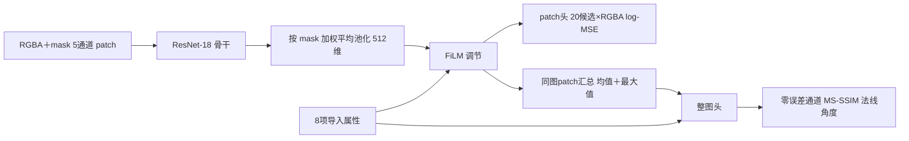

# V1 现状：数据处理、网络、损失、决策与结论

整理时间 2026-11-12 17:30（UTC+8）。本文按“数据怎么处理 → 怎么送进网络 → 网络结构 → 损失怎么算 → 最后怎么选块大小 → 结果 → 结论”的顺序，汇总 V1 的全部方法细节和实验结果。方法细节直接核对了源码，结果数字引用已归档报告，本次没有新跑训练或推理。原计划见 [V1 实验计划](<../../experiment plan/V1/README.md>)，逐项执行记录见 [Unity90% 执行记录](../unity-accuracy90-20261111/README.md)，实时队列见 [progress.json](../unity-accuracy90-20261111/progress.json)。`[verified: 本文引用的源码与报告文件]`

## 一句话现状

V1 在 GDC 源图 RGB 开发协议上完成了方法筛选：把四分类改成“原分辨率 patch 误差回归＋阈值规则”后，验证 Top-1 从分类的 66.3% 提高到 88.8%（预训练）／84.5%（随机初始化最佳），BN 重估后最高 89.2%，但没有达到 V1 的开发晋级判据（验证 Top-1≥90% 且阈值附近 PSNR RMSE≤0.75 dB）。Unity 原生协议的模型、训练器、规则重放和完整开发数据都已就绪，但 **Unity 正式训练没有运行**：用户 2026-11-12 把当前 goal 收窄为数据采集与交接，V1 的正式训练已取消，模型训练和 90% 验收交给 [V2](<../../experiment plan/V2/README.md>)。`[verified: patch-v1/README.md；patch-fixed-capacity/README.md；normalization.md；unity-data-handoff.md]`

| 部分 | 状态 |
|---|---|
| GDC 协议：分类对照 5 组 | 完成，最高 68.6%。`[verified: classification-controls/comparison.json]` |
| GDC 协议：patch 回归首批 2 组 | 完成，预训练 88.8%、随机初始化 76.0%。`[verified: patch-v1/summary.json]` |
| GDC 协议：固定容量单项对照 7 组＋BN 后处理 5 组 | 完成，随机初始化最好 84.5%（资产组限权 cap512）。`[verified: patch-fixed-capacity/README.md；normalization.md]` |
| Unity 原生模型与训练链路 | 实现完成，8 图／32 图 CUDA 小样本闭环通过，没有正式训练。`[verified: unity-native-training.md；native-training-full-v1/smoke.json]` |
| Unity 开发集数据 | train10000／validation1000 原采集、220000 个候选补测、patch 目标、合并、Dataset 全读和原规则重放全部完成。`[verified: unity-development-data11000-verification.json]` |
| Unity 确认集 2000 张 | 两图预检通过，串行采集进行中（16:48 快照为 2／2000）。`[verified: unity-confirmation-capture-smoke2-data-v2.json status；unity-confirmation-series2000-data-v2.json status、captured_images]` |
| 13000 张完整像素审计 | 等待确认集采集完成。`[verified: unity-pixel-pipeline-full13000-data-v2.json status]` |
| Unity 独立测试 90% | 未开始，交给 V2。`[verified: unity-data-handoff.md]` |

## 1. 任务定义：为什么不是普通分类

### 1.1 要做什么

给一张纹理，自动选出 ASTC 块大小（Unity 协议下还要选 preset），在满足质量门槛的前提下尽量省字节，并且只编码一次，替代当前逐个候选试压缩的搜索。生产基线是固定 8×8。`[verified: AGENTS.md 适用范围与研究定位]`

### 1.2 标签其实是一条阈值规则

- **GDC 协议**：候选为 6／8／10／12 四种方块，标签是“RGB PSNR>35 dB 的最大块大小，没有候选达标时取 PSNR 最高者”。这条规则复现了全部 10000 张训练标签，98.62% 的图 PSNR 随块大小单调下降。`[verified: experiment plan/V1/evidence.json label_structure.rule_reproduces_labels、monotonic_psnr_share]`
- **Unity 协议**：20 个候选（4 块大小×5 preset）按固定顺序试，第一个合格就停；合格条件按贴图类型分支（见 2.2 节）。原规则用实测质量重放，11000 张开发图的块大小、preset、选择原因和候选尝试次数全部一致。`[verified: unity-development-data11000-verification.json exact_policy_replay]`

所以这个任务名义上是四分类，本质上是“预测每个候选压出来的质量，再套固定规则”。图片里有什么物体并不重要，重要的是压缩误差离门槛有多远。`[opinion]`

### 1.3 精度要求

在 GDC 训练集的四个实测 PSNR 上加高斯误差后重新套规则，推出的标签准确率如下；要到 90%，PSNR 预测误差大约要控制在 0.75 dB。V1 的晋级判据“阈值附近 RMSE≤0.75 dB”就来自这张表。`[verified: experiment plan/V1/evidence.json precision_requirement]`

| PSNR 误差 σ | 0.25 dB | 0.5 dB | 0.75 dB | 1.0 dB | 1.5 dB | 2.0 dB |
|---|---|---|---|---|---|---|
| 推出标签准确率 | 96.6% | 93.4% | 90.3% | 87.2% | 82.0% | 77.2% |

另有 5 个 seed 的独立复核：σ=0.75 dB 时训练标签命中率平均 90.116%。`[verified: psnr-matrix-audit.json results]` 这个模拟假设误差与图像无关，只作量级参考。`[opinion]`

## 2. 数据来源与分布

V1 用了两套数据协议：先在已有的 GDC 源图数据上筛方法，再迁移到 Unity 原生数据。两者的输入、候选和标签规则都不同，结果不能直接互换。`[verified: experiment plan/V1/README.md“目标与开发数据”“限制与待核实”]`

### 2.1 GDC 开发协议（方法筛选用）

| 项目 | 内容 |
|---|---|
| 输入像素 | 源图 RGB8、原始尺寸、Linear LDR、无 mip。`[verified: AGENTS.md GDC 路径条目]` |
| 编码器 | astcenc 3.3，medium，RDO 关闭。`[verified: 同上]` |
| 候选 | 6×6、8×8、10×10、12×12 四个。`[verified: 同上]` |
| 标签 | RGB PSNR>35 dB 的最小 payload（等价于最大块），无可行候选取最高 PSNR 并记违规。`[verified: 同上；evidence.json label_structure.rule]` |
| 划分 | train10000／validation1000 选模；test2000 早已被观察过，只作历史对照，不参与选模。`[verified: experiment plan/V1/README.md“目标与开发数据”]` |

训练集标签分布：6×6 2593、8×8 1816、10×10 1315、12×12 4276 张；其中 1167 张 6×6 是四候选都不达标时的最高 PSNR 回退，也就是 6×6 类混着“真的需要 6×6”和“怎样都不达标”两种情况。`[verified: evidence.json label_structure.per_class、infeasible_fallbacks]`

- **尺寸跨度大**：长边 10／25／50／75／90／99 分位为 100／128／256／512／1024／2048，55.9% 的图长边≤256，22.2% 长边≥1024。`[verified: evidence.json label_structure.long_side]`
- **中间档窗口窄**：相邻块大小 PSNR 中位降幅为 6→8 3.94 dB、8→10 2.83 dB、10→12 1.98 dB；8×8 标签有 61.1%、10×10 标签有 84.9% 的图距最近阈值不足 1 dB。`[verified: experiment plan/V1/README.md“诊断依据”]`
- **资产组极不均衡**：1305 个资产组，最大组 `Assets/Art/Effects/Texture/Common/Special` 有 2077 张，占 20.77%。`[verified: evidence.json label_structure.asset_groups；patch-fixed-capacity/group-sampling-analysis.json]`
- **元数据单独不够**：只按长边量级、是否半透明、是否方形查表，验证准确率 49.3%，全部猜 12×12 是 46.2%。`[verified: evidence.json metadata_lookup]`

### 2.2 Unity 原生协议（生产目标）

| 项目 | 内容 |
|---|---|
| 输入像素 | Unity 导入处理完成后、进入 ASTC 搜索前的第一个 image／mip0，原尺寸 RGBA32；导入属性取自实际编码回调。`[verified: AGENTS.md Unity 训练数据条目]` |
| 候选与顺序 | 12×12→10×10→8×8→6×6，每块大小依次 fastest、fast、medium、thorough、exhaustive，共 20 个；常规分支首个合格即停。`[verified: AGENTS.md 自动选参偏好]` |
| 质量门槛（LITE 运行配置） | PSNR 基础 30 dB，纯黑像素比例 >40% 时 35 dB、>80% 时 37 dB；sRGB 颜色图另需 MS-SSIM≥21 dB；法线图只看平均角度≤3.2° 且 p95≤9°。阈值从每批原缓存的 tableConfig 读取，按 float32 比较。`[verified: experiment plan/V2/evidence.json capture_protocol.quality]` |
| 大图与回退 | sRGB LDR 且面积≥512²：首个 PSNR 合格候选锁定块大小，同块继续找 MS-SSIM 也合格者，始终不合格时采用该块最后一个 PSNR 合格候选；全部不合格按最高 PSNR 回退。`[verified: AGENTS.md size-first 与回退规则]` |
| PSNR 口径 | 只平均误差非零的参与通道，排除恒定 Alpha。`[verified: AGENTS.md 字段口径]` |
| 标签 | 同次原搜索的“当前策略选中配置”，不等于候选最优或严格达标。`[verified: 同上]` |
| 本轮范围 | Default／Sprite LDR 颜色图，Linear RGBA8、normal-pack=false、Tex2D 法线；只编码 mip0，RDO 关闭。`[verified: experiment plan/V2/README.md“Unity 协议”]` |

**开发集规模**：train10000／validation1000，资产名单沿用冻结的 coverage-v2 划分。原搜索提前停止，没测到的候选另行补测，11000 张×20 候选＝220000 个候选全部有解码图和原生质量。`[verified: unity-development-data11000-verification.json counts、candidate_count；unity-data-handoff.md]`

**训练集标签分布（10000 张，只统计 train）**：`[verified: unity-native-label-distribution.md]`

| 块大小 | 张数 | 占比 | fastest | fast | medium | thorough | exhaustive |
|---|---:|---:|---:|---:|---:|---:|---:|
| 6×6 | 1710 | 17.10% | 680 | 231 | 308 | 71 | 420 |
| 8×8 | 1490 | 14.90% | 267 | 101 | 578 | 395 | 149 |
| 10×10 | 1366 | 13.66% | 74 | 25 | 374 | 601 | 292 |
| 12×12 | 5434 | 54.34% | 1891 | 94 | 1109 | 1393 | 947 |

- **选择分支**：常规首个合格 7364、大图严格 1761、大图放宽 498（其中 454 张选 12×12）、最高 PSNR 回退 377（374 张选 6×6）。放宽和回退的标签本身不满足严格质量门槛。`[verified: unity-native-label-distribution.md“选参分支”]`
- **用途**：Default／profile0 9646、Default／profile1 50、NormalMap 299、Sprite 5；全部回调 normal_pack=false，法线要按导入用途识别。`[verified: 同上“用途、尺寸和资产目录”]`
- **尺寸**：导入后长边 ≤128／129–256／257–512／513–1024／>1024 为 4562／2459／1936／815／228 张。Unity 导入会缩图，所以 Unity 的 patch 总数比 GDC 少很多（训练 67105 对比 GDC 120276）。`[verified: 同上；unity-development-data11000-verification.json patch_counts；patch-data-full.json] [opinion: 原因判断]`
- **原搜索成本**：平均每图试 7.77 个候选，中位数 6；10000 张训练图 search_ms 平均 406.0 ms、中位数 259.5 ms、P95 1262.1 ms。`[verified: unity-native-label-distribution.md；experiment plan/V2/evidence.json search_baseline10000]`
- 验证集与确认集的标签分布**故意没有分析**，避免影响后续选模。`[verified: unity-native-labels10000-v1.json validation_labels_analyzed、confirmation_labels_analyzed]`

**确认集**：预留的 2000 张主名单按 V2 输入范围替换了 47 张（39 GUI、7 Cube、1 HDR），保留原 1953 张位置，按原备用顺序补齐，备用剩 441 张；新主名单覆盖 1231 个资产组，与 9 份历史清单的路径、资产组和源 MD4 重叠为 0。确认集只采参考图和原搜索标签，不补测 20 候选，不训练也不推理。`[verified: unity-confirmation-v2-revision.md]`

**重复与隔离**（部分范围）：已检查的 7744 训练图／2 验证图中有 5 组精确 RGBA 重复（10 张，全在训练集内）、6 对同尺寸近重复（RMSE≤2/255，12 张训练图）。完整 13000 张审计还在排队。`[verified: unity-pixel-identity.md；unity-near-duplicates.md；unity-pixel-pipeline-full13000-data-v2.json]`

## 3. 数据怎么处理成训练样本

核心思路：块压缩的误差是逐块独立的，所以“整图编码后的误差”可以按 patch 精确拆开，每个 patch 都有自己的真实误差标签，不需要单独编码 patch。`[opinion]` 下面每一步都是实际代码的做法。

### 3.1 第一步：离线把每个候选都真实编码一次

- **GDC**：每张图用 astcenc 3.3 medium 分别以 6×6／8×8／10×10／12×12 编码并解码，保存 4 张解码 PNG、真实 payload 字节和整图 PSNR。`[verified: AGENTS.md GDC 路径条目；patch-data-full.json]`
- **Unity**：原搜索会提前停止，只测到一部分候选。离线补测用同一个编码 DLL 把 20 个候选全部编码、解码，并用从引擎原样提取的质量函数计算 PSNR、MS-SSIM 和法线角度；原搜索测过的候选必须与原记录一致。`[verified: unity-supplement.md；AGENTS.md 补测条目]`

### 3.2 第二步：切成 240×240 的 patch

- 从左上角 (0,0) 开始，按 240 像素步长不重叠地切块；最右和最下一列不足 240 时保留实际宽高。也就是说一张 500×300 的图会切成 (0,0,240,240)、(240,0,240,240)、(480,0,20,240)、(0,240,240,60) 等 6 块。`[verified: data/patch_targets.py PatchErrorGrid.boxes] [opinion: 示例]`
- 选 240 是因为它是 6、8、10、12 的公倍数，patch 边界正好落在四种块大小的块网格上，不会把一个 ASTC 块切成两半。`[verified: experiment plan/V1/README.md“输入与数据”]`
- 规模：GDC 训练 120276／验证 12864 个 patch；Unity 训练 67105／验证 7082 个 patch。小于 240×240 的图只有一个 patch。`[verified: patch-data-full.json；unity-development-data11000-verification.json patch_counts]`

### 3.3 第三步：算每个 patch 的真实误差标签

- 对每个 patch、每个候选，用参考图和解码图逐像素算平方误差和（SSE，int64），只统计真实像素。GDC 是 RGB 三通道合起来，Unity 是 R、G、B、A 四个通道分开存。`[verified: data/patch_targets.py squared_errors；unity-patch-targets.md]`
- 换算成归一化 MSE 和训练目标（GDC 代码）：`[verified: data/patch_dataset.py NativePatchDataset.__init__]`

```text
MSE = SSE / (有效像素数 × 3 × 255²)          # 取值 0～1
y   = log10(MSE + 1e-10)                     # 网络要回归的目标
PSNR = −10 × log10(MSE)  ≈  −10 × y          # 所以 y = −3.5 对应 35 dB
```

- Unity 的目标是 20 候选×4 通道的 `log10(MSE+1e-10)`，每个通道按 `SSE/(有效像素数×255²)` 归一化。`[verified: data/unity_patch_dataset.py；evaluation/unity_quality.py aggregate_mse]`
- MS-SSIM 和法线角度不能由 patch 相加得到，保留为**整图**监督，每图 20 个候选各一组。Unity 还额外存每个通道的整图误差是否恰好为 0，用来学习“零误差通道”。`[verified: training/unity_quality_loss.py UnityImageTargets.build]`

### 3.4 第四步：核验 patch 拆分是精确的

- **整图能还原**：把 patch 的 SSE 按像素数加回去再算 PSNR，与原记录对比。GDC 44000 个候选最大差 1.42e-14 dB；Unity 开发集最大差 3.81e-6 dB。`[verified: patch-data-full.json；unity-data-handoff.md]`
- **patch 单独编码也一致**：20 张图、80 个 patch 单独送进编码器，解码像素与整图编码对应区域逐像素一致（astcenc 3.3 medium 抽样）。`[verified: patch-equivalence20.json]`
- **数据增强全部关闭**：同一 patch 翻转或旋转后重新编码，PSNR 最大变化为水平翻转 0.84 dB、垂直 1.02 dB、90° 旋转 6.60 dB。ASTC 分区表不对称，增强会改变真实误差标签，所以不用。`[verified: patch-equivalence20.json rows；opinion: 增强决定]`

### 3.5 Unity 额外的整图属性

每张图还提取 8 项导入属性，只作为网络输入，不作为标签：log2 宽、log2 高、是否 sRGB、是否法线、是否需要 Alpha、Alpha 是否恒定、法线评价 mip 数、纯黑像素比例。这些值本身就决定规则分支和门槛（例如黑像素比例决定 30／35／37 dB），所以直接给网络、不让网络去猜。`[verified: data/unity_patch_dataset.py METADATA_NAMES；evaluation/unity_quality.py UnityTextureInput] [opinion: 设计理由]`

## 4. 怎么送进网络

### 4.1 GDC patch 回归

| 步骤 | 做法 |
|---|---|
| 像素读取 | 参考图转 RGB uint8，按 patch 坐标裁出。`[verified: data/patch_dataset.py __getitem__]` |
| 补齐 | 不足 240×240 的 patch 用边缘复制（`np.pad mode="edge"`）补到 240×240；补出来的像素只进网络，不进误差统计。`[verified: 同上；NativePatchDataset.aggregate]` |
| 归一化 | 除以 255 后按 ImageNet 均值 (0.485, 0.456, 0.406)、标准差 (0.229, 0.224, 0.225) 标准化。`[verified: 同上]` |
| 张量形状 | 每个样本 3×240×240，标签是长度 4 的 log-MSE 向量。`[verified: 同上]` |
| 训练抽样 | 有放回加权抽样，每轮抽“图片数×4”个 patch（10000 图即 40000 个）。默认每张图总权重相等、再平均分给它的 patch，所以大图不会因为 patch 多而占更多样本；资产组限权实验再乘以 `min(1, 512/组内图片数)`。`[verified: training/patch_trainer.py training_batches；data/patch_sampling.py PatchSampling.weights；patch-fixed-capacity/README.md]` |
| batch | 128 个 patch，2 个数据加载 worker。`[verified: patch-v1/suite.json；patch-v1/preflight.json]` |
| 验证 | 不抽样，按顺序跑完全部 12864 个验证 patch，再按图聚合。`[verified: training/patch_trainer.py evaluate]` |

### 4.2 Unity 原生模型

| 步骤 | 做法 |
|---|---|
| 像素 | 参考图 RGBA 除以 255，再线性映射到 [−1, 1]（`rgba×2−1`）。`[verified: models/unity_quality.py encode]` |
| 有效像素 mask | 额外一个通道，真实像素为 1、补齐像素为 0，与 RGBA 拼成 **5 通道** 输入。`[verified: 同上]` |
| 导入属性 | 8 项属性按 [12, 12, 1, 1, 1, 1, 4, 1] 缩放后送入网络（log2 尺寸除以 12、mip 数除以 4）。`[verified: 同上 scale]` |
| 训练抽样 | 每轮每张图访问一次，每图有放回抽 4 个 patch；每批 16 张图，即 64 个 patch。同一张图的 4 个 patch 一起进网络，供整图头汇总。`[verified: unity-native-training.md“训练与监督协议”；unity-native-training-full-v2-config.json recipe]` |
| 验证 | 每张图的全部 patch 都进网络。`[verified: unity-native-training.md]` |

## 5. 网络结构

### 5.1 GDC patch 回归网络（`ASTCPatchRegressor`）

骨干是 torchvision 标准 ResNet-18（BasicBlock，每层 2 个残差块），只把最后的全连接层改成 4 个输出。正式实验保留 maxpool（标准 stem）。`[verified: models/resnet.py ASTCClassifier；models/patch_regressor.py；patch-v1/suite.json remove_maxpool=false]`

| 层 | 输出通道 | 输出空间尺寸（输入 240×240） |
|---|---|---|
| conv1 7×7，步长 2 ＋ BN ＋ ReLU | 64 | 120×120 |
| maxpool 3×3，步长 2 | 64 | 60×60 |
| layer1（2 个残差块） | 64 | 60×60 |
| layer2（2 个残差块，首块步长 2） | 128 | 30×30 |
| layer3（2 个残差块，首块步长 2） | 256 | 15×15 |
| layer4（2 个残差块，首块步长 2） | 512 | 8×8 |
| 全局平均池化 | 512 | 1×1 |
| 全连接 512→4 | 4 | — |

`[verified: torchvision ResNet18 结构；models/resnet.py] [opinion: 空间尺寸按卷积步长推算]`

**单调输出头**：全连接层输出 4 个数 z₀…z₃，转换为四个块大小的 log-MSE：`[verified: models/patch_regressor.py forward]`

```text
ŷ(6×6)   = z₀
ŷ(8×8)   = ŷ(6×6)  + softplus(z₁)
ŷ(10×10) = ŷ(8×8)  + softplus(z₂)
ŷ(12×12) = ŷ(10×10)+ softplus(z₃)
```

softplus 永远非负，所以预测误差一定随块变大而不减，结构上保证“块越大质量越差”。初始化时全连接权重取很小的随机值（std 0.001），偏置设为 −3.5（对应 35 dB），三个增量的初始值为 0.25（约 2.5 dB），让网络从门槛附近开始学。参数总数 11,178,564。`[verified: models/patch_regressor.py __init__；patch-v1/README.md] [opinion: 初始化意图]`

**分类基线**用同一个 ResNet-18，但输入是整图缩放到 224×224，全连接输出 4 个类别 logit，用交叉熵训练、取 argmax 作为块大小。`[verified: experiment plan/V1/evidence.json current_cnn；models/resnet.py]`

### 5.2 Unity 原生网络（`UnityQualityRegressor`，已实现未正式训练）



- **骨干**：ResNet-18 结构同上，第一层改为 5 输入通道（Kaiming 初始化），去掉原平均池化和全连接层，输出 512×8×8 特征图。`[verified: models/unity_quality.py __init__]`
- **按有效像素池化**：把 mask 缩到 8×8 作为权重，对特征图加权平均，补齐区域的特征权重更低。`[verified: 同上 encode]`
- **FiLM 调节**：8 项属性经 `Linear(8→1024)` 得到 512 维 gain 和 512 维 offset，特征变为 `特征×(1+gain)+offset`；该层权重和偏置初始化为 0，训练开始时不改变特征。`[verified: 同上 metadata_conditioner]`
- **patch 头**：`Linear(512→80)`，重排成 20 候选×4 通道的 log-MSE，偏置初始化 −3.5。`[verified: 同上 channel_head]`
- **整图头**：对同一张图的所有 patch 特征，按有效像素数求加权平均，并逐维取最大值，得到 1024 维；拼上 8 项属性后送入 `Linear(1032→140)`。前 80 个输出是 20×4 个“该通道整图误差为 0”的 logit（偏置初始 −4），后 60 个经 softplus 成为 20 候选的 MS-SSIM、平均角度、p95 角度，偏置初始化使它们从门槛值 21 dB、3.2°、9° 开始。`[verified: 同上 pool_features、predict_images、__init__]`
- **参数**：11,377,660，比 GDC 模型多约 20 万，多出的部分主要是两个输出头；不加单调约束，因为 Unity 的 20 个候选实测并不单调。`[verified: unity-native-model.md] [opinion: 按层尺寸估算的参数来源]`

## 6. 损失怎么计算

### 6.1 GDC patch 回归损失（`PatchRegressionLoss`）

对每个 patch、每个候选，在 log-MSE 上算 Huber 损失，再按“离 35 dB 门槛多近”加权，最后对 batch 内所有 patch×4 候选取平均：`[verified: training/patch_loss.py weighted_huber]`

```text
目标 y = log10(MSE+1e-10)，对应 PSNR_target = −10y
Huber(ŷ, y; δ=0.1)                     # δ=0.1 对应 1 dB：误差<1 dB 时平方，>1 dB 时线性
w = 1 + 2·exp(−|PSNR_target − 35| / 3)  # 正好在门槛上 w=3，离门槛 3 dB 时约 1.74，9 dB 时约 1.10
loss = mean( w × Huber )
```

- 加权的原因：决策只关心候选是否跨过 35 dB，门槛附近的误差最致命，远离门槛的误差几乎不影响结果。`[opinion]`
- 只有“同图成组损失”对照额外加了一项：把同一张图抽到的几个 patch 按像素数聚合成 log-MSE，再与真实聚合值做同样的加权 Huber；这项是负结果，正式配方不用。`[verified: training/patch_loss.py forward、aggregate_log_mse；patch-fixed-capacity/bag-loss.md]`
- 分类基线用未加权交叉熵；分类对照另试了 label smoothing 0.1 和有序（CORAL 式累计二分类）损失。`[verified: evidence.json current_cnn；classification-controls/README.md]`

### 6.2 Unity 原生损失（`UnityQualityLoss`）

总损失由四项组成：`[verified: training/unity_quality_loss.py forward；UnityQualityLossConfig]`

```text
total = L_patch + 0.1 × L_zero + 0.1 × L_ssim + 0.1 × L_angle
```

| 项 | 计算 | 哪些样本参与 |
|---|---|---|
| L_patch | patch 级 20×4 log-MSE 的 Huber，δ=0.1 | RGB 三通道总是参与；Alpha 只在“需要 Alpha 且不恒定”时参与 |
| L_zero | 20×4 零误差通道 logit 的二分类交叉熵 | 同上的参与通道 |
| L_ssim | 20 候选 MS-SSIM 的 Huber，δ=1 | 只有 sRGB 且不是法线的图 |
| L_angle | 20 候选平均角度和 p95 角度的 Huber，δ=1 | 只有法线图 |

`[verified: 同上；UnityImageTargets.build channel_active、quality_active]`

与 GDC 版本的区别：Unity 版 patch 损失**没有**门槛附近加权，三项附加权重 0.1 是未经验证的起点。`[verified: training/unity_quality_loss.py masked_huber；unity-native-model.md“监督与验收”]`

## 7. 最后怎么选出块大小（“分类”这一步）

回归网络本身不输出类别。块大小是把预测误差还原成整图质量后，用和标签完全相同的规则推出来的。`[verified: evaluation/patch_metrics.py；evaluation/unity_quality.py select]`

### 7.1 GDC：四步得到块大小

1. **跑完整张图的所有 patch**，得到每个 patch 的 4 个预测 log-MSE。`[verified: training/patch_trainer.py evaluate]`
2. **还原 MSE**：`MSE = max(10^clip(ŷ, −10, 0) − 1e-10, 0)`。`[verified: data/patch_dataset.py aggregate]`
3. **按像素数聚合成整图**：`整图 MSE = Σ(patch MSE × patch 有效像素数) / 整图像素数`，再算 `PSNR = −10·log10(整图 MSE)`。必须先在 MSE 域平均再取对数，因为整图 PSNR 由少数误差大的 patch 主导，直接平均 PSNR 会偏乐观。`[verified: 同上；data/patch_targets.py PatchErrorGrid.psnr] [opinion: 原因说明]`
4. **套规则**：在预测 PSNR 大于 `35 + 余量` 的候选中选最大的块；一个都没有就选预测 PSNR 最高的（并列时选更大的块）。`[verified: data/patch_targets.py PatchErrorGrid.choose]`

举例（虚构数字）：一张图四个候选的预测 PSNR 为 6×6 41.2、8×8 37.6、10×10 35.4、12×12 33.1 dB。余量 0 时，大于 35 dB 的有 6／8／10，选 10×10；余量 0.5 dB 时门槛变成 35.5，10×10 不再达标，改选 8×8。`[opinion: 示例]`

余量在验证集上扫描 0、0.25、0.5、0.75、1.0 dB，正式选模和报告的 Top-1 都用余量 0。`[verified: evaluation/patch_metrics.py margins；training/patch_trainer.py selection]`

### 7.2 Unity：交给原搜索规则

1. 每个 patch 的 20×4 log-MSE 按有效像素数聚合成整图逐通道 MSE。`[verified: evaluation/unity_quality.py aggregate_mse]`
2. 零误差通道概率>0.5 的通道视为误差为 0。按 Unity 口径算 PSNR：只平均“非零且参与”的通道，Alpha 只在需要且不恒定时参与；所有通道都是 0 时 PSNR 记 100。`[verified: 同上 psnr；unity-native-training-full-v2-config.json zero_probability_threshold]`
3. 把 20 个候选的预测 PSNR、黑像素比例，以及 MS-SSIM（sRGB）或角度（法线）交给原 `UnitySearchPolicy`，按原来的候选顺序、黑像素分档、首个合格即停、大图锁块和最高 PSNR 回退选出块大小和 preset。`[verified: 同上 candidates、select；reproductions/unity_search_baseline/policy.py select]`
4. 评估时还会检查：选中的那个候选**实际**是否达标（用实测质量，不用预测）、实际 payload、与固定 8×8／medium 的字节对比。`[verified: 同上 score]`

## 8. 训练流程与选模

- **优化器**：AdamW，weight decay 0.05；第 1 轮学习率线性 warmup，之后余弦下降；最多 30 轮。`[verified: training/patch_trainer.py fit；patch-v1/suite.json]`
- **精度与稳定性**：CUDA FP16 混合精度（autocast＋GradScaler），梯度范数裁剪到 5；GDC 每次参数更新后同步更新 EMA（衰减 0.999）。`[verified: 同上]`
- **每轮评估**：训练后在全部验证图上评估原始权重和 EMA 权重两套结果。`[verified: 同上]`
- **选模**：先看余量 0 时的验证 Top-1，再看阈值 ±3 dB 内的图级 PSNR RMSE；准确率最优和 RMSE 最优权重分开保存。`[verified: 同上 settings.selection；patch-v1/README.md]`
- **早停**：阈值附近 RMSE 连续 5 轮不改善就停。`[verified: 同上 stop_reason]`
- **复核**：训练结束后重新加载选中权重、重算全部预测，核对 PSNR 差≤1e-5 dB、标签顺序、准确率和文件 SHA。`[verified: patch-v1/README.md]`
- **学习率**：首批随机初始化 1e-3、预训练 3e-4；后续随机初始化统一改为 3e-4。Unity 原生配方为 lr 3e-4、每批 16 图、30 轮、patience 5、seed 20261112，不用 EMA、不加资产组限权。`[verified: patch-v1/suite.json；patch-fixed-capacity/README.md；unity-native-training-full-v2-config.json recipe；unity-native-training.md]`

## 9. 实验结果（全部为 GDC 协议 validation1000，单 seed）

以下数字都在同一个 validation1000 上选模和计分，没有独立测试，也没有打开 test2000。`[verified: 各结果文件 scope、test_opened]`

### 9.1 起点：整图分类基线

ImageNet 预训练 ResNet-18，整图缩到 224×224，SGD lr 0.01、momentum 0.9、weight decay 1e-4，余弦 30 轮，有效 batch 64。验证 Top-1 第 2 轮就到最高 66.3%，第 30 轮训练准确率 99.96%、验证 64.0%，明显过拟合。test2000 Top-1 73.55%，逐类召回 6×6 88.7%、8×8 25.9%、10×10 20.2%、12×12 90.8%；最终编码评估 RGB>35 dB 达标 1540／2000。`[verified: experiment plan/V1/evidence.json current_cnn；AGENTS.md GDC 正式结果条目]`

### 9.2 分类对照（固定 ResNet-18＋RGB224，最多 15 轮）

| 配置 | 验证 Top-1 | Balanced acc | NLL | 8×8 召回 | 10×10 召回 | 质量达标率 | Payload 字节 |
|---|---|---|---|---|---|---|---|
| 原 CE，lr 0.01，WD 1e-4 | 66.3% | 54.23% | 0.8284 | 17.71% | 26.56% | 75.9% | 112,551,840 |
| CE＋LS0.1，lr 0.003，WD 5e-4 | 67.9% | 56.15% | 0.8181 | 25.52% | 25.78% | 75.3% | 110,918,960 |
| CE＋LS0.1，lr 0.01，WD 5e-4 | 68.5% | 55.89% | 0.9111 | 28.65% | 20.31% | 76.4% | 109,526,640 |
| 有序 loss，lr 0.003，WD 5e-4 | 68.6% | 54.88% | 0.8063 | 32.29% | 17.19% | 72.3% | 99,731,872 |
| 有序 loss，lr 0.01，WD 5e-4 | 65.8% | 51.12% | 0.8238 | 41.67% | 6.25% | 71.1% | 105,205,536 |

`[verified: classification-controls/comparison.json]`

只调超参数和 loss，最多提高 2.3 个百分点，训练／验证差距仍然很大（正则化 CE 训练 98.46%、验证 67.9%）。`[verified: classification-controls/README.md]`

### 9.3 patch 回归首批两组（14 轮，均早停）

| 配方 | 验证 Top-1 | Balanced acc | 阈值附近 RMSE | 最佳 epoch | 6／8／10／12 召回 | 耗时 |
|---|---|---|---|---|---|---|
| 随机初始化 lr 1e-3 | 76.0% | 69.54% | 1.7681 dB | 9 raw | 68.81／58.85／59.38／91.13% | 2787.39 s |
| ImageNet 预训练 lr 3e-4 | **88.8%** | 85.81% | **0.9736 dB** | 9 raw | 91.74／81.77／75.78／93.94% | 2966.68 s |

`[verified: patch-v1/scratch-result.json、pretrained-result.json；patch-v1/README.md]`

- 预训练组比原 RGB224 分类高 22.5 个百分点，比最佳分类对照高 20.2 个百分点；输入、目标和配方同时改变，增益不能只归因于某一项。`[verified: pretrained-result.json accuracy_gain_vs_original_pp、accuracy_gain_vs_best_control_pp；opinion: 归因边界]`
- 两组学习率不同，所以“预训练 vs 随机初始化”的差距也混着学习率的影响。`[verified: patch-v1/README.md]`
- EMA 没有帮助：随机初始化组 EMA 最高仅 48.3%，预训练组 81.4%。`[verified: scratch-result.json、pretrained-result.json best_ema_accuracy]`
- **字节**：预训练模型零余量时验证集 payload 89,546,480 字节，是固定 8×8（128,132,896）的 69.9%，与原标签（90,264,688）接近；同时实际质量达标率 88.3%。`[verified: pretrained-result.json metrics.payload_bytes、fixed8_payload_bytes、label_payload_bytes、quality_pass_rate]`

**决策余量的取舍**：`[verified: pretrained-result.json metrics.margins；scratch-result.json metrics.margins]`

| 余量 | Top-1 | 实际质量达标率 | Payload 字节 |
|---|---|---|---|
| 0 dB（预训练） | 88.8% | 88.3% | 89,546,480 |
| 0.5 dB（预训练） | 85.0% | 90.8% | 94,416,752 |
| 0 dB（随机初始化） | 76.0% | 79.1% | 82,596,432 |
| 0.5 dB（随机初始化） | 76.2% | 84.4% | 88,031,072 |

加余量能把质量达标率推过 90%，但 Top-1 下降、字节增加。质量达标率超过 90% 不等于标签准确率超过 90%。`[verified: patch-v1/README.md]`

**错误集中在门槛附近**（预训练最佳模型的冻结预测）：112 个错误中 67 个来自候选 PSNR 距门槛不足 0.5 dB 的 203 张图，这组准确率只有 67.00%；距门槛至少 1 dB 的 604 张图准确率 96.36%。6×6 候选在阈值 ±3 dB 内平均高估 0.563 dB、RMSE 1.539 dB；8／10／12 候选 RMSE 为 1.037／0.770／0.828 dB。`[verified: patch-v1/error-strata.json trials[1]]` 按有效面积占比分层的准确率没有一致趋势，不支持“边缘填充是主因”。`[verified: 同上 padding_strata；opinion: 证据边界]`

### 9.4 固定容量单项对照（随机初始化主线，每次只改一项）

用户偏好随机初始化为主线，所以这一阶段固定 ResNet-18 容量，在随机初始化配方上逐项找改进。“相对基准”指该行所对照的上一个配方。`[verified: unity-accuracy90 README“随机初始化为主线”；patch-fixed-capacity/README.md]`

| 对照 | 只改动 | 验证 Top-1 | 同权重近阈值 RMSE | 相对基准 | 结论 |
|---|---|---|---|---|---|
| 学习率 | lr 1e-3→3e-4 | 80.7% | 1.6040 dB | +4.7 pp（10×10 召回 −4.69 pp） | 采用 |
| 去 maxpool | remove_maxpool=true | 74.6% | 2.5459 dB | −6.1 pp，四类召回都降 | 不采用 |
| 资产组限权 | 每组封顶 512 张等效权重 | **84.5%** | **1.3869 dB** | +3.8 pp（10×10 召回 +16.41 pp） | 采用，成为随机初始化最佳 |
| 同图成组损失 | 同图 patch 成组抽样，聚合 loss 权重 0／1 | 71.2%／71.7% | 3.5647／2.0188 dB | 比独立采样 80.7% 低约 9 pp | 不采用 |
| 按有效像素抽样 | 图内按有效像素数分配 patch 概率 | 82.0% | 1.4580 dB | −2.5 pp | 不采用 |
| 有效区域池化 | 末端特征按有效区域加权 | 78.0% | 1.7141 dB | −6.5 pp | 不采用 |
| 尺寸元数据 | 增加尺寸输入（+16 参数） | 84.2% | 1.5334 dB | −0.3 pp（8×8／10×10 召回 −2.60／−7.81 pp） | 不采用 |

`[verified: patch-fixed-capacity/scratch-lr0003-result.json、scratch-stem2-lr0003-result.json、scratch-group512-result.json、scratch-bag4-comparison.json、scratch-group512-pixels-result.json、scratch-group512-validpool-result.json、scratch-group512-metadata-result.json]`

资产组限权的细节：每张图权重 `min(1, 512/组图数)`，只下调两个最大组，最大组期望抽样占比从 20.77% 降到 6.41%，这是限制资产组集中，不是类别均衡。26 轮早停，选中 epoch 21 raw，训练 7187.98 s；balanced accuracy 80.37%，8×8／10×10 召回 72.92%／71.09%，质量达标率 84.8%；加 0.5 dB 余量后质量达标率 88.3%、准确率 81.9%。`[verified: patch-fixed-capacity/README.md“资产组抽样对照”]`

**BN 统计量后处理**（冻结末轮 EMA 权重，只用训练 patch 重估 BN，0 次参数更新）：`[verified: normalization.md；normalization-*.json]`

| 配方 | BN 重估后 Top-1 | 近阈值 RMSE | 训练中最佳 raw |
|---|---|---|---|
| 随机初始化 lr 1e-3 | 76.7% | 1.6467 dB | 76.0% |
| 预训练 lr 3e-4 | **89.2%** | **0.9512 dB** | 88.8% |
| 随机初始化 lr 3e-4 | 80.9% | 1.3716 dB | 80.7% |
| 去 maxpool | 78.6% | 2.1127 dB | 74.6% |
| 资产组 cap512 | 84.4% | 1.4284 dB | 84.5% |

训练中 EMA 很差（例如随机初始化 lr 1e-3 只有 48.3%），重估 BN 后大幅恢复，说明问题主要在 BN 统计量而不是 EMA 权重本身。相对训练中选出的最佳 raw，BN 重估只改变 −0.1 至 +0.7 个百分点（去 maxpool 组 +4.0），没有改变整体结论。`[verified: normalization.md；scratch-result.json best_ema_accuracy；opinion: 解释]`

### 9.5 冻结预测的残差诊断（cap512 最佳权重）

- **全局余量扫不出来**：余量 −2.5 至 +2.5 dB、步长 0.05 的 101 点扫描，最高仍是零余量的 84.5%。`[verified: patch-fixed-capacity/scratch-group512-residuals.json global_margin_sweep]`
- **逐候选减均值也没用**：RMSE 从 1.3869 降到 1.3372 dB，准确率反而 83.9%。`[verified: 同上 same_validation_offset_diagnostic]`
- **按候选块大小分组的近阈值偏差**（1171 项测量，正值表示高估）：`[verified: 同上 near_threshold_by_candidate]`

| 候选 | 测量数 | 平均偏差 | RMSE |
|---|---|---|---|
| 6×6 | 132 | +1.0272 dB | 2.3172 dB |
| 8×8 | 305 | +0.2395 dB | 1.5195 dB |
| 10×10 | 361 | −0.0009 dB | 1.0800 dB |
| 12×12 | 373 | −0.0655 dB | 1.0590 dB |

整体平均偏差只有 +0.157 dB，绝对误差中位数 0.6286 dB、90 分位 2.0817 dB；单 patch 小图的近阈值 RMSE 仍有 2.1655 dB。`[verified: scratch-group512-residuals.json near_threshold；group512-geometry-diagnosis.json]`

### 9.6 Unity 原生侧已完成的验证（不是模型准确率）

| 验证 | 结果 |
|---|---|
| 原规则重放 | 11000 张开发图用实测质量重放，块大小、preset、选择原因、候选尝试次数全部一致。`[verified: unity-development-data11000-verification.json exact_policy_replay]` |
| 只看 PSNR 是否够 | 260 张开发图去掉 MS-SSIM、法线和大图分支后，块大小只有 207／260 一致，块大小＋preset 只有 42.31%。`[verified: unity-policy-replay.md；experiment plan/V2/evidence.json policy_replay260]` |
| 零误差通道的影响 | 3904 张训练图上给真实 MSE 加 1e-9 下限并去掉零通道识别，6 张块大小、36 张完整配置改变，严格通过率从 89.70% 降到 88.93%。`[verified: unity-native-model.md]` |
| 候选不单调 | 同 preset 换更小块、PSNR 反而下降的图 30–49 张；同块换更慢 preset、PSNR 下降的 86–179 张。`[verified: unity-native-model.md]` |
| 训练链路 | 8 训练图／2 验证图 CUDA 闭环：2 轮 4 次更新、0 次 AMP 跳步、最佳权重重载一致；32 图预检也通过。`[verified: unity-native-training.md；native-training-full-v1/smoke.json]` |
| 推理与最终编码 | 用 8 图小样本权重在 2 张验证图上跑通封存推理→一次编码→质量复算；预测路径中位 48.81 ms、固定 8×8 38.34 ms，质量通过 1／2 与 2／2。只验证接口，没有速度或质量结论。`[verified: unity-deployment.md；unity-capture-deployment.md]` |

## 10. 结论

以下是基于上述结果的判断。`[opinion]`

1. **把分类改成“预测质量＋规则”是对的，也是 V1 最大的收益。** 同一数据上，验证 Top-1 从分类的 66.3% 提高到 88.8%，中间两类召回从 17.7%／26.6% 提高到 81.8%／75.8%。只调分类的超参数和 loss 最多提高 2.3 个百分点，说明瓶颈不在分类器调参，而在任务表述和输入分辨率。
2. **离 90% 还差一点，差在门槛附近。** 离门槛 ≥1 dB 的图已经 96% 正确；错误集中在离门槛 0.5 dB 以内的图，这组只有 67%。要达到 90%，近阈值 PSNR 误差需要从约 1 dB 降到约 0.75 dB。
3. **剩下的误差是“每张图预测不准”，不是“整体偏了”。** 全局余量和逐候选减偏差都救不回准确率；平均偏差只有 0.16 dB，但单图误差 90 分位约 2 dB。6×6 候选系统性高估约 1 dB，单 patch 小图误差最大。
4. **ImageNet 预训练在 GDC 协议上明显更好。** 同为 lr 3e-4 时，预训练 88.8% 对随机初始化 80.7%；随机初始化加上资产组限权也只到 84.5%。
5. **大部分结构和采样改动是负结果。** 有正收益的只有降低学习率和资产组限权；去 maxpool、成组损失、按像素抽样、有效区域池化、尺寸元数据都更差。BN 统计量会让 EMA 结果失真，重估后最高 89.2%，但仍不到 90%。
6. **字节收益已经可观，但质量还要单独看。** 预训练模型选出的总字节是固定 8×8 的 69.9%，与原标签接近；同时质量达标率 88.3%，加 0.5 dB 余量可到 90.8%，代价是字节增加约 5%。
7. **GDC 的经验不能直接搬到 Unity。** Unity 有 20 候选、MS-SSIM、法线角度和大图分支，只看 PSNR 时块大小一致率只有约 80%。V1 在 GDC 上得到的经验（回归＋规则、门槛附近加权、资产组限权、BN 问题、近阈值瓶颈）都是迁移假设，需要在 Unity 数据上重新验证，这是 V2 的任务。

## 11. 未完成事项与交给 V2 的内容

- **V1 取消的部分**：Unity 正式训练（原排队配置 `unity-native-training-full-v2`）及依赖它的确认集推理；配置、smoke 记录和取消记录都保留。`[verified: unity-data-handoff.md“队列调整”]`
- **当前 goal 剩余的数据工作**：确认集 2000 张采集（进行中）和 13000 张完整精确／近重复像素审计（等待），完成后交付数据并结束本 goal。`[verified: unity-data-handoff.md“本 Goal 的完成条件”；对应进度文件]`
- **交给 V2**：完整开发语料（SHA-256 `dca29d9336dc7bdd54f616ce14c137a3ef184a0b135a24f0f307b9e8cbf0f906`）、原生模型／训练器／规则重放／封存评价入口，以及上面的排队配方作为 V2 的 R0 基线。V2 的验收是确认集块大小 Top-1≥90%，质量和字节只报告不设门槛。`[verified: unity-data-handoff.md“数据交接状态”；experiment plan/V2/README.md]`

## 12. 入口与产物

| 用途 | 入口 |
|---|---|
| GDC patch 回归 | `script/patch_regression.py`（prepare、probe、train、suite、audit）。`[verified: unity-accuracy90 README“入口、记录与交付”]` |
| GDC 分类对照 | `script/classification_control.py`、`script/run_classification_controls.py`。`[verified: 同上]` |
| BN 后处理 | `script/patch_normalization.py`。`[verified: AGENTS.md BN 诊断条目]` |
| Unity 原生训练 | `script/train_unity_quality.py --config <新配置>`，需要 CUDA，正式训练要求完整 10000／1000 语料。`[verified: unity-native-training.md]` |
| Unity 规则重放 | `script/replay_unity_policy.py --config ...`。`[verified: AGENTS.md 规则重放条目]` |
| Unity 预测接口审计 | `script/audit_unity_predictions.py`。`[verified: unity-native-model.md]` |

主要源码：GDC 数据 `src/adaptive_astc/data/patch_dataset.py`、`patch_targets.py`、`patch_sampling.py`；GDC 模型 `models/patch_regressor.py`；GDC 损失与训练 `training/patch_loss.py`、`patch_trainer.py`；GDC 决策 `evaluation/patch_metrics.py`；Unity 模型 `models/unity_quality.py`；Unity 损失 `training/unity_quality_loss.py`；Unity 决策 `evaluation/unity_quality.py`。`[verified: 对应文件]`

原始日志、权重、预测和逐图数据位于 `experiment report/.local/unity-accuracy90-20261111/`（Git 忽略），公开报告绑定其 SHA-256。复跑必须使用新的输出目录和实验身份，已有产物拒绝覆盖。`[verified: patch-v1/README.md；unity-native-training.md]`

## 13. 限制

- 所有 GDC 结果都是单 seed，并且在同一个 validation1000 上选模和计分，没有独立测试；余量、偏差修正等诊断也在同一验证集上拟合和计分。`[verified: 各结果文件 scope]`
- 首批两组的初始化和学习率同时不同；单项对照的训练轮数因早停而不同，耗时不可直接比较。`[verified: patch-v1/README.md；patch-fixed-capacity/README.md]`
- 质量达标率和 payload 来自已测候选，不是部署编码计时。`[verified: patch-v1/README.md]`
- Unity 侧只覆盖 mip0、RDO 关闭、LDR；HDR、完整 mip 链和 Unity 导入耗时不在范围内。`[verified: experiment plan/V2/README.md“Unity 协议”]`
- 像素隔离目前只完成 7744 训练图／2 验证图的部分审计，裁剪、缩放和语义相似性没有覆盖。`[verified: unity-near-duplicates.md]`
