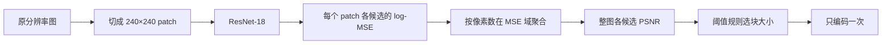

# V1 现状：训练思路、数据输入与结果汇总

整理时间 2026-11-12 16:50（UTC+8）。本文汇总 V1 从立项到收尾的数据输入、训练思路、全部已完成实验结果和未完成事项，数字均引用已归档报告，未新跑训练或推理。原计划见 [V1 实验计划](<../../experiment plan/V1/README.md>)，逐项执行记录见 [Unity90% 执行记录](../unity-accuracy90-20261111/README.md)，实时队列见 [progress.json](../unity-accuracy90-20261111/progress.json)。`[verified: 本文引用的各报告文件]`

## 一句话现状

V1 在 GDC 源图 RGB 开发协议上完成了方法筛选：把四分类改成“原分辨率 patch 误差回归＋阈值规则”后，验证 Top-1 从分类的 66.3% 提高到 88.8%（预训练）／84.5%（随机初始化最佳），但没有达到 V1 的开发晋级判据（验证 Top-1≥90% 且阈值附近 PSNR RMSE≤0.75 dB）。Unity 原生协议的模型、训练器、规则重放和完整开发数据都已就绪，但 **Unity 正式训练没有运行**：用户 2026-11-12 把当前 goal 收窄为数据采集与交接，V1 的正式训练已取消，模型训练和 90% 验收交给 [V2](<../../experiment plan/V2/README.md>)。`[verified: patch-v1/README.md；patch-fixed-capacity/README.md；unity-data-handoff.md；AGENTS.md 当前 goal 条目]`

| 部分 | 状态 |
|---|---|
| GDC 协议：分类对照 5 组 | 完成，最高 68.6%。`[verified: classification-controls/comparison.json]` |
| GDC 协议：patch 回归首批 2 组 | 完成，预训练 88.8%、随机初始化 76.0%。`[verified: patch-v1/summary.json]` |
| GDC 协议：固定容量单项对照 7 组＋BN 后处理 5 组 | 完成，随机初始化最好 84.5%（资产组限权 cap512）。`[verified: patch-fixed-capacity/README.md；normalization.md]` |
| Unity 原生模型与训练链路 | 实现完成，8 图／32 图 CUDA 小样本闭环通过，没有正式训练。`[verified: unity-native-training.md；native-training-full-v1/smoke.json]` |
| Unity 开发集数据 | train10000／validation1000 原采集、220000 个候选补测、patch 目标、合并、Dataset 全读和原规则重放全部完成。`[verified: unity-development-data11000-verification.json]` |
| Unity 确认集 2000 张 | 两图预检通过，串行采集进行中（2／2000，16:48 快照）。`[verified: unity-confirmation-capture-smoke2-data-v2.json status；unity-confirmation-series2000-data-v2.json status、captured_images]` |
| 13000 张完整像素审计 | 等待确认集采集完成。`[verified: unity-pixel-pipeline-full13000-data-v2.json status]` |
| Unity 独立测试 90% | 未开始，交给 V2。`[verified: unity-data-handoff.md]` |

## 1. 任务定义：为什么不是普通分类

### 1.1 要做什么

给一张纹理，自动选出 ASTC 块大小（以及 Unity 协议下的 preset），目标是在满足质量门槛的前提下尽量省字节，并且只编码一次，替代当前逐个候选试压缩的搜索。生产基线是固定 8×8。`[verified: AGENTS.md 适用范围与研究定位]`

### 1.2 标签其实是一条阈值规则

- **GDC 协议**：候选为 6／8／10／12 四种方块，标签是“RGB PSNR>35 dB 的最大块大小，没有候选达标时取 PSNR 最高者”。这条规则复现了全部 10000 张训练标签，98.62% 的图 PSNR 随块大小单调下降。`[verified: experiment plan/V1/evidence.json label_structure.rule_reproduces_labels、monotonic_psnr_share]`
- **Unity 协议**：20 个候选（4 块大小×5 preset）按固定顺序试，第一个合格就停；合格条件按贴图类型分支（见第 2.2 节）。原规则用实测质量重放，11000 张开发图的块大小、preset、选择原因和候选尝试次数全部一致。`[verified: unity-development-data11000-verification.json exact_policy_replay]`

所以这个任务名义上是四分类，本质上是“预测每个候选压出来的质量，再套固定规则”。图片里有什么物体并不重要，重要的是压缩误差离门槛有多远。`[opinion]`

### 1.3 精度要求

在 GDC 训练集的四个实测 PSNR 上加高斯误差后重新套规则，推出的标签准确率如下；要到 90%，PSNR 预测误差大约要控制在 0.75 dB。V1 的晋级判据“阈值附近 RMSE≤0.75 dB”就来自这张表。`[verified: experiment plan/V1/evidence.json precision_requirement]`

| PSNR 误差 σ | 0.25 dB | 0.5 dB | 0.75 dB | 1.0 dB | 1.5 dB | 2.0 dB |
|---|---|---|---|---|---|---|
| 推出标签准确率 | 96.6% | 93.4% | 90.3% | 87.2% | 82.0% | 77.2% |

另有 5 个 seed 的独立复核：σ=0.75 dB 时训练标签命中率平均 90.116%。`[verified: psnr-matrix-audit.json results]` 这个模拟假设误差与图像无关，只作量级参考。`[opinion]`

## 2. 数据输入

V1 用了两套数据协议：先在已有的 GDC 源图数据上筛方法，再迁移到 Unity 原生数据。两者的输入、候选和标签规则都不同，结果不能直接互换。`[verified: experiment plan/V1/README.md“目标与开发数据”“限制与待核实”]`

### 2.1 GDC 开发协议（方法筛选用）

| 项目 | 内容 |
|---|---|
| 输入像素 | 源图 RGB8、原始尺寸、Linear LDR、无 mip。`[verified: AGENTS.md GDC 路径条目]` |
| 编码器 | astcenc 3.3，medium，RDO 关闭。`[verified: AGENTS.md GDC 路径条目]` |
| 候选 | 6×6、8×8、10×10、12×12 四个。`[verified: 同上]` |
| 标签 | RGB PSNR>35 dB 的最小 payload（等价于最大块），无可行候选取最高 PSNR 并记违规。`[verified: 同上；evidence.json label_structure.rule]` |
| 划分 | train10000／validation1000 选模；test2000 早已被观察过，只作历史对照，不参与选模。`[verified: experiment plan/V1/README.md“目标与开发数据”]` |

训练集标签分布：6×6 2593、8×8 1816、10×10 1315、12×12 4276 张；其中 1167 张 6×6 是四候选都不达标时的最高 PSNR 回退，也就是 6×6 类混着“真的需要 6×6”和“怎样都不达标”两种情况。`[verified: evidence.json label_structure.per_class、infeasible_fallbacks]`

其他输入特征：

- **尺寸跨度大**：长边 10／25／50／75／90／99 分位为 100／128／256／512／1024／2048，55.9% 的图长边≤256，22.2% 长边≥1024。`[verified: evidence.json label_structure.long_side]`
- **中间档窗口窄**：相邻块大小 PSNR 中位降幅为 6→8 3.94 dB、8→10 2.83 dB、10→12 1.98 dB；8×8 标签有 61.1%、10×10 标签有 84.9% 的图距最近阈值不足 1 dB。`[verified: experiment plan/V1/README.md“诊断依据”]`
- **资产组极不均衡**：1305 个资产组，最大组 `Assets/Art/Effects/Texture/Common/Special` 有 2077 张，占 20.77%。`[verified: evidence.json label_structure.asset_groups；patch-fixed-capacity/group-sampling-analysis.json]`
- **元数据单独不够**：只按长边量级、是否半透明、是否方形查表，验证准确率 49.3%，全部猜 12×12 是 46.2%。`[verified: evidence.json metadata_lookup]`

### 2.2 Unity 原生协议（生产目标）

| 项目 | 内容 |
|---|---|
| 输入像素 | Unity 导入处理完成后、进入 ASTC 搜索前的第一个 image／mip0，原尺寸 RGBA32；导入属性取自实际编码回调。`[verified: AGENTS.md Unity 训练数据条目]` |
| 候选与顺序 | 12×12→10×10→8×8→6×6，每块大小依次 fastest、fast、medium、thorough、exhaustive，共 20 个；常规分支首个合格即停。`[verified: AGENTS.md 自动选参偏好]` |
| 质量门槛（LITE 运行配置） | PSNR 基础 30 dB，纯黑像素比例 >40% 时 35 dB、>80% 时 37 dB；sRGB 颜色图另需 MS-SSIM≥21 dB；法线图只看平均角度≤3.2° 且 p95≤9°。阈值从每批原缓存的 tableConfig 读取，按 float32 比较。`[verified: experiment plan/V2/evidence.json capture_protocol.quality]` |
| 大图与回退 | sRGB LDR 且面积≥512²：首个 PSNR 合格候选锁定块大小，同块继续找 MS-SSIM 也合格者，始终不合格时采用该块最后一个 PSNR 合格候选；全部不合格按最高 PSNR 回退。`[verified: AGENTS.md size-first 与回退规则]` |
| PSNR 口径 | 只平均误差非零的参与通道，排除恒定 Alpha。`[verified: AGENTS.md 字段口径]` |
| 标签 | 同次原搜索的“当前策略选中配置”，不等于候选最优或严格达标。`[verified: 同上]` |
| 本轮范围 | Default／Sprite LDR 颜色图，Linear RGBA8、normal-pack=false、Tex2D 法线；只编码 mip0，RDO 关闭。`[verified: experiment plan/V2/README.md“Unity 协议”]` |

**开发集规模**：train10000／validation1000，资产名单沿用冻结的 coverage-v2 划分。原搜索提前停止，没测到的候选另行补测，11000 张×20 候选＝220000 个候选全部有解码图和原生质量。`[verified: unity-development-data11000-verification.json counts、candidate_count；unity-data-handoff.md]`

**训练集标签分布（10000 张，只统计 train）**：`[verified: unity-native-label-distribution.md]`

| 块大小 | 张数 | 占比 | fastest | fast | medium | thorough | exhaustive |
|---|---:|---:|---:|---:|---:|---:|---:|
| 6×6 | 1710 | 17.10% | 680 | 231 | 308 | 71 | 420 |
| 8×8 | 1490 | 14.90% | 267 | 101 | 578 | 395 | 149 |
| 10×10 | 1366 | 13.66% | 74 | 25 | 374 | 601 | 292 |
| 12×12 | 5434 | 54.34% | 1891 | 94 | 1109 | 1393 | 947 |

- **选择分支**：常规首个合格 7364、大图严格 1761、大图放宽 498（其中 454 张选 12×12）、最高 PSNR 回退 377（374 张选 6×6）。放宽和回退的标签本身不满足严格质量门槛。`[verified: unity-native-label-distribution.md“选参分支”]`
- **用途**：Default／profile0 9646、Default／profile1 50、NormalMap 299、Sprite 5；全部回调 normal_pack=false，法线要按导入用途识别。`[verified: 同上“用途、尺寸和资产目录”]`
- **尺寸**：导入后长边 ≤128／129–256／257–512／513–1024／>1024 为 4562／2459／1936／815／228 张。Unity 导入会缩图，所以 Unity 的 patch 总数比 GDC 少很多（训练 67105 对比 GDC 120276）。`[verified: 同上；unity-development-data11000-verification.json patch_counts；patch-data-full.json] [opinion: 原因判断]`
- **原搜索成本**：平均每图试 7.77 个候选，中位数 6；10000 张训练图 search_ms 平均 406.0 ms、中位数 259.5 ms、P95 1262.1 ms。`[verified: unity-native-label-distribution.md；experiment plan/V2/evidence.json search_baseline10000]`
- 验证集与确认集的标签分布**故意没有分析**，避免影响后续选模。`[verified: unity-native-labels10000-v1.json validation_labels_analyzed、confirmation_labels_analyzed]`

**确认集**：预留的 2000 张主名单按 V2 输入范围替换了 47 张（39 GUI、7 Cube、1 HDR），保留原 1953 张位置，按原备用顺序补齐，备用剩 441 张；新主名单覆盖 1231 个资产组，与 9 份历史清单的路径、资产组和源 MD4 重叠为 0。确认集只采参考图和原搜索标签，不补测 20 候选，不训练也不推理。`[verified: unity-confirmation-v2-revision.md]`

**重复与隔离**（部分范围）：已检查的 7744 训练图／2 验证图中有 5 组精确 RGBA 重复（10 张，全在训练集内）、6 对同尺寸近重复（RMSE≤2/255，12 张训练图）。完整 13000 张审计还在排队。`[verified: unity-pixel-identity.md；unity-near-duplicates.md；unity-pixel-pipeline-full13000-data-v2.json]`

### 2.3 patch 目标怎么构造

两套协议都用同一个关键事实：块压缩的误差是逐块独立的，所以整图编码的误差可以按 patch 精确拆开。`[opinion]`

- **切块**：patch 边长 240。240 是 6、8、10、12 的公倍数（最小公倍数 120），patch 边界与四种块网格都对齐。不足 240 的边缘在模型输入复制边界值，误差目标和聚合只统计真实像素。`[verified: unity-accuracy90 README“实施差异与对照”；data/patch_targets.py boxes]`
- **目标**：每个 patch、每个候选的逐通道平方误差和（SSE，int64）与有效像素数，直接从存档的解码图和参考图逐像素计算。GDC 是 RGB 四候选，Unity 是 RGBA 20 候选。`[verified: patch-data-full.json；unity-patch-targets.md]`
- **整图还原**：先按像素数在 MSE 域把 patch 误差加起来，再换算整图 PSNR。GDC 44000 个候选 PSNR 重建最大误差 1.42e-14 dB；Unity 开发集最大误差 3.81e-6 dB。MS-SSIM 和法线角度不能由 patch 平均得到，保留整图监督。`[verified: patch-data-full.json；unity-data-handoff.md；unity-native-model.md]`
- **独立 patch 编码核验**：20 张图、80 个 patch 单独编码，解码像素与整图对应区域逐像素一致（astcenc 3.3 medium 抽样）。`[verified: patch-equivalence20.json]`
- **数据增强全部关闭**：同一 patch 翻转或旋转后重新编码，PSNR 最大变化为水平翻转 0.84 dB、垂直 1.02 dB、90° 旋转 6.60 dB，增强会改变真实误差标签。`[verified: patch-equivalence20.json rows；opinion: 增强决定]`
- **规模**：GDC 训练 120276／验证 12864 个 patch；Unity 训练 67105／验证 7082 个 patch。`[verified: patch-data-full.json；unity-development-data11000-verification.json patch_counts]`

## 3. 训练思路

### 3.1 起点：整图分类基线及其问题

原 GDC 复现模型是 ImageNet 预训练 ResNet-18，整图双线性缩放到 224×224（不保持长宽比），SGD lr 0.01、momentum 0.9、weight decay 1e-4，余弦 30 轮，有效 batch 64，未加权交叉熵，FP16 AMP，没有数据增强。`[verified: experiment plan/V1/evidence.json current_cnn]`

- 验证 Top-1 在第 2 轮就到最高 66.3%（NLL 0.828），第 30 轮训练准确率 99.96%、验证跌到 64.0%，明显过拟合。`[verified: 同上 best_validation、final_epoch]`
- test2000：Top-1 73.55%、balanced accuracy 56.38%；逐类召回 6×6 88.7%、8×8 25.9%、10×10 20.2%、12×12 90.8%，中间两类基本分不出来。`[verified: 同上 test2000]`
- 最终编码评估：test2000 上 RGB>35 dB 达标 1540／2000，违规率 23%。`[verified: AGENTS.md GDC 正式结果条目]`

问题判断：中间档需要亚 dB 级的 PSNR 判断，而整图缩到 224² 后大图细节、长宽比和绝对尺度都丢了；分类交叉熵也不知道“离门槛多远”。`[opinion]`

### 3.2 V1 主路线：原分辨率 patch 误差回归＋规则

GDC 版本的设计：`[verified: patch-v1/README.md；patch-v1/suite.json；experiment plan/V1/README.md“V1 方案”]`

- **输出**：四个块大小的 patch 误差 `log10(MSE+1e-10)`。单调结构：先输出 6×6 误差，再加三个经 softplus 的非负增量依次得到 8×8、10×10、12×12，保证误差随块变大不减。
- **损失**：log-MSE 上的 Huber，delta 0.1（对应 1 dB 转折），阈值附近加权。
- **决策**：预测 PSNR>35 dB＋余量 δ 的最大块大小，都不达标取预测 PSNR 最高者；δ 在验证集上扫描。
- **模型**：ResNet-18，标准 stem（含 maxpool），11,178,564 参数。
- **训练**：AdamW、weight decay 0.05、1 轮 warmup 后余弦、batch 128 个 patch、FP16 AMP、EMA 0.999、最多 30 轮；每图每轮期望抽 4 个 patch（每轮 40000 个训练样本），验证覆盖全部 12864 个 patch。早停按阈值 ±3 dB 内的图级 PSNR RMSE，patience 5。随机初始化 lr 1e-3，预训练 lr 3e-4。
- **选模**：准确率最优与 RMSE 最优权重分开保存，选中权重重新加载后重算预测并核对 SHA。

### 3.3 Unity 原生模型（已实现，未正式训练）

迁移到 Unity 时，判定除了 PSNR 还有 MS-SSIM、法线角度、黑像素分档和大图分支，候选变成 20 个且不单调，所以模型和决策都换了。`[verified: unity-native-model.md]`

- **输入**：原尺寸 RGBA patch＋有效像素 mask（5 通道）；8 项导入属性 log2 宽、log2 高、sRGB、法线、需要 Alpha、Alpha 恒定、法线评价 mip 数、纯黑像素比例，经 FiLM 调节特征并进入整图头。测得的质量和原选择只做监督，不做输入。`[verified: models/unity_quality.py；data/unity_patch_dataset.py METADATA_NAMES]`
- **patch 头**：每个 patch 输出 20 候选×RGBA 的 log-MSE（`Linear(512, 80)`）。`[verified: models/unity_quality.py channel_head]`
- **整图头**：由 patch 特征的像素加权均值和最大值拼接，再加 8 项属性（`Linear(1032, 140)`），输出 20×4 零误差通道 logit，以及 20 候选的 MS-SSIM、平均角度、p95 角度。`[verified: models/unity_quality.py image_head、pool_features]`
- **损失**：patch 通道 Huber＋零通道 BCE＋MS-SSIM Huber（sRGB 非法线图）＋角度 Huber（法线图），后三项权重均 0.1；无关目标用 mask 排除。`[verified: training/unity_quality_loss.py]`
- **决策**：聚合 MSE→Unity 口径 PSNR，连同 MS-SSIM／角度预测交给原 `UnitySearchPolicy`，候选顺序、提前停止、锁块和回退原样执行。`[verified: evaluation/unity_quality.py；policy.py select]`
- **参数**：11,377,660，比 GDC 四输出模型多约 20 万，多出的部分主要是两个输出头。随机初始化，标准 stem，无 EMA、无资产组限权、无单调约束。`[verified: unity-native-model.md；unity-native-training.md] [opinion: 按层尺寸估算的参数来源]`
- **已排队但取消的正式配方**：30 轮，每批 16 张图、每图有放回抽 4 个 patch，AdamW lr 3e-4、weight decay 0.05、1 轮 warmup 后余弦，FP16 AMP，梯度范数上限 5，patience 5，seed 20261112，零通道门槛 0.5。选模先看验证块大小 Top-1，再看颜色图近阈值 RMSE。`[verified: unity-native-training-full-v2-config.json recipe；unity-native-training.md]`

## 4. 结果（全部为 GDC 协议 validation1000，单 seed）

以下数字都在同一个 validation1000 上选模和计分，没有独立测试，也没有打开 test2000。`[verified: 各结果文件 scope、test_opened]`

### 4.1 分类对照（固定 ResNet-18＋RGB224，最多 15 轮）

| 配置 | 验证 Top-1 | Balanced acc | NLL | 8×8 召回 | 10×10 召回 | 质量达标率 | Payload 字节 |
|---|---|---|---|---|---|---|---|
| 原 CE，lr 0.01，WD 1e-4 | 66.3% | 54.23% | 0.8284 | 17.71% | 26.56% | 75.9% | 112,551,840 |
| CE＋LS0.1，lr 0.003，WD 5e-4 | 67.9% | 56.15% | 0.8181 | 25.52% | 25.78% | 75.3% | 110,918,960 |
| CE＋LS0.1，lr 0.01，WD 5e-4 | 68.5% | 55.89% | 0.9111 | 28.65% | 20.31% | 76.4% | 109,526,640 |
| 有序 loss，lr 0.003，WD 5e-4 | 68.6% | 54.88% | 0.8063 | 32.29% | 17.19% | 72.3% | 99,731,872 |
| 有序 loss，lr 0.01，WD 5e-4 | 65.8% | 51.12% | 0.8238 | 41.67% | 6.25% | 71.1% | 105,205,536 |

`[verified: classification-controls/comparison.json]`

只调超参数和 loss，最多提高 2.3 个百分点，训练／验证差距仍然很大（正则化 CE 训练 98.46%、验证 67.9%）。结论：分类路线到顶了，转回归。`[verified: classification-controls/README.md；opinion: 路线判断]`

### 4.2 patch 回归首批两组（14 轮，均早停）

| 配方 | 验证 Top-1 | Balanced acc | 阈值附近 RMSE | 最佳 epoch | 6／8／10／12 召回 | 耗时 |
|---|---|---|---|---|---|---|
| 随机初始化 lr 1e-3 | 76.0% | 69.54% | 1.7681 dB | 9 raw | 68.81／58.85／59.38／91.13% | 2787.39 s |
| ImageNet 预训练 lr 3e-4 | **88.8%** | 85.81% | **0.9736 dB** | 9 raw | 91.74／81.77／75.78／93.94% | 2966.68 s |

`[verified: patch-v1/scratch-result.json、pretrained-result.json；patch-v1/README.md]`

- 预训练组比原 RGB224 分类高 22.5 个百分点，比最佳分类对照高 20.2 个百分点；输入、目标和配方同时改变，增益不能只归因于某一项。`[verified: pretrained-result.json accuracy_gain_vs_original_pp、accuracy_gain_vs_best_control_pp；opinion: 归因边界]`
- 两组学习率不同，所以“预训练 vs 随机初始化”的差距也混着学习率的影响。`[verified: patch-v1/README.md]`
- EMA 没有帮助：随机初始化组 EMA 最高仅 48.3%，预训练组 81.4%。`[verified: scratch-result.json、pretrained-result.json best_ema_accuracy]`

**决策余量的取舍**（预训练最佳权重）：`[verified: pretrained-result.json metrics.margins；scratch-result.json metrics.margins]`

| 余量 | Top-1 | 实际质量达标率 | Payload 字节 |
|---|---|---|---|
| 0 dB（预训练） | 88.8% | 88.3% | 89,546,480 |
| 0.5 dB（预训练） | 85.0% | 90.8% | 94,416,752 |
| 0 dB（随机初始化） | 76.0% | 79.1% | 82,596,432 |
| 0.5 dB（随机初始化） | 76.2% | 84.4% | 88,031,072 |

加余量能把质量达标率推过 90%，但 Top-1 下降、字节增加。质量达标率超过 90% 不等于标签准确率超过 90%。`[verified: patch-v1/README.md]`

**错误集中在门槛附近**（预训练最佳模型的冻结预测）：112 个错误中 67 个来自候选 PSNR 距门槛不足 0.5 dB 的 203 张图，这组准确率只有 67.00%；距门槛至少 1 dB 的 604 张图准确率 96.36%。6×6 候选在阈值 ±3 dB 内平均高估 0.563 dB、RMSE 1.539 dB；8／10／12 候选 RMSE 为 1.037／0.770／0.828 dB。`[verified: patch-v1/error-strata.json trials[1]]` 按有效面积占比分层的准确率没有一致趋势，不支持“边缘填充是主因”。`[verified: 同上 padding_strata；opinion: 证据边界]`

### 4.3 固定容量单项对照（随机初始化主线，每次只改一项）

用户偏好随机初始化为主线，所以这一阶段固定 ResNet-18 容量，在随机初始化配方上逐项找改进。表中“基准”指该行所对照的上一个配方。`[verified: unity-accuracy90 README“随机初始化为主线”；patch-fixed-capacity/README.md]`

| 对照 | 只改动 | 验证 Top-1 | 同权重近阈值 RMSE | 相对基准 | 结论 |
|---|---|---|---|---|---|
| 学习率 | lr 1e-3→3e-4 | 80.7% | 1.6040 dB | +4.7 pp（10×10 召回 −4.69 pp） | 采用 |
| 去 maxpool | remove_maxpool=true | 74.6% | 2.5459 dB | −6.1 pp，四类召回都降 | 不采用 |
| 资产组限权 | 每组封顶 512 张等效权重 | **84.5%** | **1.3869 dB** | +3.8 pp（10×10 召回 +16.41 pp） | 采用，成为随机初始化最佳 |
| 同图成组损失 | 同图 patch 成组抽样，loss 权重 0／1 | 71.2%／71.7% | 3.5647／2.0188 dB | 比独立采样 80.7% 低 9 pp 左右 | 不采用 |
| 按有效像素抽样 | 图内按有效像素数分配 patch 概率 | 82.0% | 1.4580 dB | −2.5 pp | 不采用 |
| 有效区域池化 | 末端特征按有效区域加权 | 78.0% | 1.7141 dB | −6.5 pp | 不采用 |
| 尺寸元数据 | 增加尺寸输入（+16 参数） | 84.2% | 1.5334 dB | −0.3 pp（8×8／10×10 召回 −2.60／−7.81 pp） | 不采用 |

`[verified: patch-fixed-capacity/scratch-lr0003-result.json、scratch-stem2-lr0003-result.json、scratch-group512-result.json、scratch-bag4-comparison.json、scratch-group512-pixels-result.json、scratch-group512-validpool-result.json、scratch-group512-metadata-result.json]`

资产组限权的细节：`[verified: patch-fixed-capacity/README.md“资产组抽样对照”]`

- 每张图权重 `min(1, 512/组图数)`，只下调两个最大组，最大组期望抽样占比从 20.77% 降到 6.41%。这是限制资产组集中，不是类别均衡。
- 26 轮早停，选中 epoch 21 raw，训练 7187.98 s；balanced accuracy 80.37%，8×8／10×10 召回 72.92%／71.09%，质量达标率 84.8%。
- 加 0.5 dB 余量后质量达标率 88.3%、准确率 81.9%。

**BN 统计量后处理**（冻结末轮 EMA 权重，只用训练 patch 重估 BN，0 次参数更新）：`[verified: normalization.md；normalization-*.json]`

| 配方 | BN 重估后 Top-1 | 近阈值 RMSE | 训练中最佳 raw |
|---|---|---|---|
| 随机初始化 lr 1e-3 | 76.7% | 1.6467 dB | 76.0% |
| 预训练 lr 3e-4 | **89.2%** | **0.9512 dB** | 88.8% |
| 随机初始化 lr 3e-4 | 80.9% | 1.3716 dB | 80.7% |
| 去 maxpool | 78.6% | 2.1127 dB | 74.6% |
| 资产组 cap512 | 84.4% | 1.4284 dB | 84.5% |

训练中 EMA 很差（例如随机初始化 lr 1e-3 只有 48.3%），重估 BN 后大幅恢复，说明问题主要在 BN 统计量而不是 EMA 权重本身。相对训练中选出的最佳 raw，BN 重估只改变 −0.1 至 +0.7 个百分点（去 maxpool 组 +4.0），没有改变整体结论。V1 全部实验中最高开发准确率是预训练＋BN 重估的 89.2%。`[verified: normalization.md；scratch-result.json best_ema_accuracy；opinion: 解释]`

### 4.4 冻结预测的残差诊断（cap512 最佳权重）

- **全局余量扫不出来**：余量 −2.5 至 +2.5 dB、步长 0.05 的 101 点扫描，最高仍是零余量的 84.5%。`[verified: patch-fixed-capacity/scratch-group512-residuals.json global_margin_sweep]`
- **逐候选减均值也没用**：RMSE 从 1.3869 降到 1.3372 dB，准确率反而 83.9%。`[verified: 同上 same_validation_offset_diagnostic]`
- **按候选块大小分组的近阈值偏差**（1171 项测量，正值表示高估）：`[verified: 同上 near_threshold_by_candidate]`

| 候选 | 测量数 | 平均偏差 | RMSE |
|---|---|---|---|
| 6×6 | 132 | +1.0272 dB | 2.3172 dB |
| 8×8 | 305 | +0.2395 dB | 1.5195 dB |
| 10×10 | 361 | −0.0009 dB | 1.0800 dB |
| 12×12 | 373 | −0.0655 dB | 1.0590 dB |

整体平均偏差只有 +0.157 dB，绝对误差中位数 0.6286 dB、90 分位 2.0817 dB。统一的偏高或偏低只能解释很小一部分误差，主要问题是不同图片之间的预测差异；单 patch 小图的近阈值 RMSE 仍有 2.1655 dB。`[verified: scratch-group512-residuals.json near_threshold；group512-geometry-diagnosis.json；opinion: 误差分解]`

### 4.5 Unity 原生侧已完成的验证（不是模型准确率）

| 验证 | 结果 |
|---|---|
| 原规则重放 | 11000 张开发图用实测质量重放，块大小、preset、选择原因、候选尝试次数全部一致。`[verified: unity-development-data11000-verification.json exact_policy_replay]` |
| 只看 PSNR 是否够 | 260 张开发图去掉 MS-SSIM、法线和大图分支后，块大小只有 207／260 一致，块大小＋preset 只有 42.31%；必须预测非 PSNR 指标。`[verified: unity-policy-replay.md；experiment plan/V2/evidence.json policy_replay260]` |
| 零误差通道的影响 | 3904 张训练图上给真实 MSE 加 1e-9 下限并去掉零通道识别，6 张块大小、36 张完整配置改变，严格通过率从 89.70% 降到 88.93%。`[verified: unity-native-model.md]` |
| 候选不单调 | 同 preset 换更小块、PSNR 反而下降的图 30–49 张；同块换更慢 preset、PSNR 下降的 86–179 张，因此 Unity 模型不加单调硬约束。`[verified: unity-native-model.md]` |
| 训练链路 | 8 训练图／2 验证图 CUDA 闭环：2 轮 4 次更新、0 次 AMP 跳步、最佳权重重载一致；32 图预检也通过。`[verified: unity-native-training.md；native-training-full-v1/smoke.json]` |
| 推理与最终编码 | 用 8 图小样本权重在 2 张验证图上跑通封存推理→一次编码→质量复算；预测路径中位 48.81 ms、固定 8×8 38.34 ms，质量通过 1／2 与 2／2。这只验证接口，没有速度或质量结论。`[verified: unity-deployment.md；unity-capture-deployment.md]` |

## 5. 结论与经验

以下是基于上述结果的判断。`[opinion]`

1. **改成原分辨率回归是 V1 最大的收益**：从 66.3% 到 88.8%，中间两类召回从 17.7%／26.6% 提高到 81.8%／75.8%。预测“离门槛多远”比直接分类更贴合这个任务。
2. **预训练在 GDC 协议上明显更好**：同为 lr 3e-4 时，预训练 88.8% 对随机初始化 80.7%；随机初始化加上资产组限权也只到 84.5%。
3. **有效的改动很少**：只有更低学习率和资产组限权有正收益；去 maxpool、成组损失、按像素抽样、有效区域池化、尺寸元数据都是负结果。
4. **瓶颈在门槛附近的逐图精度**：离门槛 ≥1 dB 的图已经 96% 正确，错误集中在 0.5 dB 以内；6×6 候选系统性高估约 1 dB。调全局余量或减偏差都救不回来，需要提高模型本身对不同图片的区分能力。
5. **GDC 结果不能直接搬到 Unity**：Unity 有 20 候选、非 PSNR 指标和大图分支，只看 PSNR 时块大小一致率只有约 80%。V1 在 GDC 上学到的经验（回归＋规则、资产组限权、BN 问题、近阈值瓶颈）是迁移假设，需要在 Unity 数据上重新验证。

## 6. 未完成事项与交给 V2 的内容

- **V1 取消的部分**：Unity 正式训练（原排队配置 `unity-native-training-full-v2`）及依赖它的确认集推理；配置、smoke 记录和取消记录都保留。`[verified: unity-data-handoff.md“队列调整”]`
- **当前 goal 剩余的数据工作**：确认集 2000 张采集（进行中）和 13000 张完整精确／近重复像素审计（等待），完成后交付数据并结束本 goal。`[verified: unity-data-handoff.md“本 Goal 的完成条件”；对应进度文件]`
- **交给 V2**：完整开发语料（SHA-256 `dca29d9336dc7bdd54f616ce14c137a3ef184a0b135a24f0f307b9e8cbf0f906`）、原生模型／训练器／规则重放／封存评价入口，以及上面的排队配方作为 V2 的 R0 基线。V2 的验收是确认集块大小 Top-1≥90%，质量和字节只报告不设门槛。`[verified: unity-data-handoff.md“数据交接状态”；experiment plan/V2/README.md]`

## 7. 入口与产物

| 用途 | 入口 |
|---|---|
| GDC patch 回归 | `script/patch_regression.py`（prepare、probe、train、suite、audit）。`[verified: unity-accuracy90 README“入口、记录与交付”]` |
| GDC 分类对照 | `script/classification_control.py`、`script/run_classification_controls.py`。`[verified: 同上]` |
| BN 后处理 | `script/patch_normalization.py`。`[verified: AGENTS.md BN 诊断条目]` |
| Unity 原生训练 | `script/train_unity_quality.py --config <新配置>`，需要 CUDA，正式训练要求完整 10000／1000 语料。`[verified: unity-native-training.md]` |
| Unity 规则重放 | `script/replay_unity_policy.py --config ...`。`[verified: AGENTS.md 规则重放条目]` |
| Unity 预测接口审计 | `script/audit_unity_predictions.py`。`[verified: unity-native-model.md]` |

原始日志、权重、预测和逐图数据位于 `experiment report/.local/unity-accuracy90-20261111/`（Git 忽略），公开报告绑定其 SHA-256。复跑必须使用新的输出目录和实验身份，已有产物拒绝覆盖。`[verified: patch-v1/README.md；unity-native-training.md]`

## 8. 限制

- 所有 GDC 结果都是单 seed，并且在同一个 validation1000 上选模和计分，没有独立测试；余量、偏差修正等诊断也在同一验证集上拟合和计分。`[verified: 各结果文件 scope]`
- 首批两组的初始化和学习率同时不同；单项对照的训练轮数因早停而不同，耗时不可直接比较。`[verified: patch-v1/README.md；patch-fixed-capacity/README.md]`
- 质量达标率和 payload 来自已测候选，不是部署编码计时。`[verified: patch-v1/README.md]`
- Unity 侧只覆盖 mip0、RDO 关闭、LDR；HDR、完整 mip 链和 Unity 导入耗时不在范围内。`[verified: experiment plan/V2/README.md“Unity 协议”]`
- 像素隔离目前只完成 7744 训练图／2 验证图的部分审计，裁剪、缩放和语义相似性没有覆盖。`[verified: unity-near-duplicates.md]`
