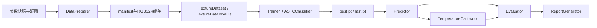

# Class架构重构与兼容性检查

核心组件按职责独立为class，CLI构造组件并调用其方法。训练状态由Trainer持有，模型继承torchvision ResNet，数据准备、数据读取、校准、评估和报告分别维护。`[verified: ../../src/adaptive_astc/cli.py的ExperimentCLI.run；models/resnet.py的ASTCClassifier；training/trainer.py的Trainer]`

## 源码结构

下列目录对应本次重构后的实现。`[verified: src/adaptive_astc各文件class定义；本次AST结构检查]`

```text
src/adaptive_astc/
├── config.py
├── models/
│   └── resnet.py              ASTCClassifier
├── data/
│   ├── catalog.py             TextureCatalog
│   ├── images.py              ImagePreprocessor
│   ├── splitting.py           DatasetSplitter
│   ├── deduplication.py       NearDuplicateIndex
│   ├── preparation.py         DataPreparer
│   └── dataset.py             TextureDataset / TextureDataModule
├── training/
│   └── trainer.py             Trainer
├── calibration/
│   └── temperature.py         TemperatureCalibrator
├── evaluation/
│   ├── inference.py           Predictor
│   ├── metrics.py             ClassificationMetrics
│   └── evaluator.py           Evaluator
├── reporting/
│   └── report.py              ReportGenerator
├── utils/
│   ├── artifacts.py           ArtifactStore
│   ├── checkpoints.py         CheckpointStore
│   ├── environment.py         RunEnvironment
│   └── runtime.py             ExperimentRuntime
└── cli.py                     ExperimentCLI
```

| 组件 | 职责与边界 | 源码 |
|---|---|---|
| ASTCClassifier | RGB输入到四类logits，保留原生ResNet参数名。`[verified: models/resnet.py的ASTCClassifier.__init__]` | [模型](../../src/adaptive_astc/models/resnet.py) |
| TextureCatalog | 固定快照SHA、路径筛选、内容去重与标签冲突处理。`[verified: data/catalog.py的TextureCatalog.build]` | [目录](../../src/adaptive_astc/data/catalog.py) |
| ImagePreprocessor | 源图MD4、位深与解码检查，生成RGB224缓存及近重复预览。`[verified: data/images.py的ImagePreprocessor.decode]` | [预处理](../../src/adaptive_astc/data/images.py) |
| DatasetSplitter / NearDuplicateIndex | 配额、资产组隔离、母折选择、跨集合检查和近重复检索。`[verified: data/splitting.py、data/deduplication.py对应class方法]` | [划分](../../src/adaptive_astc/data/splitting.py)、[近重复](../../src/adaptive_astc/data/deduplication.py) |
| DataPreparer | 组合目录、划分与预处理，保存清单、指纹和聚合数据报告。`[verified: data/preparation.py的DataPreparer.run]` | [准备](../../src/adaptive_astc/data/preparation.py) |
| TextureDataset / TextureDataModule | 从缓存构造归一化Tensor，管理DataLoader、worker与shuffle种子。`[verified: data/dataset.py的__getitem__、loader]` | [数据读取](../../src/adaptive_astc/data/dataset.py) |
| Trainer | 持有model、optimizer、scheduler、scaler，执行优化、验证选模和resume。`[verified: training/trainer.py的Trainer.fit、train_epoch]` | [训练](../../src/adaptive_astc/training/trainer.py) |
| TemperatureCalibrator | 独立校准集推理、正温度拟合、保存绑定到检查点的温度。`[verified: calibration/temperature.py的fit、run]` | [校准](../../src/adaptive_astc/calibration/temperature.py) |
| Predictor / ClassificationMetrics / Evaluator | 推理、概率指标与测试封存分别实现。`[verified: evaluation/三个文件的class方法]` | [推理](../../src/adaptive_astc/evaluation/inference.py)、[指标](../../src/adaptive_astc/evaluation/metrics.py)、[评估](../../src/adaptive_astc/evaluation/evaluator.py) |
| ReportGenerator | 读取持久化结果，生成训练曲线、可靠性图、混淆矩阵与Markdown。`[verified: reporting/report.py的ReportGenerator.render]` | [报告](../../src/adaptive_astc/reporting/report.py) |
| ArtifactStore / CheckpointStore / RunEnvironment / ExperimentRuntime | 原子保存、训练完成门禁、CPU环境信息与torch执行环境。`[verified: utils/四个class的方法]` | [工具目录](../../src/adaptive_astc/utils/) |
| ExperimentCLI | 参数解析、组件调度、OOM重试、成功回执与失败记录。`[verified: cli.py的parser、run、main]` | [命令入口](../../src/adaptive_astc/cli.py) |

## 一次训练的输入与输出

TextureDataset读取清单中的RGB224 uint8缓存，转为`[3, 224, 224]`浮点Tensor并使用ImageNet mean／std归一化，标签为`class_id`。DataModule组成batch，ASTCClassifier输出`[B, 4]`logits，类别顺序固定为`6x6, 8x8, 10x10, 12x12`。Trainer用交叉熵优化，并在验证集上按NLL、accuracy及轮次顺序选择最佳检查点。`[verified: data/dataset.py L13-L49；config.py的CLASSES；training/trainer.py的train_epoch与best_key比较]`



## Class API

新代码按职责导入以下class。`[opinion]`

```python
from pathlib import Path

from adaptive_astc.calibration import TemperatureCalibrator
from adaptive_astc.data.dataset import TextureDataModule, TextureDataset
from adaptive_astc.data.preparation import DataPreparer
from adaptive_astc.evaluation.evaluator import Evaluator
from adaptive_astc.models import ASTCClassifier
from adaptive_astc.reporting import ReportGenerator
from adaptive_astc.training import Trainer

run_dir = Path("experiment report/.local/my-run")
report_dir = Path("experiment report/my-run")

trainer = Trainer(run_dir, report_dir, initialization="pretrained")
result = trainer.fit()
```

此示例依赖已准备的manifest与缓存。两组训练完成后分别调用`TemperatureCalibrator(...).run()`，再调用`Evaluator(...).run()`与`ReportGenerator(...).render()`。命令行仍由`uv run --frozen adaptive-astc`执行，其子命令和参数见[既有入口](../README.md#python环境与入口)。`[verified: cli.py的ExperimentCLI.parser、run；Trainer.fit、TemperatureCalibrator.run、Evaluator.run]`

## 兼容处理与实现选择

- ASTCClassifier使用`ResNet(BasicBlock, [2, 2, 2, 2])`初始化，再按原顺序加载ImageNet权重并替换四分类头。这样保留`conv1.weight`、`fc.weight`等检查点键及随机数消耗顺序。`[verified: models/resnet.py L10-L20；verification.json的initialization_scratch、initialization_pretrained]`
- `common.py`、`metrics.py`、`reports.py`及`data/__init__.py`、`training/__init__.py`保留旧调用名，其实现委托给class。CLI直接调用class，核心实现引用config与utils。`[verified: 对应兼容文件和cli.py的ExperimentCLI.run]`
- data包导入及CLI帮助路径只加载CPU数据准备依赖。Torch Dataset与DataModule从`data.dataset`显式导入。`[verified: tests/test_class_api.py的test_prepare_and_help_import_without_training_stack；data/__init__.py的导入清单]`
- 新训练配置同时记录Trainer文件SHA和所有包内Python源码SHA，供多文件实现溯源。历史实验仍以其原始记录解释。`[verified: training/trainer.py的source_code_sha256、source_files_sha256字段]`
- 独立短流程只用于软件回归，验收结果记录在[verification.json](verification.json)，逐命令日志和新旧源码对照脚本位于被Git忽略的`.local/class-refactor-20261110/`。`[verified: 本次validate.py的PRIVATE、PUBLIC与command；.gitignore的.local规则]`

## 验证范围

| 检查 | 实际范围与结果 |
|---|---|
| 初始化 | scratch与pretrained各122个state tensor全部相同，参数数均为11,178,564，初始化后的torch RNG相同。`[verified: verification.json的initialization_scratch、initialization_pretrained]` |
| 历史模型与完整测试推理 | 两组最佳检查点strict加载通过，各2,000张图的新旧logits最大绝对差为0，且与历史保存logits一致。`[verified: verification.json的historical_checkpoint_pretrained、historical_checkpoint_scratch]` |
| 指标与温度拟合 | 两组原始／校准概率指标与旧实现逐字段相同，温度拟合结果与完整优化记录一致。`[verified: verification.json的historical_checkpoint_*的metrics_equal、temperature_fit_equal；validate.py的assert_equal调用]` |
| 梯度累积 | 68张32×32输入、micro-batch 16、有效batch 64，覆盖64＋4的末组，2步后的loss、模型、optimizer与scaler状态相同。`[verified: verification.json的training_epoch_parity；validate.py的epoch_states比较]` |
| 数据准备 | 新CLI与旧实现分别读取真实快照和源图，独立生成64张软件试跑清单，清单内容与指纹完全相同。`[verified: verification.json的preparation_parity]` |
| 跨版本恢复 | 旧实现的scratch首轮检查点在新CLI中resume到第2轮，与旧实现继续训练的模型、optimizer、scheduler、scaler、loss及验证指标相同。`[verified: verification.json的cross_version_resume_parity；validate.py的checkpoint字段比较]` |
| CLI与Windows worker | prepare、scratch跨版本resume、pretrained训练、两组校准、首次evaluate和缓存evaluate均退出0，训练／校准／测试覆盖workers=2。`[verified: verification.json各cli_*的argv、exit_code]` |
| 测试封存与报告 | 缓存复用指标相同，seal相同，已打开测试后训练与再校准均被拒绝，Markdown与三张图生成通过。`[verified: verification.json的test_seal_and_report]` |
| 历史工件核对 | 既有正式报告、清单、检查点、温度与封存等44个文件的SHA-256一致。`[verified: verification.json的protected_historical_artifacts]` |

独立代码审查返回CLEAN，审查范围覆盖旧CLI适配、初始化、resume、清单指纹、温度拟合与测试封存。自动检查结果见[验证记录](verification.json)，Python单元测试新增模型／RNG、Dataset／DataModule、CPU依赖路径与兼容别名4项回归。`[verified: 本次review_experiment审查输出；tests/test_class_api.py四个test函数]`

短流程使用32张训练、8张验证、8张校准及16张测试样本。pretrained跑1轮，scratch以旧实现跑1轮后由新实现恢复至2轮，这些产物用于兼容性验收。`[verified: verification.json的preparation_parity、cli_pretrained_train、cli_cross_version_resume]`

数据划分的代表性问题沿用[比例复核报告](../gdc-lite-rgb-resnet18-seed20261109/数据集划分比例复核.md)单独追踪，分类复现的质量与字节收益边界见[原实验报告](../gdc-lite-rgb-resnet18-seed20261109/training_report.md#证据边界)。`[verified: 对应报告小节]`
