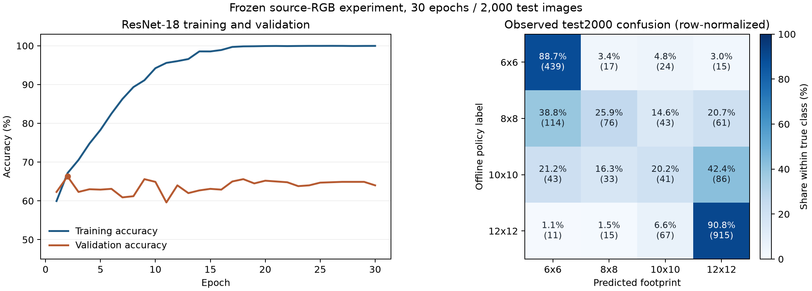

# ASTC 选参分类准确率提升调研

2026-11-11。本报告结合当前 ResNet-18 的冻结训练记录、2,000 图测试结果和35项一手资料，覆盖相似分类任务、输入与标签、batch、学习率、优化器、正则化、loss、网络结构、Unity导入、编码协议、数值精度、缓存与部署计时。逐项阅读深度、来源链接和已下载 PDF 的 SHA-256 保存在 [sources.json](sources.json)，本地重算结果保存在 [diagnostics.json](diagnostics.json)。`[verified: 用户补充“只要一切影响最终结果的因素”；sources.json；diagnostics.json source_sha256]`

## 结论与建议顺序

建议先完成有效配置核对、生产输入配对和较小学习率的迁移学习对照，再比较加权分类、局部纹理输入及 ResNet-50／现代预训练骨干。最后检验有序分类、候选可行性分类和决策代价 loss。各项增益通过独立对照测量，本文列出的搜索范围是待验证的项目建议。`[opinion]`

当前总体准确率73.55%，类别平均召回率56.38%。8×8和10×10的召回率分别为25.85%和20.20%，第30轮训练准确率99.96%、验证准确率64.00%。这些观察支持优先研究中间类别的可分性与泛化。`[verified: diagnostics.json accuracy、balanced_accuracy、per_class_recall、history；opinion: 研究优先级]`

固定现有四个候选和35dB门槛时，2,000图中218图全部候选不合格，质量达标率的当前候选上限为89.10%。分类准确率仍按选中标签计算，这218图有最高PSNR回退标签。`[verified: diagnostics.json quality_agreement、quality_ceiling_fixed_candidates；reproductions/gdc2023/dataset.py GDCLabelSelection.choose]`

## 当前实验的可核对事实

### 训练、输入与选模

| 项目 | 当前设置或结果 |
|---|---|
| 模型 | ImageNet预训练ResNet-18，四分类头，11,178,564参数。`[verified: diagnostics.json config、architecture_sizes]` |
| 训练数据 | 10,000张源图，验证1,000，校准1,000，测试2,000。生产输入规范要求Unity导入后、ASTC搜索前参考像素。`[verified: diagnostics.json class_counts；根README“Unity导入结果与训练数据准备”]` |
| 图像输入 | RGB、双线性缩放224×224、ImageNet均值方差。当前Dataset直接加载缓存并归一化。`[verified: diagnostics.json config.input；src/adaptive_astc/data/dataset.py TextureDataset.__getitem__]` |
| 更新设置 | SGD，lr=0.01，momentum=0.9，weight_decay=0.0001，有效batch=64，micro_batch=64。`[verified: diagnostics.json config]` |
| loss与schedule | 无类别权重的交叉熵，30轮cosine，FP16 AMP，RTX4070/CUDA。`[verified: diagnostics.json config；training/trainer.py train_epoch/fit]` |
| 选模 | 先最小验证NLL，再最大accuracy，再较早epoch。当前最小NLL和最大验证accuracy都在第2轮，accuracy=66.30%。`[verified: training/trainer.py key；diagnostics.json min_validation_nll、max_validation_accuracy]` |
| 独立测试 | 1471/2000命中标签，1540/2000质量达标。`[verified: diagnostics.json correct、quality_agreement]` |

后续若以accuracy为主目标，建议同时保存best_accuracy、best_nll和验证集压缩决策指标对应的权重，预先明确最终选择规则。本次历史训练中两项最优恰好同轮，更换选模指标的潜在收益仍需新实验测量。`[opinion]` `[verified: diagnostics.json max_validation_accuracy、min_validation_nll]`

图中左侧是30轮训练／验证准确率，右侧是已观测test2000的按真实类别归一化混淆矩阵。括号内为图片数。该图用于本轮事后诊断，验证集与测试集分别具有不同的类别分布。`[verified: diagnostics.json history、confusion_matrix、class_counts]`

### 错误集中在哪里

| 真实标签 | 训练数 | 测试数 | 测试预测正确数 | 召回率 |
|---|---:|---:|---:|---:|
| 6×6 | 2593 | 495 | 439 | 88.69% `[verified: diagnostics.json class_counts、confusion_matrix]` |
| 8×8 | 1816 | 294 | 76 | 25.85% `[verified: diagnostics.json class_counts、confusion_matrix]` |
| 10×10 | 1315 | 203 | 41 | 20.20% `[verified: diagnostics.json class_counts、confusion_matrix]` |
| 12×12 | 4276 | 1008 | 915 | 90.77% `[verified: diagnostics.json class_counts、confusion_matrix]` |

训练集最大／最小类别比例约3.25，当前不平衡程度应按这组数量解释。建议把类别重加权作为温和对照，并同时看总体accuracy、中间类召回和最终字节数。`[verified: diagnostics.json class_counts.train；opinion: 调参建议]`

| 标签命中与质量的组合 | 图片数 |
|---|---:|
| 标签正确且质量达标 | 1257 `[verified: diagnostics.json quality_agreement]` |
| 标签正确且质量失败 | 214 `[verified: diagnostics.json quality_agreement]` |
| 标签错误且质量达标 | 283 `[verified: diagnostics.json quality_agreement]` |
| 标签错误且质量失败 | 246 `[verified: diagnostics.json quality_agreement]` |

至少有一个候选可行的1782图中，模型质量通过1540图，即86.42%，另有242图存在可行候选却选择失败。214个“标签正确且质量失败”的预测命中了无可行候选时的回退标签。优化报告应同时保留这几项，便于解释准确率变化产生的实际影响。`[verified: diagnostics.json quality_agreement、feasible_subset_quality_pass_rate；opinion: 指标维护建议]`

可行赢家中167图的PSNR余量≤0.5dB，296图余量≤1dB。四候选PSNR在41图出现相邻反向变化，但本次35dB的可行性向量没有出现非前缀情形。后续有序模型可以利用本次观察做假设验证，新的preset、用途和Unity复合规则另行核对。`[verified: diagnostics.json feasible_winner_margins、candidate_psnr_nonmonotonic_images、candidate_feasibility_nonprefix_images；opinion: 有序结构的适用范围]`

## 相近任务提供了哪些方法

| 工作 | 原任务和已读证据 | 对本项目可借鉴的部分 |
|---|---|---|
| GDC2023 ASTC选参 | 多候选试压缩产生标签，ResNet整图分类。`[verified: 已归档演讲10:00、11:28、12:28]` | 直接沿用离线标签、在线预测及最终一次编码流程。`[opinion]` |
| TexNN | ASTC块内部配置预测，论文§3.5–3.6比较网络／超参数，采用交叉熵、dropout0.6，报告batch100–200、lr约1e-4的稳定区间。`[verified: 本地TexNN主文PDF pp.6–7]` | 候选配置分类和最终编码评价。其MLP和百万块训练的参数范围用于文献背景，项目整图ResNet另行搜索。`[opinion]` |
| DeepQTMT | VVC编码单元划分，多阶段CNN、类别重权、归一化RD代价loss和多阈值决策。`[verified: DeepQTMT §IV-A–IV-C]` | 把错分的压缩代价带入分类训练，按质量／体积／耗时衡量网络。`[opinion]` |
| MUSIQ | IQA模型保留原分辨率与多尺度patch，显式编码空间和尺度信息。`[verified: MUSIQ §3.1–3.2]` | 全局缩略图加原生尺度局部patch，再输出四分类。`[opinion]` |
| Deep Filter Banks | 纹理描述使用卷积特征与orderless pooling，作者扩展稿讨论Fisher vector。`[verified: CVPR2015出版页；作者arXiv1507.02620摘要]` | 对局部纹理做统计池化，比较纹理表征与全局语义表征。`[opinion]` |
| Tune It or Don’t Use It | 六个数据域的少样本分类比较，联合调LR、WD和batch后，CE基线表现有竞争力。`[verified: TuneIt §4.4、§5.3，PDF pp.6、8]` | 先给当前CE基线相同调参预算，再评判复杂loss和结构的增益。`[opinion]` |

DeepQTMT的网络输出对应视频编码树划分，MUSIQ输出对应图像质量，Deep Filter Banks输出对应纹理类别。这些工作的迁移建议来自输入特征和决策结构上的对应关系，ASTC准确率增益由本地对照决定。`[verified: 对应原文上述章节；opinion: 跨任务迁移判断]` [DeepQTMT](https://arxiv.org/html/2006.13125v3)、[MUSIQ](https://arxiv.org/html/2108.05997v1)、[TuneIt](https://arxiv.org/html/2108.13122v1)

截至本次检索，DINOv3提供自监督视觉表征和多种模型规模，2026年纹理预印本研究卷积自编码器预训练与深滤波／Fisher池化。可以把冻结表征加线性分类头作为低训练成本探针，再决定是否全量微调。`[verified: DINOv3摘要；texture-SSL2026摘要和§2.2；opinion: 项目探针设计]` [DINOv3](https://arxiv.org/abs/2508.10104)、[2026纹理工作](https://arxiv.org/html/2605.27843v1)

## 输入、数据和标签

### 保持生产输入与监督对应

当前GDC正式结果采用源图RGB协议。已采集的Unity64参考图中38图与源RGB相同、26图发生变化。源图训练模型迁移到这组导入像素后，模型与固定8×8均通过46/64，模型payload为11,881,536字节，固定8×8为8,735,312字节。该组来自训练划分，应作为输入变化诊断解释。`[verified: ../unity-reference64-lite-rdo-off/summary.json；../reproduction-unity-reference64/comparison.json methods、scope]`

建议以同一次导入和搜索的参考像素、用途、尺寸、颜色空间和选中配置构建生产样本。GDC源图复现保留原身份，新的Unity数据使用新清单、缓存指纹和实验目录。`[opinion]`

### 补充被224缩略图弱化的信息

建议比较三种输入。第一种为现有224缩略图。第二种在相同骨干上测试384输入。第三种为224全局图加4个原生尺度patch，通过共享CNN池化成一个整图表示，再执行一次整图分类。384与多patch的预处理、传输和推理全部计时。`[opinion]`

可低成本加入log2宽高、面积、长宽比、Alpha统计、纯黑比例、贴图用途和颜色空间等元数据，连接至图像特征后的分类头。对固定源图RGB协议，先试尺寸／长宽比。对Unity数据，按真实导入属性构建。`[opinion]`

MUSIQ为保留多尺度／原生像素提供相邻证据，具体patch数量、采样方式和聚合器属于本项目设计。patch仅生成整图表示，监督标签仍对应原整张纹理。`[verified: MUSIQ §3.1–3.2；opinion: 项目实现方式]` [MUSIQ](https://arxiv.org/html/2108.05997v1)

### 增强需要检验标签稳定性

mixup通过混合输入与标签构造训练样本，CutMix研究局部区域替换，Bag of Tricks包含裁剪、颜色与训练增强。这些证据来自其原始分类任务。对压缩选参，颜色扰动、加噪、模糊、重新JPEG编码、裁剪和区域混合可能改变可压缩性、尺寸或质量阈值关系。建议先抽取开发样本重新试压缩，测增强前后标签变化及质量可行性变化，再决定增强设置。`[verified: mixup摘要；CutMix原始摘要；Bag of Tricks §2.1；opinion: ASTC标签稳定性检验]` [mixup](https://arxiv.org/abs/1710.09412)、[CutMix](https://openaccess.thecvf.com/content_ICCV_2019/html/Yun_CutMix_Regularization_Strategy_to_Train_Strong_Classifiers_With_Localizable_Features_ICCV_2019_paper.html)

水平翻转和90°旋转也建议先做上述实测。ASTC块边界、非整块尺寸、padding和编码搜索路径可能影响临界样本的标签。可先测试每种变换64图，报告原label保留率和最终候选PSNR变化。`[opinion]`

训练／验证按资产组冻结划分，patch和同一源图的派生版本归入同组。难例优先覆盖8×8／10×10边界、法线／Mask／UI等用途和低质量余量样本，补采时保留原分布评价集。`[opinion]`

本轮按冻结manifest的14,000条cache_sha256分组，得到13,940个不同RGB224缓存标识，相同标识跨标签冲突组为0。跨train／test相同标识有两组共37图，读取两组代表缓存后确认均为纯白或纯黑、标签12×12。后续可单列纯色子集，资产分组与缩略图内容相同这两项证据分别记录。`[verified: diagnostics.json rgb224_cache_collisions；opinion: 后续子集评价]`

## batch、学习率与优化器

### batch的两层含义

当前`accumulation = effective_batch // micro_batch`。例如micro_batch=32、effective_batch=64时，每两次前向／反向形成一次优化器更新。BatchNorm在每次前向上使用微批统计。改变micro_batch会改变计算和BN统计，优化器有效batch仍由effective_batch决定。`[verified: src/adaptive_astc/training/trainer.py train_epoch；PyTorch2.8 BatchNorm2d文档]` [官方BatchNorm说明](https://docs.pytorch.org/docs/2.8/generated/torch.nn.BatchNorm2d.html)

建议首轮测试有效batch16、32、64，每项同步搜索学习率。按固定epoch比较时记录更新数，补充按固定优化器更新数／训练时间的比较。Batch16在同样epoch内会产生更多更新。`[opinion]`

TuneIt在少数据分类上联合搜索LR、WD、batch，并观察较小batch的收益。大batch ImageNet工作采用线性LR缩放及warmup。本项目的有效batch应通过开发集选择，并同时保留BN策略，原论文的规模条件随来源记录。`[verified: TuneIt §4.4、5.3；Large Minibatch SGD摘要；opinion: 项目实验条件]` [TuneIt](https://arxiv.org/html/2108.13122v1)、[Large Minibatch SGD](https://arxiv.org/abs/1706.02677)

### 联合调学习率、momentum和weight decay

Rethinking Hyperparameters指出微调超参数依赖源／目标域，momentum与学习率耦合，分析中使用有效学习率η/(1−m)。建议把当前0.01／0.9作为历史控制，先比较较小LR及参数组学习率。`[verified: Rethinking Hyperparameters PDF pp.1–2、6–7；opinion: 项目搜索方向]` [论文](https://arxiv.org/abs/2002.11770)

| 旋钮 | 首轮建议范围 | 检查方式 |
|---|---|---|
| SGD backbone LR | 1e-4、3e-4、1e-3、3e-3，保留原1e-2控制。`[opinion]` | 同batch比较验证accuracy、NLL和稳定性。`[opinion]` |
| 分类头LR | backbone的1倍、10倍。`[opinion]` | 配置快照保存每个参数组实际LR。`[opinion]` |
| SGD momentum | 先0.9，候选0、0.5。改变momentum时联合调整LR。`[opinion]` | 同时记录η和η/(1−m)。`[opinion]` |
| SGD WD | 0、1e-5、1e-4、1e-3。`[opinion]` | 与LR联合搜索，训练／验证曲线配对观察。`[opinion]` |
| AdamW | backbone LR 1e-5、3e-5、1e-4，head为1或10倍，WD 0、0.01、0.05。`[opinion]` | 作为独立优化器对照，保存β与衰减参数组。`[opinion]` |
| Warmup与schedule | warmup0或1–2轮，之后cosine，保留原30轮控制。`[opinion]` | 避免在warmup结束前淘汰该配置。`[opinion]` |

AdamW对衰减与自适应梯度更新进行解耦，为优化器对照提供依据。上表的项目数值来自待验证设计。bias与归一化参数的衰减策略需要写入配置并作为独立消融。`[verified: AdamW摘要；Bag of Tricks §3.1；opinion: 项目参数组策略]` [AdamW](https://arxiv.org/abs/1711.05101)、[Bag of Tricks](https://arxiv.org/html/1812.01187v2)

### 微调阶段、BN和正则化

- 建议比较全量微调与“先训练分类头，再以较小backbone LR全量微调”。LP-FT在原文分布变化实验中支持分阶段迁移的研究方向。冻结backbone时，BN运行统计的更新模式单独设置和记录。`[verified: LP-FT PDF pp.1–2；BatchNorm官方文档；opinion: 项目对照]` [LP-FT](https://arxiv.org/abs/2202.10054)
- 建议比较分类头dropout0、0.1、0.2，以及EMA权重与原始权重的验证表现。以相同选模规则保存两者，并计入训练成本。TexNN论文的dropout0.6属于其MLP配置，可作为文献背景。`[verified: TexNN §3.6；opinion: 当前CNN的正则化范围]`
- SAM优化局部邻域内的损失平坦性，可放在常规LR／WD搜索之后试验。其额外梯度计算和BN状态管理应纳入实现与成本记录。`[verified: SAM摘要；opinion: 项目优先级及实现检查]` [SAM](https://arxiv.org/abs/2010.01412)

## loss的选择与适用条件

### 交叉熵、类别权重与平滑

当前基线为`L = -log p(y|x)`。建议先保留同一CE，调好优化器和输入后，再按相同预算比较loss。TuneIt的结果支持认真调优CE基线。`[verified: training/trainer.py train_epoch；TuneIt §4.4–5；opinion: 对照顺序]`

| loss | 具体候选 | 适用判断与代价 |
|---|---|---|
| Weighted CE | 权重∝n_c^(-a)，a∈{0,0.25,0.5}，进行归一化。`[opinion]` | 检验8／10召回和总体accuracy／字节变化。DeepQTMT有按类别频率加权的相似设计。`[verified: DeepQTMT §IV-B；opinion: 项目判断]` |
| Label smoothing | q=(1−ε)onehot(y)+ε/4，ε∈{0,0.05,0.1}。`[opinion]` | 原文研究其对置信度和泛化的影响，项目同时测NLL、ECE与top1。`[verified: When Does Label Smoothing Help摘要；opinion: 项目评价]` |
| Focal loss | −α_y(1−p_y)^γ log p_y，γ∈{0,1,2}。`[verified: Focal Loss Figure1、§3.2；opinion: 搜索集合]` | 优先难例的收益和临界样本权重变化都要实测。源任务为密集检测。`[verified: Focal Loss摘要；opinion: 项目适用性]` |
| Class-balanced loss | w_c∝(1−β)/(1−β^n_c)，β∈{0.99,0.999,0.9999}。`[verified: CB Loss §4 Eq6；opinion: 搜索集合]` | 对照轻量Weighted CE，记录权重有效差异。`[opinion]` |
| Balanced Softmax | 比较类先验校正的训练目标。`[verified: Balanced Meta-Softmax摘要]` | 本项目训练／测试先验和用途组成随清单测量，先验修正幅度由开发集决定。`[opinion]` |

类别权重、重采样和Focal建议先分别消融，再检验组合，便于估计各项贡献。带权损失的归一化以完整有效batch为单位，处理尾批及梯度累积，避免损失尺度随类别组成漂移。`[opinion]`

参考原文分别见 [Label smoothing](https://proceedings.neurips.cc/paper/2019/hash/f1748d6b0fd9d439f71450117eba2725-Abstract.html)、[Focal Loss](https://arxiv.org/html/1708.02002v2)、[Class-balanced Loss](https://arxiv.org/html/1901.05555v1)、[Balanced Softmax](https://proceedings.neurips.cc/paper/2020/hash/2ba61cc3a8f44143e1f2f13b2b729ab3-Abstract.html)。`[verified: 上述一手材料及sources.json]`

### 有序分类与可行性分类

CORAL把有序标签转为二元子任务，并使用共享输出权重及独立bias构建rank一致性框架。其最优解有序bias结论依赖原文loss及条件。对四个方形块，建议按原结构比较三个阈值输出，表示最优标签是否大于6、8、10，训练后核对概率顺序。评价额外报告预测偏向更激进块还是更保守块、质量失败及字节后悔值。`[verified: CORAL §3.2.1–3.2.3、Theorem1；opinion: ASTC输出设计]` [CORAL](https://arxiv.org/html/1901.07884v7)

另一项建议是四个sigmoid分别预测四候选是否满足规则，采用多标签BCE，可作为主分类头的辅助任务。监督直接来自已有四候选实测表，决策依据验证集拟合的风险规则选择候选。无可行候选作为单独状态记录。该方法保留分类路线和最终单次编码。`[opinion]`

四候选PSNR在41图非单调，当前35dB可行集合虽均为前缀，新的候选／preset／导入类型需重新检查。普通四类softmax概率描述“哪一类最优”的概率，直接把每类概率解释为“此候选质量达标”的概率需要额外建模与验证。`[verified: diagnostics.json candidate_psnr_nonmonotonic_images、candidate_feasibility_nonprefix_images；opinion: 概率语义与建模建议]`

### 把压缩决策代价加入分类训练

DeepQTMT组合分类与归一化RD代价，Smart Predict-then-Optimize研究把下游决策结构带入预测loss。下式是本项目提出的四候选分类目标，迁移部分为决策代价思想。`[verified: DeepQTMT §IV-B Eq3–6；SPO摘要；opinion: 本项目loss]` [DeepQTMT](https://arxiv.org/html/2006.13125v3)、[SPO](https://arxiv.org/abs/1710.08005)

对可行候选集合F_i非空的图片，记实际payload为B_ic，B_i*为可行候选最小payload，模型四类概率为p_ic，定义待检验目标如下。α、β和λ是开发集选择的权重。`[opinion]`

$$
C_i(c)=\alpha\,\mathbf{1}[c\notin F_i]
+\beta\,\max\left(0,\frac{B_{ic}-B_i^*}{B_i^*}\right)
$$

$$
L_i=L_{CE,i}+\lambda\sum_c p_{ic} C_i(c)
$$

质量失败和保守选择造成的多余字节由两个可记录项表达。F_i为空时，保留回退标签CE并单列不可行状态。有限惩罚的效果按实测风险曲线解释。`[opinion]`

也可比较基于可行集合的soft target，给体积更小的可行候选更大权重，再用交叉熵训练。它改变了监督分布，原硬标签accuracy与新的压缩决策效用一起报告。`[opinion]`

在Unity规则上构造F_i时，需按颜色空间、normal角度、MS-SSIM、黑像素阈值和大图接受规则复核。原策略选中配置、各项质量严格通过和fallback状态分别保留。搜索提前停止造成的未测候选采用显式缺失mask。建议先在已有完整GDC四候选表上验证loss，再扩展生产数据覆盖，并记录新增离线编码成本。`[verified: 根README“自动选参的偏好与判定规则”；GDC dataset.py；opinion: 迁移步骤]`

### 蒸馏与置信度后处理

蒸馏研究把较大模型／集成的知识迁入单一学生。若较大骨干在独立验证上有效，可比较ResNet-50教师到ResNet-18学生，保持生产推理模型紧凑。教师的原始logits、训练来源及输入协议需保存，学生仍按真实压缩输出验收。`[verified: Distilling the Knowledge摘要；opinion: 项目蒸馏设计]` [原文](https://arxiv.org/abs/1503.02531)

温度缩放采用一个正温度缩放所有logits，保持argmax和分类accuracy。它可作为置信度后处理，再研究使用置信度的决策规则。后处理参数只在独立校准集拟合。`[verified: Guo2017 PDF p.6 §4.2 Eq9；opinion: 项目数据使用]` [原文](https://proceedings.mlr.press/v70/guo17a.html)

## 网络结构与预训练方案

下表是在当前本地torchvision中构造四分类头得到的实际参数和FP32 state_dict字节统计，包含BN等缓冲。跨结构训练／推理耗时需要另测。`[verified: diagnostics.json architecture_sizes]`

| 模型 | 四分类参数 | FP32权重 | 建议作用 |
|---|---:|---:|---|
| ResNet-18 | 11.18M | 42.68MiB | 保留固定结构，先检验训练配方。`[verified: diagnostics.json architecture_sizes；opinion: 作用]` |
| ResNet-34 | 21.29M | 81.27MiB | 观察同系列深度变化。`[verified: diagnostics.json architecture_sizes；opinion: 作用]` |
| ResNet-50 | 23.52M | 89.91MiB | 较大预训练骨干／潜在教师。`[verified: diagnostics.json architecture_sizes；opinion: 作用]` |
| EfficientNetV2-S | 20.18M | 77.58MiB | 参数效率不同的CNN对照。`[verified: diagnostics.json architecture_sizes；opinion: 作用]` |
| ConvNeXt-Tiny | 27.82M | 106.14MiB | 现代卷积骨干对照。`[verified: diagnostics.json architecture_sizes；opinion: 作用]` |

EfficientNetV2研究训练效率与参数效率，ConvNeXt研究现代卷积结构，ConvNeXt V2引入卷积MAE和GRN。建议同时比较预训练权重来源与微调配方，保存准确的权重版本和SHA。模型规模、预训练数据与输入分辨率各自作为实验因素记录。`[verified: 对应论文摘要；opinion: 项目对照设计]` [EfficientNetV2](https://arxiv.org/abs/2104.00298)、[ConvNeXt](https://arxiv.org/abs/2201.03545)、[ConvNeXt V2](https://arxiv.org/abs/2301.00808)

局部纹理池化、频率／梯度统计与图像元数据融合建议安排在大模型之后或并行的小规模探针中。原生尺度高频信息、边缘密度及Alpha／黑像素属性与压缩规则的关联属于待检验假设。2026纹理工作提供局部卷积表征的近期研究入口。`[opinion]` [近期纹理工作](https://arxiv.org/html/2605.27843v1)

## 导入、编码与部署的全流程因素

最终评价建议以分类准确率、规则一致性、质量风险、字节数、耗时和实际显示效果共同描述。下面补充训练配方以外的因素，每项先明确固定条件，再选择小样本对照。`[opinion]`

| 因素 | 需要记录的条件 | 建议对照及观察结果 |
|---|---|---|
| 原图解码与导入缩放 | 原文件格式、PNG gamma／色彩信息、resize算法、max size、NPOT及平台override。`[verified: Unity2019.4导入说明]` | 保持源文件，比较同次导入参考图的尺寸和RGBA差异，检查模型输入是否对应标签生成时的参考图。`[opinion]` |
| Alpha与透明边缘 | Alpha来源、透明扩色、是否需编码Alpha、预乘约定、模型读取RGB／RGBA。Unity文档说明Alpha is Transparency会扩色。`[verified: Unity2019.4 Texture Import Settings]` | 分别统计可见区、透明区和边缘误差，保持项目Alpha处理约定；RGB模型增加Alpha统计或Alpha分支作为候选。`[opinion]` |
| 颜色与贴图用途 | sRGB／Linear、LDR／HDR、normal／mask通道、swizzle及实际编码profile。`[verified: Arm Effective ASTC Encoding；Unity导入说明]` | 依据用途验证质量分支，测试专门的用途条件特征或分类头。`[opinion]` |
| mip与其他纹理形状 | 参考标签的mip0范围、最终mip链、法线重归一化、Alpha coverage、array／cube范围。`[verified: Unity导入说明；根README源码导航]` | 按实际生产mip／形状分别统计质量和完整输出字节，先用现有2D流程做控制。`[opinion]` |
| 候选与编码器 | block候选、preset、线程数、库／DLL／CLI版本、CPU指令集、profile及RDO。`[verified: GDC protocol；Unity baseline identity；Arm编码文档]` | 先固定编码器比较模型，候选扩充另记标签覆盖、质量上限和额外离线成本。`[opinion]` |
| 标签策略与阈值 | 严格>或≥、各通道统计、normal角度、MS-SSIM、黑像素门槛、大图策略、early exit及fallback。`[verified: 根README判定规则；GDCLabelSelection.choose]` | 评价原策略标签命中和逐项质量通过。新阈值与新候选使用新协议身份。`[opinion]` |
| 重复、用途及项目分布 | 资产组、源hash、相同RGB224、法线／Mask／UI比例、尺寸和新旧项目分布。`[verified: DatasetSplitter；diagnostics.json缓存分组]` | 报告分用途／尺寸／项目的召回及风险，并用独立项目做外推评价。`[opinion]` |
| 采集失败和缺失候选 | 技术失败、无可行候选、未测候选、cache-hit、错误解码和源图变化。`[verified: Unity与GDC原始receipt字段及恢复记录]` | 记录缺失原因和重试成本，逐图核验实际候选覆盖。`[opinion]` |
| 随机性和数值设置 | seed、样本顺序、worker RNG、AMP／TF32、算法确定性、库与驱动版本。`[verified: Runtime.configure；PyTorch2.8官方说明]` | 多seed及同权重精度对照，记录预测翻转、质量／字节变化与耗时。`[opinion]` |
| 模型选择和概率解释 | 选模指标、开发／校准／测试的使用记录、置信度含义和实际部署argmax／阈值。`[verified: Trainer选模；Guo2017 §4.2]` | 用预先声明的指标选配置，对相同logits复查后处理究竟改变了哪些决策。`[opinion]` |
| 推理及编码工程 | CPU解码、resize、H2D、GPU forward、D2H、缓存I/O、CLI启动、线程及队列等待。`[verified: GDC evaluation.py计时区间]` | 比较批量推理、持久模型／编码器和单图路径，分别报告启动成本与稳定吞吐。`[opinion]` |
| 计量范围与显示效果 | 原生ASTC payload、容器、完整mip、打包后二次压缩、渲染视角／LOD／材质。`[verified: Arm格式说明；Unity导入说明；FLIP摘要]` | 分层记录存储和延迟，保留纹理指标及固定场景的可见性检查。`[opinion]` |

上述导入属性的官方含义见 [Unity2019.4手册](https://docs.unity.cn/2019.4/Documentation/Manual/class-TextureImporter.html)，ASTC通道与profile的编码建议见 [Arm编码文档](https://github.com/ARM-software/astc-encoder/blob/main/Docs/Encoding.md)。官方通用说明与本地定制引擎运行时设置分别核验。`[verified: 对应官方文档；opinion: 版本对齐要求]`

### 质量度量与编码任务定义

建议固定一套质量评价协议，至少包含参考像素、参与通道、颜色解释、度量公式、阈值及接受／回退规则。RGB整体MSE得到的PSNR、先算各通道再汇总的统计，以及排除零误差通道的统计，可能产生不同值。Alpha、法线和MS-SSIM按各自用途核对。质量标准的修改作为独立协议变化记录。`[opinion]`

本次额外读取的当前引擎源码快照SHA-256为`48bf3b9bdc5d7c62d610343187e0c6edbc5a26c5572be7e4eaa085143f8f8467`。该快照中CalculatePSNR有rgbOnlyPsnr分支，并在相应分支按非零误差通道累积。正式基线则保存其已测Editor／DLL、运行时质量配置及原始结果身份。当前源码静态观察与历史二进制实测分别解释。`[verified: diagnostics.json current_engine_source_inspection；当前ASTCCompressor.cpp L2181–2266；原baseline identity.json与full-receipt.json provenance]`

当前GDC四候选的样本质量通过上限89.10%说明候选覆盖也影响最终结果。可单独研究更小footprint、更多preset或用途专用编码，测新增可行图数与字节／编码成本。新标签空间及质量门槛保持明确，原四类准确率继续按原协议报告。`[verified: diagnostics.json quality_ceiling_fixed_candidates；opinion: 候选研究设计]`

标准ASTC块输出固定128bit，即16字节，同尺寸同footprint的块数确定了原生payload。preset／RDO等变化的收益应在相应质量和实际打包输出上测量，报告同时保存原生payload、容器和包内二次压缩体积。`[verified: Arm Format Overview“Block compression”“Block sizes”；opinion: 项目计量方式]` [格式说明](https://github.com/ARM-software/astc-encoder/blob/main/Docs/FormatOverview.md)

### 缓存身份、失效与预测保存

当前GetCachedParameters函数可直接观察到资产路径标识、源内容hash和候选索引检查。全局缓存tableConfig的加载／失效另有流程。预测缓存建议把导入设置和参考图身份纳入验证，避免仅凭源文件身份解释所有导入结果。`[verified: 当前ASTCCompressor.cpp L1902–1934；根README缓存导航；opinion: 预测缓存复用条件]`

建议保存源MD4、导入meta／有效设置摘要、参考RGBA hash、尺寸、用途、颜色／Alpha、候选及规则版本、编码器版本、模型checkpoint SHA和预处理版本。以这些身份判定是否可以复用预测与已有压缩payload。缓存命中、预测、最终编码和缓存写入分别计时。`[opinion]`

这些身份信息允许日常流程读取已保存的预测参数，并使模型更新、导入配置变化或质量规则变化具有可核对的失效条件。失效率与重复导入的节省时间可作为实际收益指标。`[opinion]`

### 精度、随机性与推理吞吐

当前Runtime配置seed、cuDNN deterministic和关闭benchmark。PyTorch文档说明不同版本／平台、批量与逐切片计算、不同精度设置可能具有不同浮点结果。建议保存PyTorch／torchvision／CUDA／驱动、精度和算法配置，分别测同模型单图／批量、FP32／FP16等路径的预测一致性。所有训练保持CUDA。`[verified: src/adaptive_astc/utils/runtime.py；PyTorch2.8 Reproducibility与Numerical accuracy；opinion: 项目复核]` [可复现性](https://docs.pytorch.org/docs/2.8/notes/randomness.html)、[数值精度](https://docs.pytorch.org/docs/2.8/notes/numerical_accuracy.html)

对FP16／FP32／未来量化导出的比较，建议保存logits差异、argmax翻转、翻转图的质量／字节及端到端耗时。仅以权重文件变小评价部署收益会漏掉算子、数据传输与启动成本，端到端实测可补齐这些区间。`[opinion]`

批量预测可先集中生成并保存选参结果，之后每张图按选定参数编码一次。工程对照建议覆盖模型驻留、predict batch1／16／64、异步I/O和编码线程预算，保持逐图结果和质量规则一致。若允许低置信度样本回到搜索，另记搜索比例、额外编码数和成本，按该运行协议单独评价。`[opinion]`

### 实际渲染与实验选择偏差

FLIP研究渲染图像与参考图之间的感知差异，提供逐像素差异图。可补充固定相机／光照／LOD的渲染比较和人工盲评，按透明边缘、法线高光、UI文字及Mask用途记录问题。当前PSNR／角度等标签定义继续随原协议保留，新增可见性评价具有自己的观看条件与记录。`[verified: FLIP作者版摘要和Introduction；opinion: 项目渲染评价]` [FLIP](https://research.nvidia.com/sites/default/files/node/3260/FLIP_Paper.pdf)

建议同时报告逐图平均与按总字节／像素／资产组聚合的结果、分位数和最差样本。多次调参的尝试预算、被淘汰配置、失败实验、选模规则和已查看的测试结果都写入记录。配置改善由相同输入及匹配协议的配对结果解释。`[opinion]`

## 可执行的实验优先级和预算

### 开发条件

全部模型训练使用CUDA。先做少量样本或少量更新，核对实际LR、有效batch、optimizer_updates、AMP skip、输入缓存和候选标签，再扩展训练。输入协议发生变化时使用新manifest指纹与实验身份，原有已封存模型保留为历史控制。`[verified: AGENTS.md CUDA要求；Trainer与EvaluationSeal约束；opinion: 后续执行流程]`

建议保留源图GDC研究协议和Unity生产协议的独立实验身份。前者可利用现成完整四候选数据做配方筛选，后者用于验证生产相关的最终判断。`[opinion]`

### 分阶段预算

| 实验组 | 建议配置与次数 | 产出 |
|---|---|---|
| 配方筛选 | 固定ResNet-18，随机／分层抽样24组LR×有效batch×WD。先6轮，选6组从头训练30轮，保守预算324个epoch等价，按基线平均轮时粗估约2.1小时。真实耗时受batch和验证开销影响。`[opinion]` | 最优CE配方和LR／batch敏感性。`[opinion]` |
| 分阶段微调 | 在最优配方上比较head warmup、BN策略和参数组LR，先4–6组。`[opinion]` | 训练／验证差距及中间类别召回。`[opinion]` |
| loss消融 | CE控制，加温和Weighted CE、LS、Focal、CB各一到两项开发集设置。`[opinion]` | 每项loss独立贡献及质量／字节变化。`[opinion]` |
| 输入与模型 | 使用选定配方，对比ResNet-50、ConvNeXt-Tiny、EfficientNetV2-S，另测384输入和全局＋patch。先同224输入比较结构。`[opinion]` | 容量、表征和输入分辨率的独立贡献。`[opinion]` |
| 规则相关目标 | 有序分类、可行性辅助分类、CE＋代价各做独立对照。`[opinion]` | 原标签accuracy与生产效用的对应变化。`[opinion]` |
| 最终复核 | 最优两套设置各3个seed，按资产组做配对置信区间和逐图编码复查。`[opinion]` | 均值、波动、难例和运行成本。`[opinion]` |

上述预算采用24×6＋6×30=324轮的保守完整训练计数，基线689.86秒／30轮约23秒每轮。若晋级候选保持同一配置从6轮续跑至30轮，则计数为288轮。它们是资源规划估算，开发准入、数据准备、不同batch、不同网络和最终编码另计。`[verified: 正式pretrained_training.json与wall-clock.json；opinion: 外推预算]`

Hyperband与TuneIt的ASHA实践支持按资源逐步筛选配置。短程排名可能偏向较早收敛的配方，建议为低LR／warmup候选保留完整训练机会。优胜配置均用相同完整训练预算复核。`[verified: Hyperband摘要；TuneIt §4.4；opinion: 筛选细节]` [Hyperband](https://jmlr.org/papers/v18/16-558.html)

### 记录哪些指标

1. 标签一致性记录top1、macro-F1、balanced accuracy、每类precision／recall、混淆矩阵和激进／保守错分。新增logits、top2及置信度分布。`[opinion]`
2. 决策效果记录质量违规率、可行子集通过率、无可行候选数、总payload及相对候选oracle的字节后悔值。质量阈值以有效协议解释。`[opinion]`
3. 成本记录数据准备、标签生成、训练、模型加载、输入处理、推理、一次最终编码和验证解码，各自保存原始区间。`[opinion]`
4. 校准记录NLL、Brier、ECE和可靠性图，并验证部署决策实际是否改变。`[opinion]`
5. 模型选择使用开发验证数据，校准参数使用校准集。原test2000已被观察，其本轮重算为事后诊断，后续对照保留这项历史。更强的最终泛化证据可来自预先冻结的新项目或时间划分。`[opinion]`

按图二项近似给出的当前accuracy区间约71.57%–75.44%，该计算忽略资产组相关性和模型选择影响。新旧模型建议用同图配对、按资产组bootstrap及多seed报告变化。`[verified: diagnostics.json wilson95_image_level_descriptive、wilson_limit；opinion: 后续不确定性评价]`

## 当前代码入口需要补齐的部分

| 位置 | 当前已核对行为 | 后续需要的改动 |
|---|---|---|
| `script/reproduce.py` GDC train | 透传epochs、micro_batch、workers、resume，未透传解析器中的learning_rate、batch_size。`[verified: GDC分支调用]` | 给GDC明确的LR、有效batch、optimizer等入口，拒绝不适用参数，并测最终有效配置。`[opinion]` |
| `reproductions/gdc2023/training.py` | 构造TrainConfig时其余优化参数使用默认值。`[verified: GDCTraining.train]` | 超参数透传到统一配置，绑定成本和checkpoint签名。`[opinion]` |
| `src/adaptive_astc/cli.py` | 通用训练入口已支持LR、momentum、WD、effective_batch等覆盖。`[verified: ExperimentCLI.parser]` | 与复现入口共享配置表示，维护准入及计时记录。`[opinion]` |
| `training/trainer.py` | loss固定CE、optimizer固定SGD，按有效batch累积，NLL优先选模。`[verified: train_epoch/fit]` | loss／参数组／选模配置化，维持尾批、AMP更新及resume一致性。`[opinion]` |
| `models/resnet.py` | 类内固定ResNet-18。`[verified: ASTCClassifier.__init__]` | 独立骨干选择和分类头，严格绑定架构／预训练版本。`[opinion]` |
| `data/dataset.py`与缓存准备 | 加载预生成RGB224缓存。`[verified: TextureDataset.__getitem__；GDCTraining.validate_data]` | 新尺寸、patch及元数据进入新的数据指纹。`[opinion]` |
| 逐图预测记录 | 正式GDC压缩评估保存predicted_class／footprint／confidence；参考像素分支额外保存logits。`[verified: gdc2023/evaluation.py；reference_evaluation.py result]` | 新实验统一保存完整logits供top2、蒸馏和后处理审计。`[opinion]` |

当前仅修改研究报告和资料入口。本报告中的超参数、loss和网络对照属于实验提案，模型训练及优化器设置的现有实测状态见冻结报告。`[verified: 本轮变更范围；sources.json与diagnostics.json；opinion: 实验提案状态]`

## 证据深度与使用范围

- TuneIt、Rethinking Hyperparameters、LP-FT、Guo校准论文已下载并提取文本，本文只引用本轮实际阅读的章节。TexNN从本地原件读取§3.5–3.6。下载成功与全文逐页阅读分别记录在sources.json。`[verified: sources.json local_pdf_access、各项read_depth]`
- DeepQTMT、MUSIQ、Focal、CB、Bag of Tricks等通过作者arXiv全文读取相关章节。部分现代骨干和优化器只核对一手摘要。对应方法的完整训练配方在实施前按源代码固定版本复核。`[verified: sources.json read_depth、locator；opinion: 后续实施要求]`
- 本轮外部方法效果取自其原始任务，ASTC上的收益列为项目假设。输入、有效配置和标签规则优先与目标流程对应，最终优化由准确率、压缩质量、字节和成本共同评价。`[opinion]`

## 一手资料索引

完整索引和逐项核实深度见 [sources.json](sources.json)。下列链接覆盖本报告涉及的35项资料。`[verified: sources.json primary_source_count]`

- GDC 2023 Parameter Selection for ASTC Mapping Compression Using Machine Learning。核对范围为10:00, 11:28, 12:28; reproductions/gdc2023/source.json，阅读深度记录为`archived_talk_and_local_reproduction`。`[verified: sources.json gdc2023；对应一手材料所列位置]` [原文](https://www.gdcvault.com/play/1029226/Machine-Learning-Summit-Parameter-Selection)

- TexNN: Fast Texture Encoding Using Neural Networks。核对范围为Main paper pp.6-7, sections3.5-3.6; Appendix p.1，阅读深度记录为`local_pdf_selected_sections`。`[verified: sources.json texnn；对应一手材料所列位置]` [原文](https://doi.org/10.1111/cgf.13534)

- DeepQTMT: A Deep Learning Approach for Fast QTMT-based CU Partition of Intra-mode VVC。核对范围为IV-A, IV-B equations3-6, IV-C，阅读深度记录为`fulltext_selected_sections`。`[verified: sources.json deepqtmt；对应一手材料所列位置]` [原文](https://arxiv.org/html/2006.13125v3)

- Tune It or Don't Use It: Benchmarking Data-Efficient Image Classification。核对范围为4.4, 5.3; PDF pp.6,8，阅读深度记录为`fulltext_selected_sections_and_local_pdf`。`[verified: sources.json tuneit；对应一手材料所列位置]` [原文](https://arxiv.org/html/2108.13122v1)

- Rethinking the Hyperparameters for Fine-tuning。核对范围为pp.1-2,6-7; effective learning rate and momentum，阅读深度记录为`local_pdf_selected_sections`。`[verified: sources.json finetune；对应一手材料所列位置]` [原文](https://arxiv.org/abs/2002.11770)

- Bag of Tricks for Image Classification with Convolutional Neural Networks。核对范围为3.1, 5.1-5.4，阅读深度记录为`fulltext_selected_sections`。`[verified: sources.json bagtricks；对应一手材料所列位置]` [原文](https://arxiv.org/html/1812.01187v2)

- Fine-Tuning can Distort Pretrained Features and Underperform Out-of-Distribution。核对范围为pp.1-2, LP-FT explanation，阅读深度记录为`local_pdf_abstract_and_introduction`。`[verified: sources.json lpft；对应一手材料所列位置]` [原文](https://arxiv.org/abs/2202.10054)

- PyTorch2.8 BatchNorm2d official documentation。核对范围为mini-batch statistics, running estimates, momentum，阅读深度记录为`official_api_documentation`。`[verified: sources.json batchnorm；对应一手材料所列位置]` [原文](https://docs.pytorch.org/docs/2.8/generated/torch.nn.BatchNorm2d.html)

- Decoupled Weight Decay Regularization。核对范围为abstract, decoupled decay，阅读深度记录为`primary_abstract`。`[verified: sources.json adamw；对应一手材料所列位置]` [原文](https://arxiv.org/abs/1711.05101)

- Focal Loss for Dense Object Detection。核对范围为3.2 and Figure1，阅读深度记录为`fulltext_selected_sections`。`[verified: sources.json focal；对应一手材料所列位置]` [原文](https://arxiv.org/html/1708.02002v2)

- Class-Balanced Loss Based on Effective Number of Samples。核对范围为4 equations6-8, 5 Table1，阅读深度记录为`fulltext_selected_sections`。`[verified: sources.json classbalanced；对应一手材料所列位置]` [原文](https://arxiv.org/html/1901.05555v1)

- Balanced Meta-Softmax for Long-Tailed Visual Recognition。核对范围为abstract，阅读深度记录为`primary_abstract`。`[verified: sources.json balancedsoftmax；对应一手材料所列位置]` [原文](https://proceedings.neurips.cc/paper/2020/hash/2ba61cc3a8f44143e1f2f13b2b729ab3-Abstract.html)

- Rank consistent ordinal regression for neural networks with application to age estimation。核对范围为3.2.1-3.2.3, shared weights, independent bias and Theorem1 conditions，阅读深度记录为`fulltext_selected_sections`。`[verified: sources.json coral；对应一手材料所列位置]` [原文](https://arxiv.org/html/1901.07884v7)

- When Does Label Smoothing Help?。核对范围为abstract; use limited to confidence regularization，阅读深度记录为`primary_abstract`。`[verified: sources.json smoothing；对应一手材料所列位置]` [原文](https://proceedings.neurips.cc/paper/2019/hash/f1748d6b0fd9d439f71450117eba2725-Abstract.html)

- mixup: Beyond Empirical Risk Minimization。核对范围为convex combinations of examples and labels，阅读深度记录为`primary_abstract`。`[verified: sources.json mixup；对应一手材料所列位置]` [原文](https://arxiv.org/abs/1710.09412)

- CutMix: Regularization Strategy to Train Strong Classifiers With Localizable Features。核对范围为publisher abstract and method summary from primary PDF search，阅读深度记录为`primary_search_excerpt`。`[verified: sources.json cutmix；对应一手材料所列位置]` [原文](https://openaccess.thecvf.com/content_ICCV_2019/html/Yun_CutMix_Regularization_Strategy_to_Train_Strong_Classifiers_With_Localizable_Features_ICCV_2019_paper.html)

- MUSIQ: Multi-scale Image Quality Transformer。核对范围为3.1-3.2, native-resolution multi-scale patches，阅读深度记录为`fulltext_selected_sections`。`[verified: sources.json musiq；对应一手材料所列位置]` [原文](https://arxiv.org/html/2108.05997v1)

- Deep Filter Banks for Texture Recognition and Segmentation。核对范围为CVPR2015 publisher page; author extended paper arXiv1507.02620 abstract，阅读深度记录为`publisher_page_and_author_extended_abstract`。`[verified: sources.json deepfilter；对应一手材料所列位置]` [原文](https://www.cv-foundation.org/openaccess/content_cvpr_2015/html/Cimpoi_Deep_Filter_Banks_2015_CVPR_paper.html)

- A self-supervised learning approach to deep filter banks for texture recognition。核对范围为abstract,2.2; preprint submitted2026-05-27，阅读深度记录为`fulltext_selected_sections`。`[verified: sources.json texturessl2026；对应一手材料所列位置]` [原文](https://arxiv.org/html/2605.27843v1)

- A ConvNet for the 2020s。核对范围为abstract; CVPR2022，阅读深度记录为`primary_abstract`。`[verified: sources.json convnext；对应一手材料所列位置]` [原文](https://arxiv.org/abs/2201.03545)

- ConvNeXt V2: Co-designing and Scaling ConvNets with Masked Autoencoders。核对范围为abstract; FCMAE and GRN，阅读深度记录为`primary_abstract`。`[verified: sources.json convnextv2；对应一手材料所列位置]` [原文](https://arxiv.org/abs/2301.00808)

- EfficientNetV2: Smaller Models and Faster Training。核对范围为abstract; ICML2021，阅读深度记录为`primary_abstract`。`[verified: sources.json efficientnetv2；对应一手材料所列位置]` [原文](https://arxiv.org/abs/2104.00298)

- DINOv3。核对范围为abstract; official facebookresearch/dinov3，阅读深度记录为`primary_abstract_and_official_repository_excerpt`。`[verified: sources.json dinov3；对应一手材料所列位置]` [原文](https://arxiv.org/abs/2508.10104)

- Distilling the Knowledge in a Neural Network。核对范围为abstract; single-model transfer of ensemble knowledge，阅读深度记录为`primary_abstract`。`[verified: sources.json distillation；对应一手材料所列位置]` [原文](https://arxiv.org/abs/1503.02531)

- Sharpness-Aware Minimization for Efficiently Improving Generalization。核对范围为abstract; ICLR2021，阅读深度记录为`primary_abstract`。`[verified: sources.json sam；对应一手材料所列位置]` [原文](https://arxiv.org/abs/2010.01412)

- On Calibration of Modern Neural Networks。核对范围为PDF p.6 section4.2 equation9 and unchanged argmax，阅读深度记录为`local_pdf_selected_section`。`[verified: sources.json calibration；对应一手材料所列位置]` [原文](https://proceedings.mlr.press/v70/guo17a.html)

- Hyperband: A Novel Bandit-Based Approach to Hyperparameter Optimization。核对范围为resource allocation and early stopping; JMLR page2018，阅读深度记录为`primary_abstract`。`[verified: sources.json hyperband；对应一手材料所列位置]` [原文](https://jmlr.org/papers/v18/16-558.html)

- Smart Predict, then Optimize。核对范围为decision loss and downstream objective, conceptual transfer only，阅读深度记录为`primary_abstract_and_author_search_excerpt`。`[verified: sources.json spo；对应一手材料所列位置]` [原文](https://arxiv.org/abs/1710.08005)

- Accurate, Large Minibatch SGD: Training ImageNet in1Hour。核对范围为linear scaling and gradual warmup, ImageNet setting，阅读深度记录为`primary_abstract`。`[verified: sources.json largebatch；对应一手材料所列位置]` [原文](https://arxiv.org/abs/1706.02677)

- Unity2019.4 Texture Import Settings。核对范围为type-specific settings, sRGB, Alpha, max size, mip and platform override，阅读深度记录为`official_manual_selected_sections`。`[verified: sources.json unity_import；对应一手材料所列位置]` [原文](https://docs.unity.cn/2019.4/Documentation/Manual/class-TextureImporter.html)

- Arm Effective ASTC Encoding。核对范围为sRGB input, normal-map and non-correlated component encoding，阅读深度记录为`official_encoder_documentation`。`[verified: sources.json astc_encoding；对应一手材料所列位置]` [原文](https://github.com/ARM-software/astc-encoder/blob/main/Docs/Encoding.md)

- Arm ASTC Format Overview。核对范围为block footprints and fixed128-bit block storage，阅读深度记录为`official_format_documentation`。`[verified: sources.json astc_format；对应一手材料所列位置]` [原文](https://github.com/ARM-software/astc-encoder/blob/main/Docs/FormatOverview.md)

- PyTorch2.8 Reproducibility。核对范围为random seeds, algorithm determinism, platform boundaries，阅读深度记录为`official_documentation_selected_sections`。`[verified: sources.json torch_random；对应一手材料所列位置]` [原文](https://docs.pytorch.org/docs/2.8/notes/randomness.html)

- PyTorch2.8 Numerical accuracy。核对范围为batched vs slice computations, floating point, TF32，阅读深度记录为`official_documentation_selected_sections`。`[verified: sources.json torch_numerics；对应一手材料所列位置]` [原文](https://docs.pytorch.org/docs/2.8/notes/numerical_accuracy.html)

- FLIP: A Difference Evaluator for Alternating Images。核对范围为abstract and introduction; rendered image difference and human perception，阅读深度记录为`author_pdf_abstract_and_introduction`。`[verified: sources.json flip；对应一手材料所列位置]` [原文](https://research.nvidia.com/sites/default/files/node/3260/FLIP_Paper.pdf)
