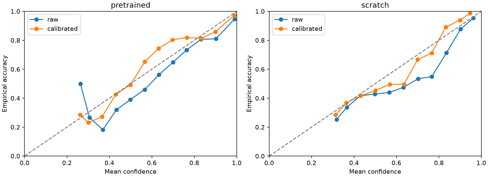
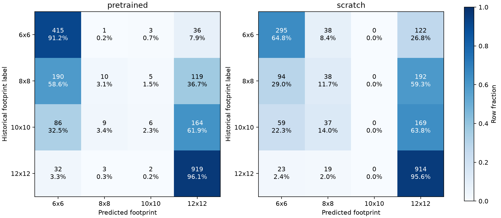
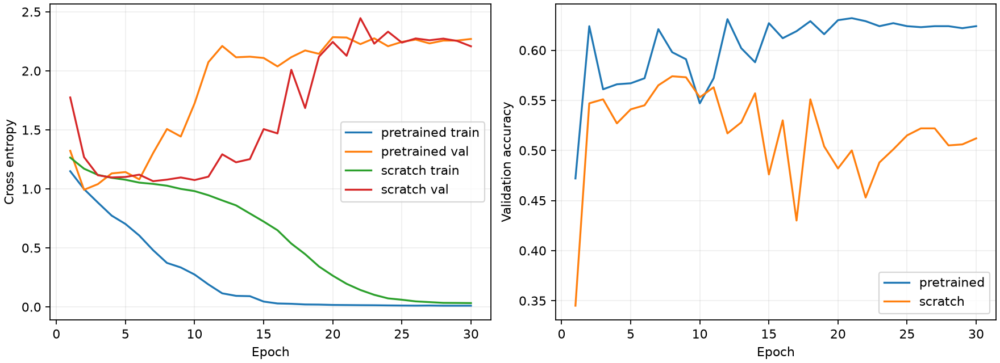

# 训练与校准报告

本报告记录现有LITE历史标签、RGB源图输入的分类复现。网络深度、初始化及训练超参数采用协议中明确补全的设置。`[verified: protocol.md；各组training.json /config]`

## 封存测试结果

| 模型与处理 | Accuracy | Macro F1 | Balanced accuracy | NLL | Brier | ECE | 证据 |
|---|---|---|---|---|---|---|---|
| pretrained raw | 0.6750 | 0.4107 | 0.4817 | 0.8016 | 0.4084 | 0.0695 | `[verified: metrics.json /arms]` |
| pretrained calibrated | 0.6750 | 0.4107 | 0.4817 | 0.7752 | 0.4042 | 0.0469 | `[verified: metrics.json /arms]` |
| scratch raw | 0.6235 | 0.3952 | 0.4304 | 0.9367 | 0.4933 | 0.0693 | `[verified: metrics.json /arms]` |
| scratch calibrated | 0.6235 | 0.3952 | 0.4304 | 0.9198 | 0.4837 | 0.0438 | `[verified: metrics.json /arms]` |

训练集多数类为12x12，测试准确率0.4780。`[verified: metrics.json /majority_baseline]`

校准前后逐样本argmax一致。校准效果按测试NLL、Brier与ECE的实际变化解释。`[verified: metrics.json /arms/*/argmax_unchanged]`

## 逐类识别与当前限制

| 模型 | 历史类别 | 测试样本数 | Recall | Precision | 预测为该类的数量 | 证据 |
|---|---|---|---|---|---|---|
| pretrained | 6x6 | 455 | 91.21% | 57.40% | 723 | `[verified: metrics.json /arms/*/raw/per_class、confusion_matrix]` |
| pretrained | 8x8 | 324 | 3.09% | 43.48% | 23 | `[verified: metrics.json /arms/*/raw/per_class、confusion_matrix]` |
| pretrained | 10x10 | 265 | 2.26% | 37.50% | 16 | `[verified: metrics.json /arms/*/raw/per_class、confusion_matrix]` |
| pretrained | 12x12 | 956 | 96.13% | 74.23% | 1238 | `[verified: metrics.json /arms/*/raw/per_class、confusion_matrix]` |
| scratch | 6x6 | 455 | 64.84% | 62.63% | 471 | `[verified: metrics.json /arms/*/raw/per_class、confusion_matrix]` |
| scratch | 8x8 | 324 | 11.73% | 28.79% | 132 | `[verified: metrics.json /arms/*/raw/per_class、confusion_matrix]` |
| scratch | 10x10 | 265 | 0.00% | 0.00% | 0 | `[verified: metrics.json /arms/*/raw/per_class、confusion_matrix]` |
| scratch | 12x12 | 956 | 95.61% | 65.43% | 1397 | `[verified: metrics.json /arms/*/raw/per_class、confusion_matrix]` |

预训练模型的8×8和10×10召回率分别为3.09%和2.26%，随机初始化模型的10×10召回率为0.00%。温度处理后的类别指标见同一份聚合统计。`[verified: metrics.json /arms/*/raw/per_class及calibrated/per_class]`

pretrained训练loss由1.1499至0.0104，验证NLL由1.3228至2.2701，选中第2轮。`[verified: pretrained_training.json /epochs；training_complete.json]`

scratch训练loss由1.2649至0.0326，验证NLL由1.7747至2.2079，选中第7轮。`[verified: scratch_training.json /epochs；training_complete.json]`

最佳轮次按预先固定的验证NLL规则选择。`[verified: protocol.md；各组训练记录]`

结果范围为单个固定种子、LITE标签与源图RGB输入的资产隔离划分。`[verified: metrics.json；data_summary.json；protocol.md]`

## 训练成本与模型选择

| 模型 | 完成轮次 | 最佳轮次 | 累计轮次耗时秒 | 峰值CUDA分配MiB | 主进程RSS MiB | T | 证据 |
|---|---|---|---|---|---|---|---|
| pretrained | 30 | 2 | 741.2 | 910.3 | 1813.2 | 1.427781 | `[verified: pretrained_training.json；metrics.json]` |
| scratch | 30 | 7 | 736.4 | 910.3 | 1786.8 | 1.258730 | `[verified: scratch_training.json；metrics.json]` |

轮次耗时包含训练与验证，测试推理时间包含数据加载与GPU前向。RSS为主进程轮次末观测值，CUDA数值为PyTorch峰值分配；系统侧采样另记资源日志。`[verified: training.py的轮次计时、RSS采样与checkpoint_inference；资源日志]`

## 证据边界

标签来源为LITE选参缓存，其preset与RDO混合，RGB输入省略Alpha，Unity导入后输入域仍需独立验证。本次类别正确率对应历史标签。PSNR35达标率、法线误差、真实字节收益与生产单次压缩效果需要候选压缩实测。`[verified: protocol.md；data_summary.json /table_config]`

温度在独立校准集拟合，两个模型与温度固定后统一打开测试集。所有逐类指标、混淆矩阵、可靠性分箱及模型指纹见[聚合指标](metrics.json)。`[verified: metrics.json；私有test_seal.json]`
