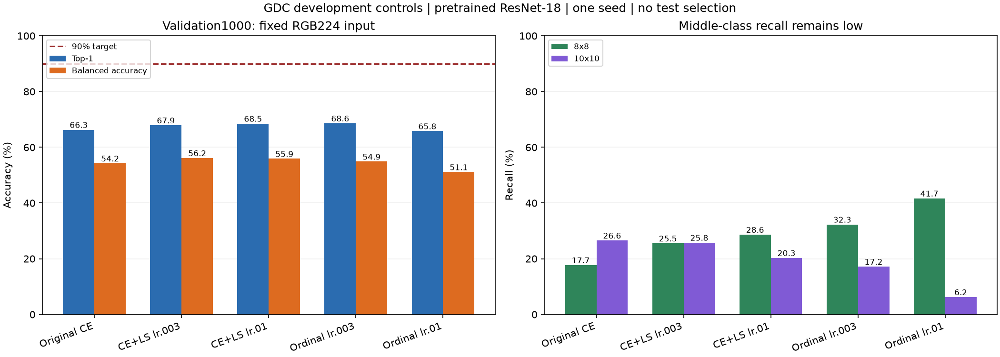

# V1：固定 ResNet-18 的分类对照

五组已完成，验证Top-1最好68.6%，原配置为66.3%。本批参数与loss调整没有达到90%；最高Top-1组的10×10召回与质量达标率均低于原配置，后续继续V1的原分辨率误差回归。`[verified: comparison.json trials；opinion: 后续路线]`

## 数据与配置

使用冻结GDC源RGB train10000／validation1000、RGB224双线性输入、ImageNet预训练ResNet-18、SGD momentum0.9、有效batch64、seed20261109、cosine周期30。每组最多15轮，验证NLL patience5早停。分类对照沿用预训练以匹配历史基线，V1回归主线使用随机初始化。test2000未用于这批训练或选模。`[verified: suite.json；各报告config、test_opened]`

变换编码核验未通过误差不变性，所有组关闭图像增强。正则化CE组合改变label smoothing和weight decay；有序loss组合改变输出头与损失，不能将组合收益归因于单一组件。`[verified: ../patch-equivalence20.json；suite.json；opinion: 归因边界]`

## 同一准确率最优权重的结果

下表的NLL、召回、质量和payload都对应各组**Top-1最优权重**，没有混用另一轮的最低NLL权重。质量达标指按预测标签选择已实测候选后，其真实RGB PSNR>35 dB；这里只复用冻结测量，未重新执行压缩计时。`[verified: comparison.json；归档classification_analysis.py]`

| 配置 | 验证Top-1 | Balanced accuracy | NLL | 8×8召回 | 10×10召回 | 质量达标率 | Payload字节 |
|---|---|---|---|---|---|---|---|
| 原CE，lr0.01，WD1e-4 | 66.3% | 54.23% | 0.8284 | 17.71% | 26.56% | 75.9% | 112,551,840。`[verified: comparison.json baseline-ce]` |
| CE+LS0.1，lr0.003，WD5e-4 | 67.9% | 56.15% | 0.8181 | 25.52% | 25.78% | 75.3% | 110,918,960。`[verified: comparison.json regularized-lr003]` |
| CE+LS0.1，lr0.01，WD5e-4 | 68.5% | 55.89% | 0.9111 | 28.65% | 20.31% | 76.4% | 109,526,640。`[verified: comparison.json regularized-lr01]` |
| 有序loss，lr0.003，WD5e-4 | 68.6% | 54.88% | 0.8063 | 32.29% | 17.19% | 72.3% | 99,731,872。`[verified: comparison.json ordinal-lr003]` |
| 有序loss，lr0.01，WD5e-4 | 65.8% | 51.12% | 0.8238 | 41.67% | 6.25% | 71.1% | 105,205,536。`[verified: comparison.json ordinal-lr01]` |

原配置最佳epoch2，复现历史66.3%与NLL0.828363；正则化CE lr0.003的最终训练准确率98.46%，固定512张训练eval探针99.41%，其最佳验证仍为67.9%。这批结果仍表现出明显训练／验证差距。`[verified: comparison.json baseline-ce、regularized-lr003；opinion: 泛化差距解释]`

有序输出采用一个共享分数、softplus保证有序的阈值、三个累计二分类loss，最终按四类概率argmax选择。它借鉴[CORAL作者实现](https://raschka-research-group.github.io/coral-pytorch/api_subpackages/coral_pytorch.losses/)的累计监督，本地阈值参数化和最终决策有改动，按本地变体报告。`[verified: src/adaptive_astc/models/ordinal.py；classification_control.py ordinal_variant；作者loss文档]`

## 工件与复核

- [冻结配置](suite.json)、[完整汇总](summary.json)、[保存预测复核与质量统计](comparison.json)，各组完整逐轮历史保存在同名JSON。`[verified: 对应文件]`
- 本批总进程墙钟1518.87秒，包含数据核验、训练、每轮验证和训练探针。CPU检查与部分训练同时发生，该时间用于记录开发成本。`[verified: .local/.../jobs/classification-controls/receipt.json wall_seconds；本轮执行记录]`
- 复核脚本位于`experiment report/.local/unity-accuracy90-20261111/classification_analysis.py`，SHA保存在comparison.json。它检查报告SHA、预测与checkpoint绑定、验证路径／标签顺序，并从保存预测重算指标。`[verified: comparison.json script_sha256；classification_analysis.py]`
- 仅单seed、同一验证集开发比较；尚无新独立测试或Unity生产验收结果。`[verified: suite.json seed；comparison.json scope；opinion: 适用边界]`
