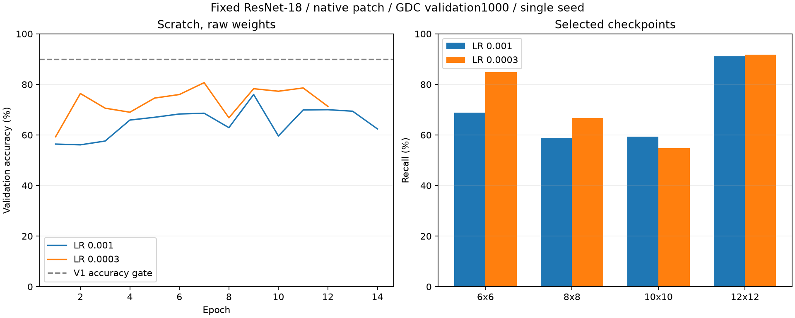
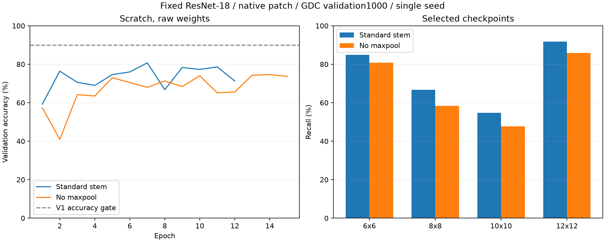
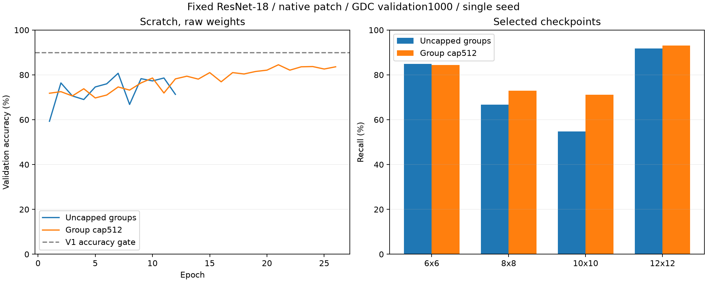

# 固定容量的学习率、采样与损失对照

最新启动[按有效像素抽样的对照](pixel-sampling.md)，沿用cap512基准，只调整图内patch概率，每图／组总权重和参数量不变。小样本两轮4次CUDA更新、权重重载及26项检查通过，完整train10000／validation1000正在运行；尚不报告正式准确率收益。`[verified: scratch-group512-pixels-suite.json；scratch-group512-pixels-smoke-summary.json；pixel-sampling-verification.json；opinion: 效果边界]`

资产组限权对照完成，验证准确率84.5%，比同LR标准采样提高3.8个百分点，10×10召回提高16.41个百分点。后续[同图patch聚合损失对照](bag-loss.md)也已完成，权重0／1为71.2%／71.7%，均低于历史独立采样80.7%；保留负结果，采样变化与新增loss的影响分别解释。`[verified: scratch-group512-result.json；scratch-bag4-comparison.json；opinion: 解释边界]`

首批回归与BN诊断结束后，启动随机初始化学习率单项对照。正式配置与原V1 scratch相比只将lr从1e-3改为3e-4，输出身份另建；数据、seed、ResNet-18、标准stem、单调输出、EMA0.999、batch128、AdamW/WD0.05、warmup1、最多30轮、RMSE patience5均保持。配置见[scratch-lr0003-suite.json](scratch-lr0003-suite.json)，启动时逐字段核对仅learning_rate变化。`[verified: 两份suite config；启动字段差异检查输出learning_rate]`

这项实验检验较低学习率是否改善随机初始化配方的泛化及阈值误差，也补齐与预训练lr3e-4相同超参数的初始化比较；不预设能达到90%。仍只使用GDC train10000／validation1000，CUDA串行，未打开test。`[opinion: 单项假设；verified: suite scope、PatchTrainer.fit]`

先在48训练图／16验证图上完成[两轮小样本检查](scratch-lr0003-smoke-summary.json)，最佳权重重载通过。该检查完整遍历小语料，每轮2步、共4次更新；建配置时可选max_steps字段赋值未生效，最终显式采用epochs=2及小语料限制，实际配置保留在[smoke suite](scratch-lr0003-smoke-suite.json)，不将该小样本指标用于效果判断。`[verified: scratch-lr0003-smoke.json history、config；smoke-summary.json；配置生成工具输出；opinion: 证据范围]`

正式训练完成12轮，按阈值附近RMSE早停，选中第7轮raw权重；[训练汇总](scratch-lr0003-summary.json)与[最佳权重重载](scratch-lr0003-audit.json)均通过。学习参数11,178,564个、FP32参数字节44,714,256不变。训练墙钟2483.18秒，包含重载审计的完整进程2516.98秒。日志和检查点保存在.local的同名目录。`[verified: scratch-lr0003-result.json selected_epoch、completed_epochs、parameters、training_wall_seconds；scratch-lr0003-summary.json；.local对应jobs/scratch-lr0003/receipt.json]`

| 固定容量随机初始化配方 | 验证Top-1 | balanced accuracy | 阈值附近RMSE | 10×10召回 |
|---|---|---|---|---|
| lr0.001，原V1 | 76.0% | 69.54% | 1.7681dB | 59.38%。`[verified: ../patch-v1/scratch-result.json metrics]` |
| lr0.0003，本轮 | 80.7% | 74.50% | 1.6040dB | 54.69%。`[verified: scratch-lr0003-result.json metrics]` |

总准确率提高4.7个百分点，但10×10召回下降4.69个百分点，不能据此判断中间类别问题已经解决。新配方6×6／8×8／12×12召回为84.86%／66.67%／91.77%。零余量质量达标率84.6%，payload92,273,392字节；0.5dB余量使质量达标率升到88.4%，同时准确率降到78.9%、payload增到98,643,440字节。V1联合条件和Unity独立90%验收仍未达到。`[verified: scratch-lr0003-result.json metrics、accuracy_change_pp、recall_change_pp、v1_development_gate_passed；opinion: 结论边界]`

[完整结果与输入哈希](scratch-lr0003-result.json)由已保存的历史和最佳权重审计生成，没有重新推理或读取test。图中是同一开发validation1000的单seed对照，原配方训练14轮，本轮12轮；两者均按原定patience5停止。`[verified: scratch-lr0003-result.json scope、inputs_sha256、curves；两个训练报告stop_reason；opinion: 单次实验边界]`

后续保留两条独立身份：末轮raw／EMA的训练集BN统计量重估，以及只将remove_maxpool设为true的输入stem对照。后一组沿用lr0.0003、batch128和所有正式设置，[小样本配置](scratch-stem2-lr0003-smoke-suite.json)先检查CUDA更新及权重重载，[正式配置](scratch-stem2-lr0003-suite.json)在该检查通过后启动；移除无参数pool不改变参数数量，计算和显存成本另测。`[verified: 两份stem suite配置；ASTCPatchRegressor.__init__；opinion: 实验顺序与假设]`

上述后处理已完成，epoch12 EMA经训练集BN重估为80.9%／1.3716dB，四种变体详见[诊断报告](../normalization.md#后续随机初始化lr00003的末轮诊断)。去maxpool的[两轮CUDA检查](scratch-stem2-lr0003-smoke-summary.json)及重载通过，峰值分配显存4,677,542,400字节，进程23.27秒。正式队列随后启动，状态见[stem训练汇总](scratch-stem2-lr0003-summary.json)；启动前逐字段确认只改变remove_maxpool，空闲RAM26.79GiB、GPU占用1234MiB／12282MiB。当时仅用小样本核验执行路径，正式结果见下一节。`[verified: normalization-scratch-lr0003.json；scratch-stem2-lr0003-smoke.json；.local对应jobs/scratch-stem2-lr0003-smoke/receipt.json、jobs/scratch-stem2-lr0003/preflight.json；opinion: 结果边界]`

## 去maxpool的正式对照

正式训练已完成15轮，按既定近阈值RMSE patience5早停。最佳准确率权重为epoch14 raw，重载核验通过；验证Top-1为74.6%、同一权重的近阈值RMSE为2.5459dB，相比标准stem配方的80.7%／1.6040dB，准确率下降6.1个百分点，四类召回均下降。参数仍为11,178,564，完整训练3345.85秒、含重载的进程3385.97秒。[结果和来源哈希](scratch-stem2-lr0003-result.json)保留逐类指标与曲线。`[verified: scratch-stem2-lr0003-result.json；scratch-stem2-lr0003-audit.json；.local对应jobs/scratch-stem2-lr0003/receipt.json]`

| 同LR0.0003、随机初始化 | 验证Top-1 | balanced accuracy | 同权重近阈值RMSE | 8×8／10×10召回 | 质量达标率 |
|---|---|---|---|---|---|
| 标准stem | 80.7% | 74.50% | 1.6040dB | 66.67%／54.69% | 84.6%。`[verified: scratch-lr0003-result.json metrics]` |
| 去maxpool | 74.6% | 68.16% | 2.5459dB | 58.33%／47.66% | 81.3%。`[verified: scratch-stem2-lr0003-result.json metrics]` |

训练过程的最低近阈值RMSE为2.3122dB，发生在epoch10，对应准确率74.0%；它与epoch14的最高准确率来自不同权重，不组合成一对模型指标。当前这次单seed实验不支持将去maxpool作为默认改进；后续保留标准stem配方，另对已冻结的末轮raw／EMA做相同train-only BN诊断，成本和结果单列。`[verified: scratch-stem2-lr0003.json history[9]；scratch-stem2-lr0003-result.json metric_pair_scope；opinion: 配方选择与范围]`

上述末轮BN诊断随后完成：去maxpool的epoch15 EMA重估后为78.6%／2.1127dB，仍低于标准stem的80.9%／1.3716dB；完整后处理进程599.74秒，0次优化器更新。四种变体均保留在[诊断报告](../normalization.md#去maxpool的末轮诊断)，不替换原训练选中权重或结果。`[verified: ../normalization-scratch-stem2-lr0003.json；对应job receipt；opinion: 历史记录边界]`

## 资产组抽样对照

[训练清单分析](group-sampling-analysis.json)重新核对10000图、1305个资产组，最大组`Assets/Art/Effects/Texture/Common/Special`含2077图，占20.77%。按每组512张等效图权重封顶，只下调两个最大组，最大组的期望抽样占比降到6.41%；6／8／10／12类别的期望占比为25.91%／17.37%／13.01%／43.71%。这项控制限制资产组集中程度，不等于类别均衡。`[verified: group-sampling-analysis.json largest_groups、scenarios[2]；opinion: 解释边界]`

该组保留标准stem、随机初始化、lr0.0003和原训练预算，仅改变组抽样权重。每张图的总权重为`min(1,512/组图数)`，再均分给该图所有patch；原图级采样对应cap=0。120276个实际训练patch的权重检查通过，cap=0逐项等于旧公式，cap512的图权重合计7982。准备阶段的采样决定只用了train清单，正式CUDA结果见下文。`[verified: group-sampling-analysis.json actual_patch_weight_check；PatchSampling.weights；opinion: 下一组配置]`

[两轮CUDA检查](scratch-group512-smoke-summary.json)已通过，完整进程34.44秒、最佳权重重载通过。小语料48张train／16张validation使用cap2，以实际触发组限权；[正式配置](scratch-group512-suite.json)使用cap512，其余设置相对标准stem的lr0.0003对照保持不变。原有图级采样默认cap0，代码与配置SHA随检查点保存；9项单元测试及独立复核通过。`[verified: scratch-group512-smoke-suite.json、scratch-group512-smoke-summary.json；scratch-group512-suite.json；对应job receipts；test_patch_sampling.py；review回执]`

正式训练完成26轮、按近阈值RMSE早停，最佳权重为epoch21 raw，重新加载的预测与已保存结果一致。训练墙钟7187.98秒，包含审计的任务进程7230.64秒；参数仍为11,178,564个、FP32参数44,714,256字节。相对标准采样，唯一主动配置变化为group_image_cap 0→512；标准采样在12轮停止，两者实际训练成本不同。`[verified: scratch-group512-result.json；scratch-group512-audit.json；jobs/scratch-group512/receipt.json；opinion: 单项配方和耗时解释]`

| 同LR0.0003、随机初始化、标准stem | 验证Top-1 | balanced accuracy | 同权重近阈值RMSE | 8×8／10×10召回 | 质量达标率 |
|---|---|---|---|---|---|
| 标准图级等权 | 80.7% | 74.50% | 1.6040dB | 66.67%／54.69% | 84.6%。`[verified: scratch-lr0003-result.json metrics]` |
| 资产组cap512 | 84.5% | 80.37% | 1.3869dB | 72.92%／71.09% | 84.8%。`[verified: scratch-group512-result.json metrics]` |

这次单seed结果支持继续研究资产组配比，但仍未达到验证90%与近阈值RMSE≤0.75dB的联合门槛。无余量时payload为87,607,504字节，质量达标率84.8%；加0.5dB余量后达标率88.3%，准确率81.9%、payload93,661,840字节。不能将更小payload单独解释成等质量收益。`[verified: scratch-group512-result.json metrics.margins、v1_development_gate_passed；opinion: 解释范围]`

[结果与输入哈希](scratch-group512-result.json)来自冻结训练记录和最佳权重审计，未重新推理或访问test。聚合损失的首轮成对配置沿用cap0，以保留已准备的采样控制；后续若组合cap512，应以新身份单独实测。`[verified: scratch-group512-result.json scope；scratch-bag4-suite.json；opinion: 后续实验范围]`
