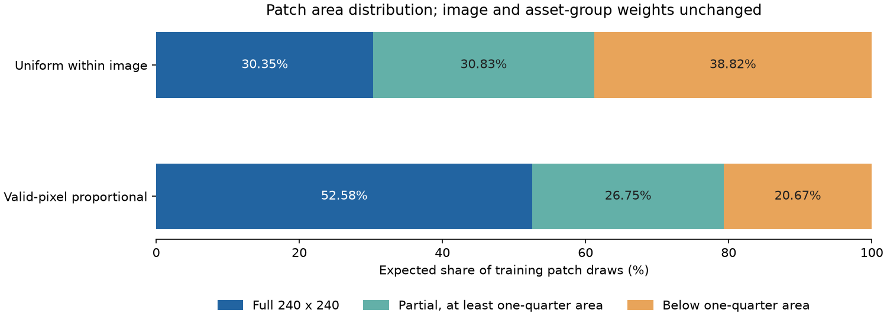

# 按有效像素抽取原尺寸 patch

随机初始化ResNet-18的下一项固定容量对照，只把图内patch抽样从等概率改为按有效像素数分配概率。资产组cap512、每图总权重、训练预算、网络、loss和选模规则保持不变；两轮CUDA小样本及最佳权重重载通过，正式train10000／validation1000已启动，效果尚待训练完成后判断。`[verified: scratch-group512-pixels-suite.json baseline；scratch-group512-pixels-smoke-summary.json；scratch-group512-pixels-smoke-audit.json；scratch-group512-pixels-summary.json；opinion: 效果边界]`

## 先核对单调约束

训练数据的120,276个patch中，3,467个存在相邻块大小误差反向变化，占2.88%，涉及1,652张图。按等权log-MSE最小二乘投影到单调序列，再按实际像素数汇总，10,000张训练图的原标签全部不变，整图近阈值PSNR变化的RMSE为0.05934dB。此诊断没有训练模型，也不是模型准确率上限；当前证据不足以将单调约束认定为主要误差来源，因此下一项先检查采样。`[verified: patch-monotonicity.json；opinion: 实验排序]`

投影枚举四个数的全部8种连续分组，取满足非递减约束且平方差最小的分组均值。独立检查用pool-adjacent-violators算法核对1,003组数值，最大差2.22e-16；训练目标文件逐一核对SHA和整图SSE，未读取validation或test像素／目标。脚本与SHA随[单调性诊断](patch-monotonicity.json)保存。`[verified: diagnose_patch_monotonicity.py project、run；baseline_code_review独立probe；patch-monotonicity.json scope、validation_opened、test_opened]`

## 采样差异与实际分布

现有240patch在右侧或底部不足240时复制边缘像素补足，误差与最终整图聚合只统计有效区域。图内等概率抽patch时，16×16与240×240的patch具有相同抽样机会；按有效像素抽样将两者比例改为1:225，同时保持这张图原有的总权重。这个变化检验训练采样与最终按像素汇总的差异，不预设泛化收益。`[verified: NativePatchDataset.__getitem__、aggregate；PatchSampling.weights；opinion: 实验假设]`

| train10000、资产组cap512 | 图内等概率 | 按有效像素 |
|---|---:|---:|
| 不满240²的patch期望抽样占比 | 69.65% | 47.42%。`[verified: patch-pixel-sampling-analysis.json scenarios.*.expected_partial_patch_share]` |
| 有效面积不足四分之一的期望占比 | 38.82% | 20.67%。`[verified: patch-pixel-sampling-analysis.json scenarios.*.expected_below_quarter_patch_share]` |
| 固定40000次抽样的平均有效面积比例 | 43.30% | 63.44%。`[verified: patch-pixel-sampling-analysis.json scenarios.*.drawn_mean_valid_fraction]` |
| 固定seed抽到的不同图像数 | 9298 | 9298。`[verified: patch-pixel-sampling-analysis.json scenarios.*.drawn_distinct_images]` |
| 固定seed抽到的不同patch数 | 23162 | 20564。`[verified: patch-pixel-sampling-analysis.json scenarios.*.drawn_distinct_patches]` |

全部patch中43,409个不是完整面积、18,806个不足四分之一。两种方案的每图总权重最大差4.66e-15，总等效图权重都为7,982；保留资产组限权和图级权重，只改变图内分配。不同patch覆盖数随抽样变化，不能据平均有效面积增加就称为信息量或准确率提高。`[verified: patch-pixel-sampling-analysis.json；opinion: 归因边界]`

## 配置、检查与成本

正式配置见[scratch-group512-pixels-suite.json](scratch-group512-pixels-suite.json)，逐字段核对语义变化只有`pixel_weighted_sampling=false→true`；基准仍为[scratch-group512](scratch-group512-result.json)的84.5%／同权重近阈值RMSE1.3869dB。两者都使用scratch、标准stem、单调输出、lr0.0003、WD0.05、EMA0.999、batch128、每轮40000次patch抽样、最多30轮和近阈值RMSE patience5，参数11,178,564不变。`[verified: 两份suite；scratch-group512-result.json；launch-preflight.json semantic_change]`

小样本使用原48训练图／16验证图，cap2以触发组限权，两轮4次实际更新，最佳权重重载通过；完整进程21.54秒，峰值分配显存2,118,426,112字节。正式启动前空闲RAM28.87GiB，GPU占用1195／12282MiB；与Unity采集及候选补测并行，只作开发耗时，不用于部署加速比。原cap512进程7230.64秒仅用作预算参照，新训练实际停止轮数及成本单列。`[verified: scratch-group512-pixels-smoke.json；对应job receipt、launch-preflight.json；启动前GPU输出；opinion: 成本口径]`

26项测试及独立代码审查通过：默认模式保持旧抽样序列，像素比例模式保持每图／组总权重、正确处理边缘面积，并拒绝不合法像素数和未支持的bag组合。已有成组loss实验的8份绑定源码在修改前归档，不改历史检查点和指标。正式运行期间冻结绑定源码，逐epoch结果见[训练报告](scratch-group512-pixels.json)，任务状态见[汇总](scratch-group512-pixels-summary.json)。`[verified: test_patch_sampling.py；test_patch_training_bags.py；pre-pixel-sampling-source/sources.json；pixel-sampling-verification.json；opinion: 运行约束]`

入口继续使用`script/patch_regression.py suite --config ...`；单次train入口新增`--pixel-weighted-sampling`。只有正式验证结果与权重重载完成后才评价收益，最终Unity独立测试90%验收保持不变。`[verified: script/patch_regression.py；V1“目标与开发数据”；opinion: 完成要求]`
