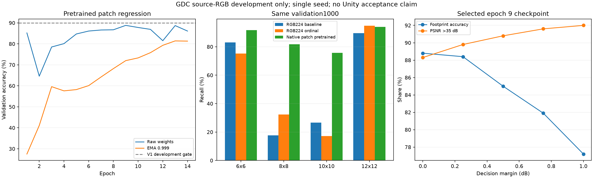
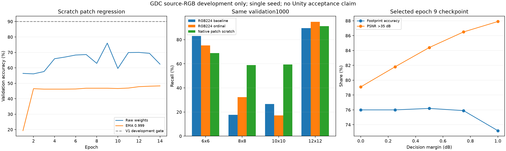

# V1：原分辨率patch回归

正式CUDA队列已完成随机初始化和预训练两组，各14轮，两组最佳权重重载核验均通过。结果见[汇总](summary.json)，当前状态见[总进展](../progress.json)。两组均未达到V1开发晋级要求，进入固定容量下的误差诊断。`[verified: summary.json；scratch-monotone-ema-audit.json；pretrained-monotone-ema-audit.json；opinion: 后续安排]`

| 配方 | 验证Top-1 | Balanced accuracy | 阈值附近RMSE | 最佳epoch／变体 |
|---|---|---|---|---|
| 随机初始化lr1e-3 | 76.0% | 69.54% | 1.7681dB | 9／raw。`[verified: scratch-result.json]` |
| 预训练lr3e-4 | 88.8% | 85.81% | 0.9736dB | 9／raw。`[verified: pretrained-result.json]` |

预训练组耗时2966.68秒，参数量仍为11,178,564。四类召回依次为91.74%、81.77%、75.78%、93.94%；长边≤256的小图准确率85.40%，另外两个尺寸组为90.75%／91.56%。相同验证集上比原RGB224分类高22.5个百分点、比最佳分类修正配方高20.2个百分点；多个方法组件共同改变，不能把增益全部归因于原分辨率或初始化。`[verified: pretrained-result.json metrics、wall_seconds、parameters、accuracy_gain_vs_original_pp、accuracy_gain_vs_best_control_pp；opinion: 归因边界]`

预训练最佳权重的零余量准确率88.8%、质量达标88.3%、payload89,546,480字节；余量0.5dB时分别85.0%、90.8%、94,416,752字节。质量达标率超过90%不等于标签准确率超过90%。EMA本组最高81.4%，后续用冻结权重的训练集BatchNorm重估诊断统计量影响。`[verified: pretrained-result.json metrics.margins、best_ema_accuracy；opinion: 诊断安排]`

后续[统计量诊断](../normalization.md)完成两组末轮对照：同一EMA权重只重估BN统计量，随机初始化为76.7%／1.6467dB，预训练为89.2%／0.9512dB，分别比训练中原选出的最佳raw高0.7／0.4个百分点。该诊断没有更新学习参数，作为独立后处理实验保留，质量和成本另列；两组仍未达V1联合判据。`[verified: normalization-scratch.json rows；normalization-pretrained.json rows；scratch-result.json；pretrained-result.json；opinion: 记录边界]`

[冻结预测的错误分层](error-strata.json)未执行新forward或读取test。预训练最佳模型112个错误中，67个来自距离候选门槛不足0.5dB的203张图；这组准确率67.00%，而距门槛至少1dB的604张图准确率96.36%。6×6候选在阈值±3dB内的预测平均偏高0.563dB、RMSE1.539dB；8／10／12候选对应RMSE为1.037／0.770／0.828dB。下一步需要针对近阈值误差，不能把全部剩余问题归为分类配比。`[verified: error-strata.json trials[1]；opinion: 改进方向]`

按整图有效像素／输入patch面积分层，预训练模型在有效面积<5%、5%–25%、25%–75%、≥75%的准确率分别85.19%、92.21%、88.48%、91.11%，各组样本27／77／851／45张，类别构成不同。该结果不支持直接断言边缘填充就是主要原因，后续输入对照仍需独立实验。`[verified: error-strata.json trials[1].padding_strata；opinion: 证据边界]`

随机初始化最终选中第9轮raw权重：验证1000图Top-1为76.0%，balanced accuracy为69.54%，阈值附近PSNR RMSE为1.7681dB。第14轮触发RMSE patience5早停，总训练流程2787.39秒。相同验证集上，比原RGB224分类66.3%高9.7个百分点，比最佳分类对照68.6%高7.4个百分点；这是输入、目标及训练配方一起改变后的结果。未达到V1的90%／0.75dB晋级判据，不能作为Unity独立验收。`[verified: scratch-result.json；scratch-monotone-ema-audit.json；opinion: 归因边界]`

逐类召回为6×6 68.81%、8×8 58.85%、10×10 59.38%、12×12 91.13%。中间类提高，但6×6低于原分类对照的83.03%。长边≤256、257–1023、≥1024三个组的准确率分别为73.72%、76.16%、78.90%；小图和各类错误仍需要拆分分析。`[verified: scratch-result.json metrics；classification-controls/comparison.json baseline-ce；opinion: 后续诊断]`

同一权重的决策余量0.5dB使准确率达到76.2%、实际质量达标率84.4%，payload为88,031,072字节；零余量分别为76.0%、79.1%、82,596,432字节。这些质量和字节数取自已测四候选，不是新的部署编码计时。EMA0.999的最高准确率仅48.3%，本组没有获得EMA收益，原因尚待单独检验。`[verified: scratch-result.json metrics.margins、best_ema_accuracy；PatchRegressionMetrics.compute；opinion: EMA结论边界]`

结果汇总见[scratch-result.json](scratch-result.json)，[权重核验](scratch-monotone-ema-audit.json)记录checkpoint和保存预测SHA。模型参数11,178,564，纯FP32参数44,714,256字节；含优化器的训练检查点文件大小另计。`[verified: scratch-result.json parameters、fp32_parameter_bytes；scratch-monotone-ema-audit.json]`

输入为240×240原分辨率patch，起点对齐120；边缘复制值仅用于模型输入，误差目标与整图聚合只按真实像素计量。训练10000图、验证1000图，共133140个可用patch；每轮按图等权期望抽4个patch，即40000训练样本，验证覆盖全部12864个patch。`[verified: ../patch-data-full.json；suite.json；NativePatchDataset.aggregate；PatchTrainer.fit]`

两组保留11,178,564参数的ResNet-18，标准stem、单调误差输出、AdamW、WD0.05、batch128、warmup1、EMA0.999，最多30轮，阈值附近RMSE patience5早停。scratch lr1e-3，pretrained lr3e-4，其他设置相同；这是两套V1训练配方对照。完整参数见[suite.json](suite.json)。`[verified: suite.json；../patch-v1-smoke.json config；opinion: 比较边界]`

损失为log10(MSE+1e-10)上的Huber，delta0.1对应1dB转折点，并增加阈值附近权重。输出单调结构约束MSE随块大小不减，整图先在MSE域按有效像素聚合，最后转换PSNR并应用35dB规则。报告保留原始与EMA结果、0–1dB余量、各类别／尺寸／资产组指标、真实候选payload和质量达标率。`[verified: PatchTrainer.fit；ASTCPatchRegressor.forward；PatchRegressionMetrics.compute]`

准确率最优与RMSE最优权重分别保存，两者可能不同。每组完成后重新加载准确率最优权重，在同一验证集重算所有预测，核对PSNR差异≤1e-5dB、标签顺序、准确率与SHA。选择的EMA／raw身份保存在checkpoint中。`[verified: PatchTrainer.audit_best；PatchExperimentSuite.run]`

## 已通过的启动检查

- [CUDA执行探针](../patch-v1-smoke.json)：48训练图／16验证图，两轮共6次更新，AMP跳步0，EMA更新6；batch128峰值显存2,118,429,184字节。小样本准确率仅验证执行，不能用于正式效果结论。`[verified: patch-v1-smoke.json history、peak_vram_bytes；opinion: 结论边界]`
- [权重重载核验](../patch-v1-smoke-audit.json)：选中epoch2的EMA权重，保存预测与重新计算结果一致。`[verified: patch-v1-smoke-audit.json status、selected_variant、selected_epoch]`
- [资源检查](preflight.json)：启动前GPU6%、显存1078／12282MiB、空闲RAM约39.7GB；单GPU任务，两名数据加载worker。正式耗时以实测轮次更新。`[verified: preflight.json]`

训练入口为`uv run --frozen python script/patch_regression.py suite --config <新的suite配置>`，复跑必须使用新的输出目录与summary，已有失败和完成工件保留。公开配置含本机绝对路径，换机时需根据冻结数据位置显式调整并生成新的实验身份。原始日志、权重和预测位于`experiment report/.local/unity-accuracy90-20261111/patch-v1/`及其jobs目录。`[verified: suite.json；PatchExperimentSuite.run；PatchTrainer.fit]`

本轮仅用GDC源RGB开发集；Unity的preset、MS-SSIM、法线和大图规则尚需单独迁移。test2000不参与选模，正式Unity独立90%验收未完成。`[verified: suite.json scope；V1“限制与待核实”]`
