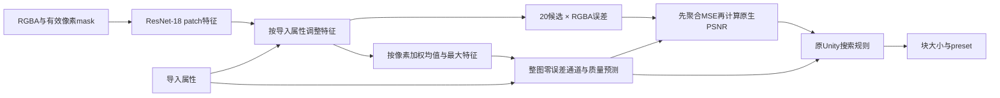

# Unity 原生质量模型与决策接口

后续已在[3906图统一语料](unity-prediction-interface3906.json)上完成接口复核：3904训练图／2验证图的块大小和preset全部重建同次原搜索选择，17个原策略来源通过核对，MSE聚合最大差2.08e-17。检查循环62.50秒、完整进程67.29秒；这些输入是精确测量目标，训练更新为0，不能作为模型准确率。`[verified: unity-prediction-interface3906.json results、policy_origins、wall_seconds、training_updates；jobs/unity-prediction-interface3906/receipt.json；opinion: 验收边界]`

已实现随机初始化ResNet-18的原生模型原型、分项监督损失和预测到原搜索规则的接口。先期18项CPU检查通过，随后新增训练器并完成[8图CUDA训练检查](unity-native-training.md)，含最佳权重重载；相关检查现共35项。2370图精确目标全部重建原块大小和preset，仍只作为接口验证，不是学得的准确率；完整生产训练尚未完成。`[verified: unity-native-model-contract.json；unity-native-smoke8-v1-result.json；unity-native-training-verification.json；unity-prediction-interface2370.json results；opinion: 完成边界]`

## 输入、输出与计算顺序

模型只读取原尺寸RGBA patch、有效像素mask及8项导入属性：尺寸、sRGB、法线用途、Alpha需求／是否恒定、法线评价mip数和纯黑像素比例。导入属性同时调整patch特征，并进入整图预测头；测得的质量、原选择和目标只供损失／评价，不进入模型输入。`[verified: models/unity_quality.py encode、forward、predict_images；data/unity_patch_dataset.py METADATA_NAMES；test_prediction_inputs_do_not_consume_measured_labels_or_quality、test_import_metadata_can_condition_patch_error_predictions]`

通道头输出每个patch的20×4个log-MSE；整图头预测20×4个零误差通道logit，以及20候选的MS-SSIM、平均法线角度和p95角度。后两类指标由整图聚合特征学习，不平均patch质量分数。零通道概率的决策门槛留待独立validation选择；当前接口接收显式预测mask。`[verified: models/unity_quality.py channel_head、image_head；evaluation/unity_quality.py psnr、candidates；opinion: 零通道校准与学习假设]`

骨干保持正式GDC对照的ResNet-18层数、宽度和标准stem／maxpool，改为5通道输入并增加导入属性调节及原生输出头。实际参数为**11,377,660**，FP32参数**45,510,640字节**；GDC四输出模型为11,178,564参数，两者不再是完全相同参数量／任务。这里没有升级到ResNet-34／50，后续仍须评价这些原生适配的效果与成本。`[verified: unity-native-model-contract.json parameters、fp32_parameter_bytes；scratch-bag4-suite.json remove_maxpool=false；opinion: 比较和后续范围]`

## 监督与验收

损失分别记录patch通道Huber、整图零误差通道BCE、sRGB非normal图的MS-SSIM Huber和normal图的角度Huber。无关质量目标保留缺失值并通过显式mask排除；Alpha不需要或为恒定值时不参与对应通道损失。整图质量和零通道目标来自完整编码结果。当前默认附加权重均0.1，是待CUDA实验验证的起点。`[verified: training/unity_quality_loss.py UnityImageTargets、UnityQualityLossConfig、UnityQualityLoss.forward；opinion: 权重选择]`

预测先按有效像素数聚合MSE，再按预测零通道及输入Alpha条件计算Unity PSNR。候选顺序、黑像素门槛、MS-SSIM／角度门槛、大图规则和回退继续交给原`UnitySearchPolicy`。评价单列块大小／完整配置命中、真实选中候选质量、真实payload和无严格可行候选；预测声称达标不代替真实候选指标。`[verified: evaluation/unity_quality.py aggregate_mse、psnr、score；reproductions/unity_search_baseline/policy.py select]`

新接口通过原始分批corpus及candidate manifest定位同次capture，复用原策略来源核验，再加载各批tableConfig。2368训练图／2验证图共11个原采集策略来源核对通过；没有用一份相似门槛配置替换所有采集记录。完整验收仍需要全量Unity训练及独立测试。`[verified: prediction_audit.py policy_for；unity-prediction-interface2370.json policy_origins；opinion: 验收范围]`

## 实测检查与发现

| 检查 | 实际结果 |
|---|---|
| 首次66图检查 | 失败，进程7.11秒。某些Alpha patch的MSE恰好为1，旧的log上界0会在逆变换时少算epsilon；没有放宽容差，改为log10(1+epsilon)，增加精确0／1边界测试。失败日志及源码归档保留。`[verified: unity-prediction-interface66-failure.json；evaluation/unity_quality.py aggregate_mse；test_aggregate_preserves_exact_zero_and_maximum_byte_error]` |
| 修复后66图检查 | 独立v2身份通过，64／2图全部块大小和preset与原搜索一致，检查循环2.02秒。`[verified: unity-prediction-interface66-v2.json results、wall_seconds]` |
| 扩大2370图检查 | 2368／2图、15619patch、47400候选，全部原配置重建一致，循环21.62秒；通道MSE聚合最大差2.08e-17。使用精确目标、0次训练更新、没有模型准确率。`[verified: unity-prediction-interface2370.json results、wall_seconds、model_accuracy、training_updates]` |
| 零通道诊断 | 对训练图的真实MSE设最低正值1e-9并去掉零通道识别，其余质量保持实测：5张块大小改变，26张完整配置改变，严格达标图从2045降至2025，近阈值PSNR RMSE约0.599dB。这只说明数值／通道口径会影响决策，不代表模型的实际误差分布。`[verified: unity-prediction-interface2370.json results.train；opinion: 诊断边界]` |

可复跑入口为[audit_unity_predictions.py](../../script/audit_unity_predictions.py)，配置见[2370图检查配置](unity-prediction-interface2370-config.json)，原始逐图结果按SHA保存在.local。复跑使用新的output和report，已有产物拒绝覆盖。`[verified: prediction_audit.py run；unity-prediction-interface2370-config.json]`

## 部分训练目标的分布

[目标诊断](unity-native3906-target-diagnostics.json)仅覆盖冻结顺序中先完成的3904张训练图，不代表完整训练集分布，也没有打开测试集。四类数量为6×6 429、8×8 512、10×10 549、12×12 2414；选中preset为fastest 1159、fast 138、medium 956、thorough 929、exhaustive 722。`[verified: unity-native3906-target-diagnostics.json counts、labels、presets、limits]`

这批数据包含262张法线图，其中21张采用四级法线评价；319张按大图放宽规则选中，83张按最高PSNR回退。原策略选中结果的严格质量通过率为89.70%，与块大小标签重建率是不同指标；不能把原标签全部当成严格合格样本。`[verified: unity-native3906-target-diagnostics.json input_conditions、selection_reasons；unity-prediction-interface3906.json results.train.exact_targets.actual_quality_pass_rate；opinion: 指标解释]`

同一preset下，改用更小块时PSNR仍有下降的训练图数为30至49张；同一块大小下，改用更慢preset时仍有下降的图数为86至179张，下降判据为超过1e-5dB。因此原生20候选继续保留独立质量输出，不能直接把GDC四候选的单调结构推广为20候选硬约束。`[verified: unity-native3906-target-diagnostics.json nonmonotone_psnr_image_counts；opinion: 模型约束判断]`

对真实MSE加1e-9正值下限并去掉零通道识别，其余质量保持实测，3904训练图中6张块大小、36张完整配置改变，严格质量通过率降至88.93%。这项数值诊断支持保留原生零通道口径，不能用于估算模型实际预测误差。`[verified: unity-prediction-interface3906.json results.train.positive_floor_without_zero_mask；opinion: 诊断边界]`

## 下一步

CUDA小样本闭环已通过，后续在完整Unity开发划分上训练并比较。GDC成组采样／聚合损失对照已结束，仍保留独立协议和负结果。整图质量头的泛化精度、抽样覆盖、零通道校准、推理开销及独立测试90%均尚待实测。`[verified: unity-native-smoke8-v1-result.json；scratch-bag4-comparison.json；opinion: 后续实验范围]`
