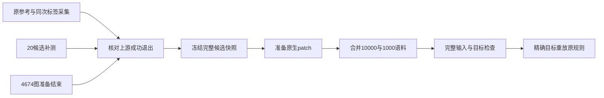

# Unity 全量原生数据衔接

新增[全量数据入口](../../script/finish_unity_native_data.py)，在原参考采集、20候选补测和当前4674图目标准备都成功退出后，依次准备完整patch、合并语料、完整读取Dataset并验证精确目标能重建原选择。完整模式要求10000训练图／1000验证图；该入口不训练模型，不打开测试图，也不将数据检查通过当成90%生产验收。`[verified: native_data_pipeline.py __init__、run、execute_stage；opinion: 验收边界]`

流程图对应入口的实际阶段顺序。既有单批目标通过原准备器的哈希与来源检查复用；原始搜索、提前停止、标签及计时保持独立。`[verified: native_data_pipeline.py run；patch_batches.py prepare_shard、prepare]`

## 等待与失败处理

- 上游身份绑定job配置哈希和完整命令；运行时核对PID、创建时刻与命令参数。刚启动尚无子进程编号，或刚退出尚未发布终态时，只在observer仍有效且记录新鲜的120秒窗口内等待；不会自行重启上游。`[verified: native_data_pipeline.py dependency_status、await_observer]`
- 等待期间及每个执行阶段前后核对14个源码文件与配置哈希。失败的上游、变化的来源或不完整的全量发布会停止流水线并保存失败状态；重试使用新的输出和报告身份。`[verified: native_data_pipeline.py SOURCE_FILES、verify_bindings、snapshot、run]`
- 主报告采用原子占用，拒绝与阶段报告目录混用。每个阶段保存配置、报告哈希与实际墙钟时间；最终再次核对语料和阶段报告。`[verified: native_data_pipeline.py __init__、execute_stage、run；test_concurrent_public_identity_claim_preserves_other_report]`
- 全量入口启动执行前要求22GiB空闲RAM／40GiB磁盘；既有patch准备器继续逐批要求20GiB空闲RAM并持有共享shard独占锁。GPU训练不会由这个入口启动。`[verified: unity-native-pipeline-full-v1-config.json；patch_batches.py run、prepare；native_data_pipeline.py run]`

## 实测与状态

| 项目 | 结果 |
|---|---|
| 边界与状态检查 | 25项通过，覆盖不完整覆盖、输入变化、进程身份、启动／退出竞态、失败状态与并发报告冲突；静态检查通过。`[verified: tests/test_unity_native_data_pipeline.py；本轮pytest、Ruff、BasedPyright输出]` |
| 首次真实66图闭环 | 64训练图／2验证图，四阶段通过，完整进程71.14秒。其14个源码文件已归档，随后仅补充observer终态发布竞态的保护。`[verified: unity-native-pipeline-smoke66-v1.json stages；jobs/unity-native-pipeline-smoke66-v1/receipt.json；native-pipeline-smoke66-v1/source/sources.json]` |
| 第二次66图复跑 | 四阶段通过，完整进程24.85秒，阶段调用合计24.14秒；新输出和报告身份复用首次通过的shard。首次准备与复用复核的成本分别保留。`[verified: unity-native-pipeline-smoke66-v2.json status、stages、execution_seconds；jobs/unity-native-pipeline-smoke66-v2/receipt.json；opinion: 成本口径]` |
| 最终源码66图复跑 | 补齐子进程正常退出时的终态重读后，四阶段再次通过，进程22.70秒、阶段合计22.02秒，仍复用首次shard。`[verified: unity-native-pipeline-smoke66-v3.json；jobs/unity-native-pipeline-smoke66-v3/receipt.json]` |
| 完整11000图 | [当前完整配置](unity-native-pipeline-full-v2-config.json)绑定三个上游job，任务已启动等待，状态见[完整流水线](unity-native-pipeline-full-v2.json)。只有全量四阶段实际通过才记为数据完成。`[verified: unity-native-pipeline-full-v2-config.json dependencies、expected_counts；unity-native-pipeline-full-v2.json status；opinion: 验收边界]` |

首个全量等待身份在尚未执行任何数据阶段时主动停止，以修复正常退出瞬间的误判；进程226.26秒全部属于等待与观察。其wrapper保留非零退出码，原waiting快照不冒充终态，停止记录和14个源码归档由当前配置的prior_attempt绑定。新身份继续等待同一批上游，原采集、补测、4674准备和CUDA训练均未重启。`[verified: unity-native-pipeline-full-v2-config.json prior_attempt；jobs/unity-native-pipeline-full-v1/receipt.json、interruption.json；opinion: 历史状态解释]`

小样本配置见[首次配置](unity-native-pipeline-smoke66-v1-config.json)、[第二次复跑配置](unity-native-pipeline-smoke66-v2-config.json)和[最终源码配置](unity-native-pipeline-smoke66-v3-config.json)。可复跑命令为`uv run --frozen python -u script/finish_unity_native_data.py --config <新配置>`；必须使用新的output、reports和report路径。`--check-once`只取消等待轮询：未就绪时返回waiting，已就绪时仍执行四阶段；使用独立检查身份，返回waiting不表示数据完成。`[verified: finish_unity_native_data.py main；native_data_pipeline.py run]`

长时间等待的成本与真正的数据处理成本分开：顶层wall_seconds包含等待，waiting_seconds记录执行前等待，各阶段stage_wall_seconds与execution_seconds记录实际阶段调用。与Unity采集和GDC CUDA训练同时发生的计时属于本机数据准备成本，不能作为部署加速比。`[verified: native_data_pipeline.py run、execute_stage；opinion: 成本解释]`
