# GDC2023 ASTC贴图压缩参数选择 阅读笔记

## 核心结论与阅读入口

正文把整张贴图的ASTC块大小选择转成图像分类，先通过压缩试验生成标签，再训练ResNet预测块大小。`[verified: 10:00 Model Structure；11:28 Calculate Label；12:28 Network Structure]`

官网简介提到了强化学习。当前已读的完整中英文字幕和方法幻灯片提供了监督分类流程，RL训练环节仍缺少可核对细节。方法归类以正文证据记录为“有标签的块大小分类”。`[verified: 官方Overview；中英文字幕001–328；10:00、11:28、12:28画面；opinion: 方法归类]` [演讲页面](https://www.gdcvault.com/play/1029226/Machine-Learning-Summit-Parameter-Selection)

- [完整中文校订稿](../materials/gdc2023-astc-parameter-selection/transcripts/完整中文校订稿.md)，328条字幕按40段整理，保留歧义与条目映射。`[verified: 全文稿各段与覆盖元数据]`
- [完整中英文原字幕对照](../materials/gdc2023-astc-parameter-selection/transcripts/完整字幕对照.md)，逐条查看原始内容。`[verified: 对照稿001–328]`
- [本地视频](../materials/gdc2023-astc-parameter-selection/source/talk.mp4)，约18分18秒，1080p。`[verified: ffprobe]`
- [中文SRT](../materials/gdc2023-astc-parameter-selection/source/subtitles.zh.srt)与[英文SRT](../materials/gdc2023-astc-parameter-selection/source/subtitles.en.srt)。`[verified: 网站字幕下载及本地文件]`

本笔记主版本位于 `E:\ASTC_Compression\notes`，Obsidian保留同步阅读副本。全文来源为网站字幕加画面校订，音轨独立ASR状态为未运行。`[verified: 本轮资料处理与同步记录]`

## 来源、讲者与论文关系

00:25标题页署名Wunong Li和Xing Liu，00:02–00:20开场中，刘星说明同事无法到场，因此由他代讲。这解释了页面Speaker字段和简介正文出现不同姓名。`[verified: detail_00m25s.png；原英文字幕1–4]`

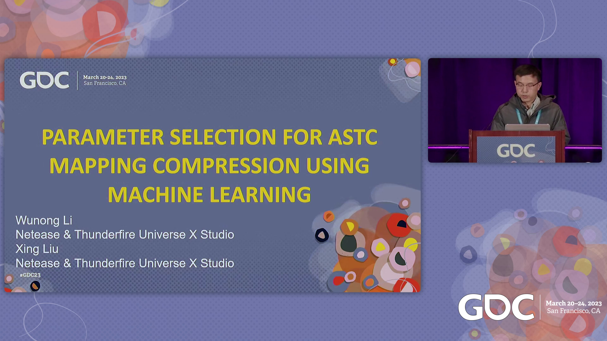

17:57参考页列出了ASTC格式论文、ResNet论文和Arm文档。当前资料尚未确认该选参方案单独发表的论文或开源代码，后续可沿两位署名及网易雷火材料继续核对。`[verified: detail_17m57s.png；opinion: 后续检索方向]`

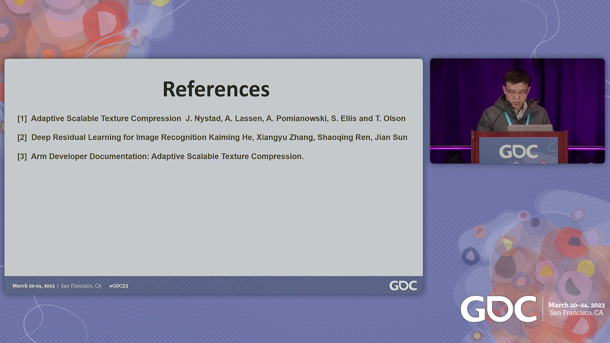

- *Adaptive Scalable Texture Compression*，J. Nystad、A. Lassen、A. Pomianowski、S. Ellis、T. Olson，HPG 2012。`[verified: 17:57参考页；论文首页]` [论文PDF](https://www.cs.cmu.edu/afs/cs/academic/class/15869-f11/www/readings/nystad12_astc.pdf)
- *Deep Residual Learning for Image Recognition*，Kaiming He、Xiangyu Zhang、Shaoqing Ren、Jian Sun。`[verified: 17:57参考页；arXiv 1512.03385]` [论文页面](https://arxiv.org/abs/1512.03385)
- Arm ASTC Developer Documentation。`[verified: 17:57参考页]` [Arm编码器仓库及文档入口](https://github.com/ARM-software/astc-encoder)

## 要解决的生产问题

演讲比较了统一默认值和人工逐图覆盖两种工作方式。默认6×6可能为简单贴图分配过多字节，人工尝试全部块大小又受贴图数量、编码耗时及开发期频繁更新影响。`[verified: 07:09–08:49字幕；08:00默认方案、08:35手工覆盖画面]`

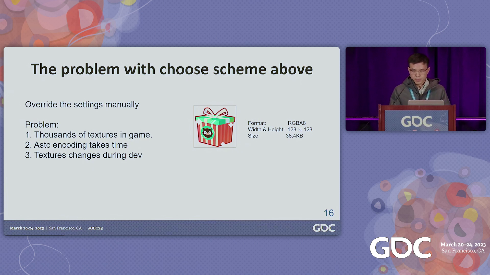

同一种块大小对不同贴图的质量影响不同。礼盒例子含较多边缘和细节，大块产生明显失真；另一个低细节例子则能使用更大的块。演讲据此提出根据贴图内容选择块大小。`[verified: 05:19–06:46字幕；05:35与06:00画面]`

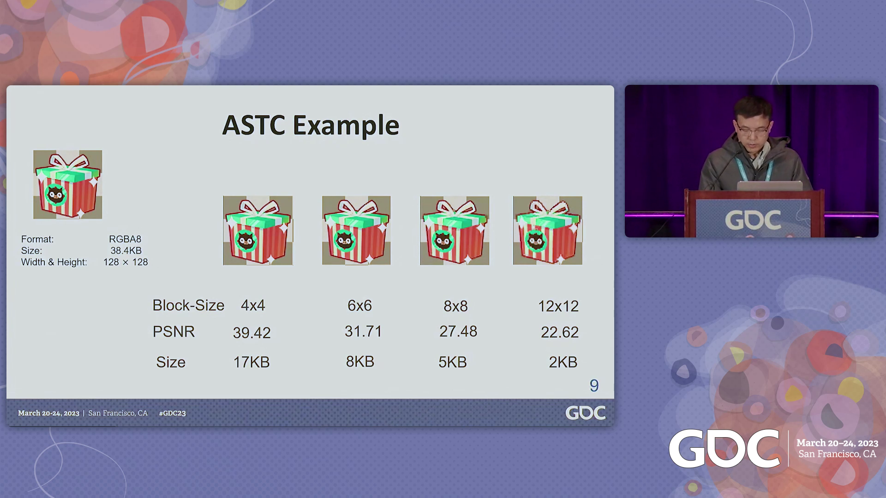

## 机制拆解

### 块大小、码率与实际字节

ASTC每块为128 bit。05:00表格给出4×4为8 bpp、6×6约3.56 bpp、8×8为2 bpp、12×12约0.89 bpp。`[verified: 04:41–05:09字幕；frame_05m00s.png]`

对单张尺寸为\(W\times H\)的二维贴图和\(b_w\times b_h\)块，单层块负载可按下式计算。多级mip需逐级相加，文件容器和运行时对齐另计。`[opinion: 根据固定128 bit块重述的计量方法]`

\[
S_{\mathrm{blocks}}=16\left\lceil\frac{W}{b_w}\right\rceil\left\lceil\frac{H}{b_h}\right\rceil\quad\mathrm{bytes}.
\]

演讲举例页同时标了RGBA8、128×128和38.4 KB，原始图像的文件体积定义需核实。后续研究应从实际编码结果读取字节，并保存尺寸、mip及容器口径。`[verified: 05:35画面左侧字段；opinion: 计量规则]`

### 质量指标与标签目标

03:25幻灯片写明PSNR越高质量越好，并给出MSE和PSNR公式。英文字幕第68条把方向识别反了，中文原字幕沿用了这一错误。`[verified: detail_03m25s.png；原中英文字幕68]`

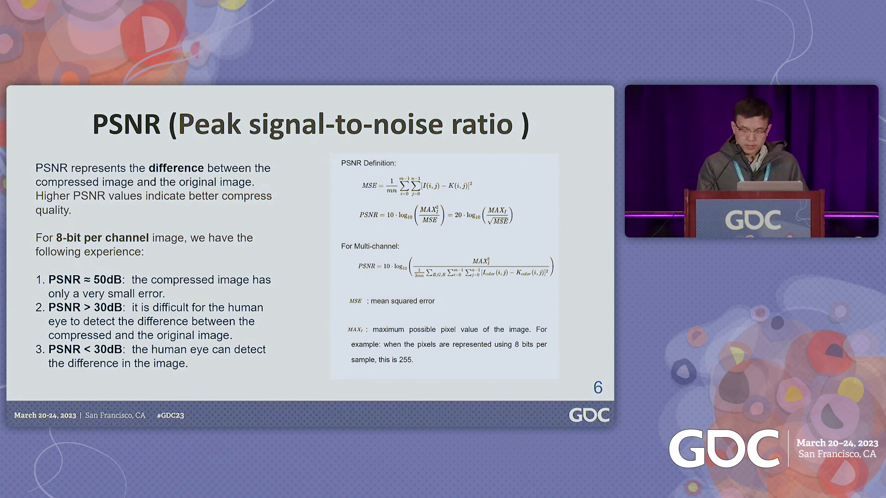

11:00目标页举例为在PSNR > 35.0的条件下，尽量选择更大的块。这个35 dB目标属于演讲的实验设计。PSNR与人眼感知的关系、色彩空间、通道和Alpha参与方式，需要在后续实验协议中具体定义。`[verified: frame_11m00s.png；opinion: 需要冻结的实验口径]`

用便于实现的约束形式重述标签规则，可令\(B\)为候选块大小集合，\(Q(x,b)\)为贴图\(x\)采用块\(b\)后的质量，选择满足质量目标的最低字节方案。这个表达是笔记对幻灯片的形式化整理。`[opinion]`

\[
b^*(x)=\arg\min_{b\in B}S(x,b)\quad\text{subject to}\quad Q(x,b)>35\ \mathrm{dB}.
\]

无候选满足目标时的处理、相同字节候选的取舍，以及质量目标是否在实际标签生成中采用严格约束，演讲现有材料仍需补充。`[opinion: 复现前需要补齐的定义]`

### 标签生成

11:28标签页展示原图经过ASTC压缩和解压，与原图计算PSNR，枚举候选后按目标选出标签。图上列出6×6、8×5、8×6、……、12×12。10:00输出示意另出现4×4与5×4，实际训练候选集合没有完整展开。`[verified: detail_11m28s.png；frame_10m00s.png]`

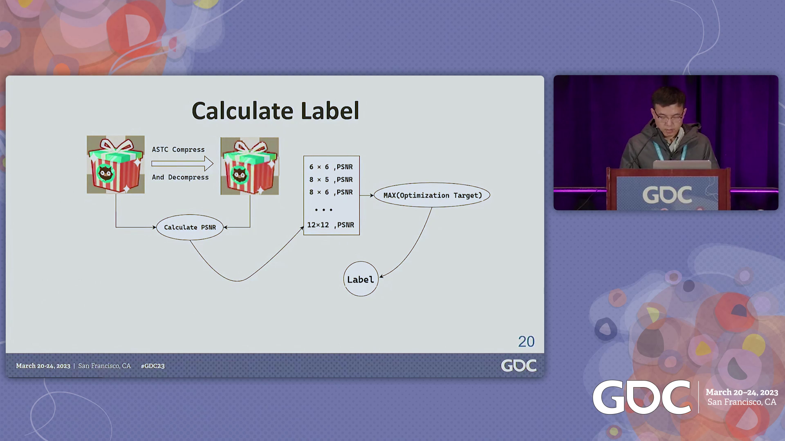

标签生成把昂贵的编码搜索前置到数据准备阶段，预测阶段利用分类网络选择参数。研究时需要分别计入生成标签和模型推理的成本。`[opinion: 对已展示流程的分析]`

### 分类网络与训练信息

12:28网络页明确标注ResNet，结构为输入、卷积、若干残差块、平均池化、全连接和输出。残差块图展示卷积支路与输入相加。`[verified: detail_12m28s.png]`

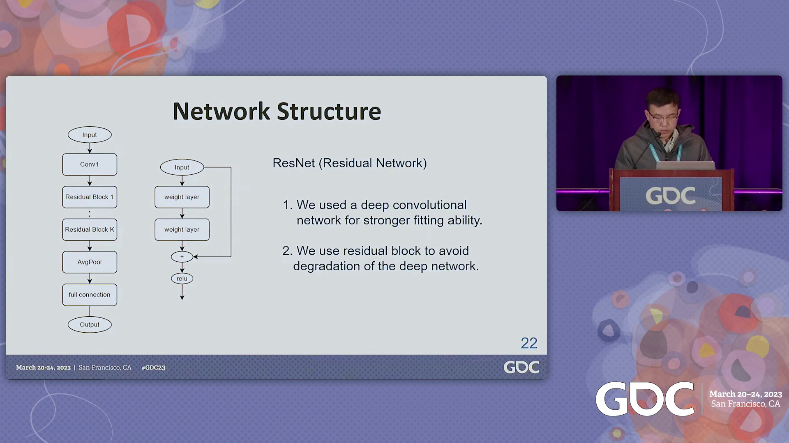

数据集为10,000张训练贴图与2,000张测试贴图，训练30个epoch。网络深度、输入分辨率、数据预处理、优化器、学习率、batch size、分类损失和数据泄漏控制细节尚待补充。`[verified: 12:00数据表；17:00耗时表；opinion: 复现缺项清单]`

讲者在11:11与11:39提到loss function，但对应画面展示的是块大小标签选择目标。分类训练损失的具体形式仍待确认。`[verified: 原英文字幕205、213；11:00目标页与11:28标签页]`

## 演讲结果与证据范围

### 三组对照

下表照录15:00、16:00和16:30表格。MB口径与Std (PSNR)的计算定义保留为待核实。`[verified: 对应结果页]`

| 方案 | 平均PSNR | Std (PSNR)原表 | Size (MB)原表 |
|---|---|---|---|
| 固定6×6 | 40.38 | 80.73 | 83.25。`[verified: 15:00]` |
| 模型选参 | 36.36 | 47.98 | 47.21。`[verified: 15:00、16:00、16:30]` |
| 固定12×12 | 31.55 | 76.85 | 21.19。`[verified: 16:00]` |
| 标签Best | 36.27 | 43.17 | 43.50。`[verified: 16:30]` |

模型相对固定6×6的表中体积下降约43.29%，平均PSNR下降4.02 dB。模型相对标签Best的体积高约8.53%。这些比值由上表计算，实验来源仍是演讲。`[verified: 上表数值；verification.json derived_metrics]`

16:30的Best直接使用生成数据集时的标签。它的“最优”由候选集合、指标与目标共同定义，当前资料没有更广范围的最优性证据。`[verified: detail_16m30s.png页内说明；opinion: 最优性范围]`

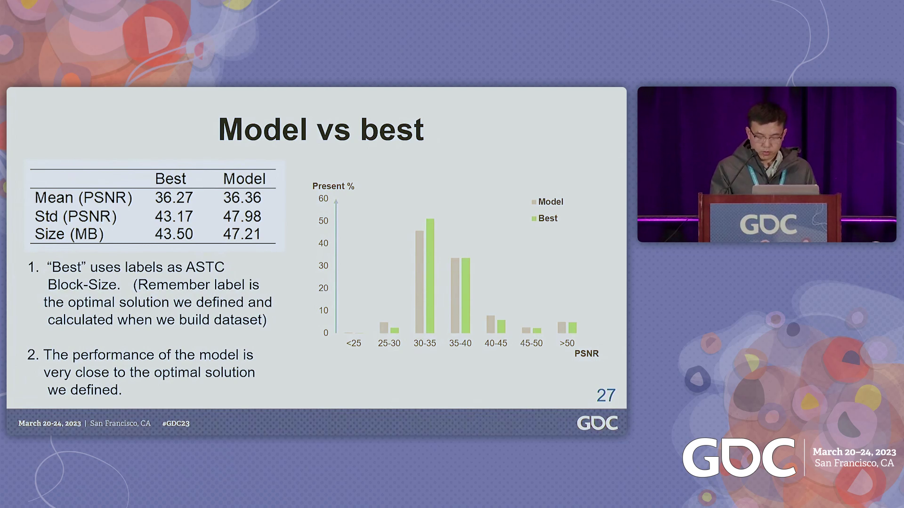

### 质量分布与失败尾部

15:00页把模型选参后的PSNR分布画得更集中，强调低于30和30–40两个区间。16:00页显示统一12×12会显著增加低PSNR比例，而模型选择12×12约占35%的贴图。`[verified: frame_15m00s.png、frame_16m00s.png]`

模型输出的集合仍有低于35 dB、甚至低于30 dB的样本。因此“训练标签参考35 dB目标”和“所有预测输出通过35 dB门禁”是两个需要分别核实的状态。后续实现可显式记录逐图违规率，再决定是否添加质量复检和回退。`[verified: 15:00、16:00分布图；opinion: 后续验收设计]`

讲者称卡通项目中的质量损失可以接受。这个判断来自所示项目，通用PBR、多通道、法线、Alpha、mip和最终材质渲染的质量需要独立实验。`[verified: 13:47–14:08字幕；opinion: 外推范围]`

### 成本

| 阶段 | 演讲报告值 |
|---|---|
| 构建12,000张贴图数据集 | 约12小时。`[verified: 17:00耗时表]` |
| 训练10,000张贴图、30 epoch | 27.18分钟。`[verified: 17:00耗时表]` |
| 为2,000张测试贴图预测 | 9.06秒。`[verified: 17:00耗时表]` |
| 硬件 | NVIDIA GeForce GTX1060 6GB，Intel i7-8700。`[verified: 17:00耗时表]` |

9.06秒对应块大小预测。最终按预测块大小编码ASTC的时间还应单独计入部署流程。`[verified: 17:00表格Make predictions标签；opinion: 成本核算范围]`

## 后续研究问题

1. 固定6×6、固定12×12、逐图穷举标签和监督分类四种方案，在相同编码器设置与质量指标下各自的成本与质量尾部如何？`[opinion]`
2. 以纹理语义、通道与材质用途分层后，PSNR目标如何设定？屏幕空间误差、Alpha边缘、法线方向和mip表现怎样纳入验收？`[opinion]`
3. 模型对新项目、不同美术风格和贴图类型的泛化如何？按资产或项目划分训练与测试，如何控制近重复贴图泄漏？`[opinion]`
4. 预测错误的体积代价与质量违规代价如何分别统计？能否通过候选预测、复检和局部回退降低失败尾部？`[opinion]`
5. 数据集生成、训练、推理与最终编码合计后，何种更新频率和规模能体现收益？`[opinion]`
6. 如果研究RL，哪部分存在需要序列决策或全局预算协调的问题？如何定义状态、动作、奖励和同预算监督基线？`[opinion]`

## 每分钟截图

固定采样从00:00到18:00，每分钟一张，共19张。补充截图单列在前文及下一节。`[verified: frame_00m00s.png–frame_18m00s.png；采样检查]`

### 00:00 · GDC开场

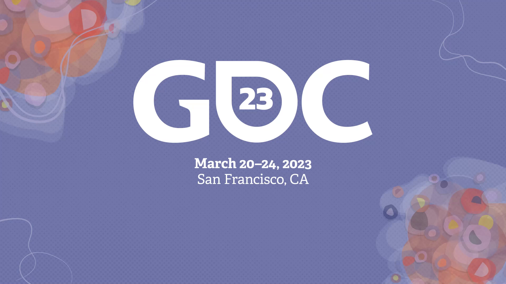

采样时间为00:00。`[verified: frame_00m00s.png；原视频对应时间点]`

### 01:00 · 内容安排

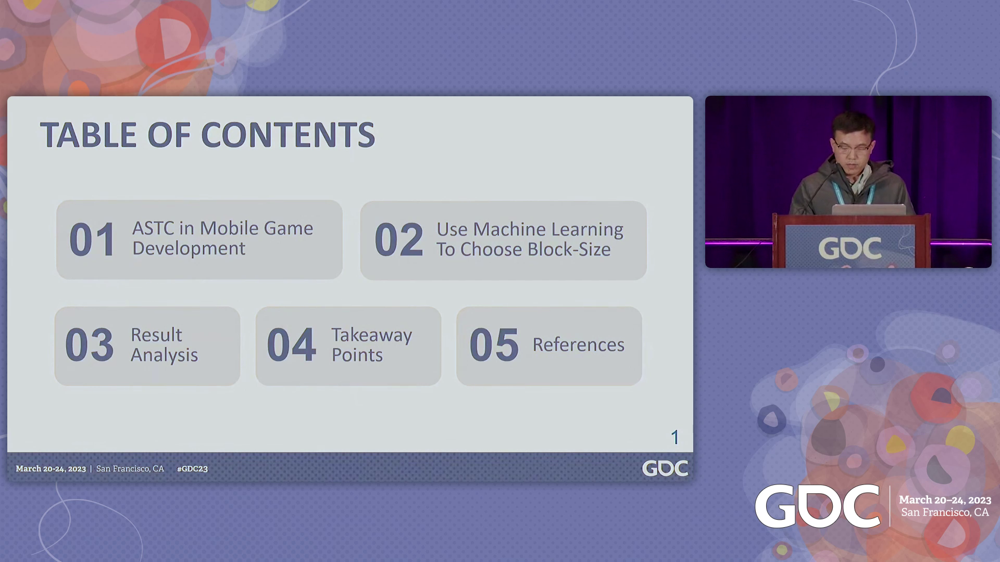

采样时间为01:00。`[verified: frame_01m00s.png；原视频对应时间点]`

### 02:00 · 压缩贴图的收益

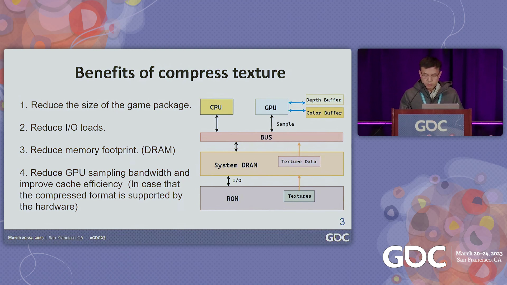

采样时间为02:00。`[verified: frame_02m00s.png；原视频对应时间点]`

### 03:00 · 格式性能比较

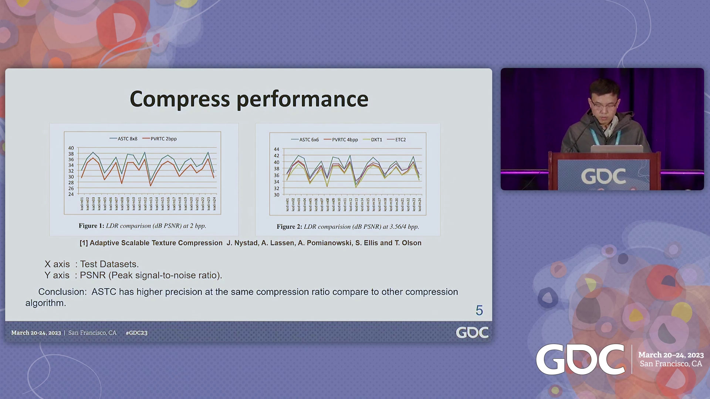

采样时间为03:00。`[verified: frame_03m00s.png；原视频对应时间点]`

### 04:00 · 分块压缩原理

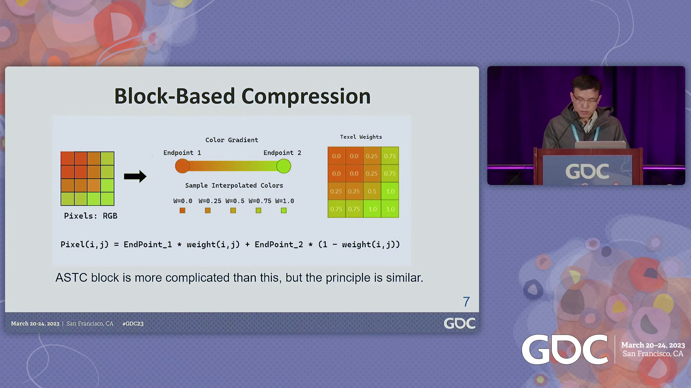

采样时间为04:00。`[verified: frame_04m00s.png；原视频对应时间点]`

### 05:00 · 块大小与码率

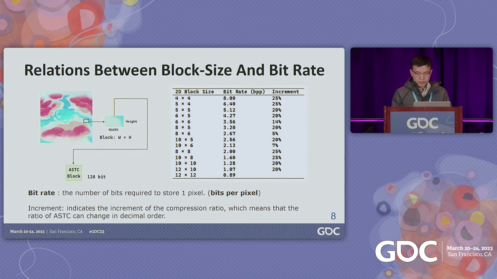

采样时间为05:00。`[verified: frame_05m00s.png；原视频对应时间点]`

### 06:00 · 礼盒贴图实例

采样时间为06:00。`[verified: frame_06m00s.png；原视频对应时间点]`

### 07:00 · 块大小与质量

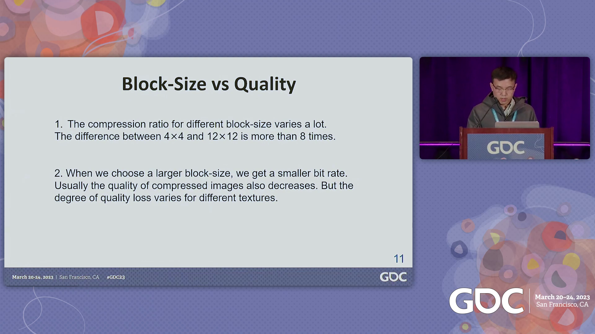

采样时间为07:00。`[verified: frame_07m00s.png；原视频对应时间点]`

### 08:00 · 默认6×6的空间代价

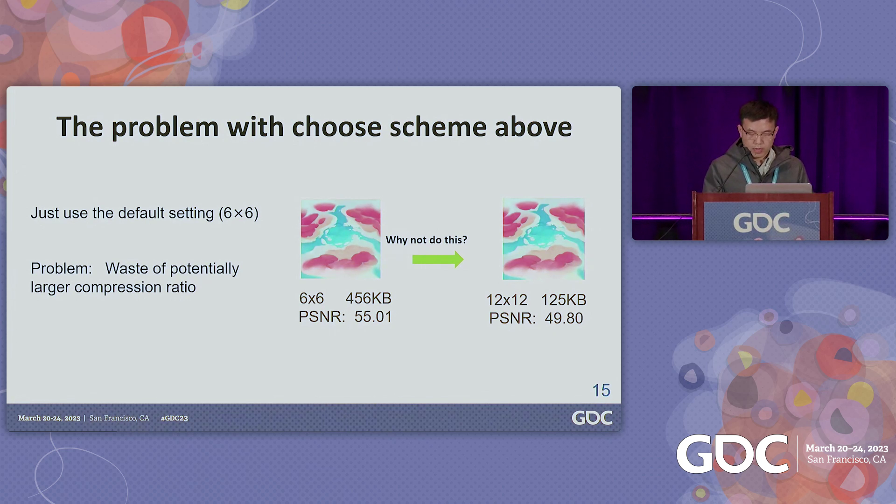

采样时间为08:00。`[verified: frame_08m00s.png；原视频对应时间点]`

### 09:00 · 机器学习选参动机

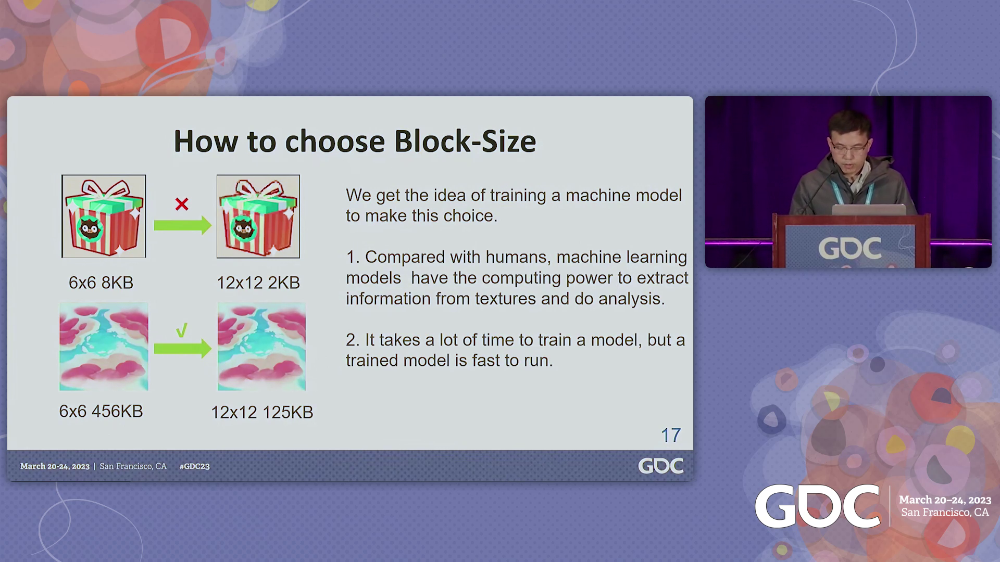

采样时间为09:00。`[verified: frame_09m00s.png；原视频对应时间点]`

### 10:00 · 块大小分类建模

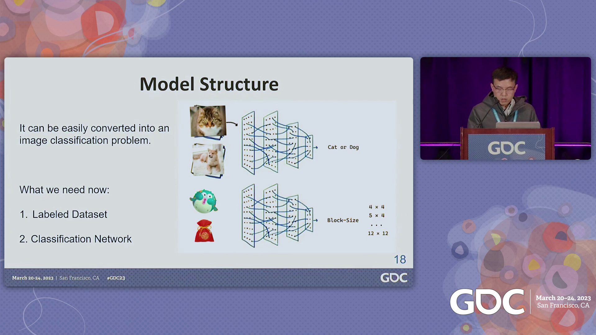

采样时间为10:00。`[verified: frame_10m00s.png；原视频对应时间点]`

### 11:00 · 优化目标

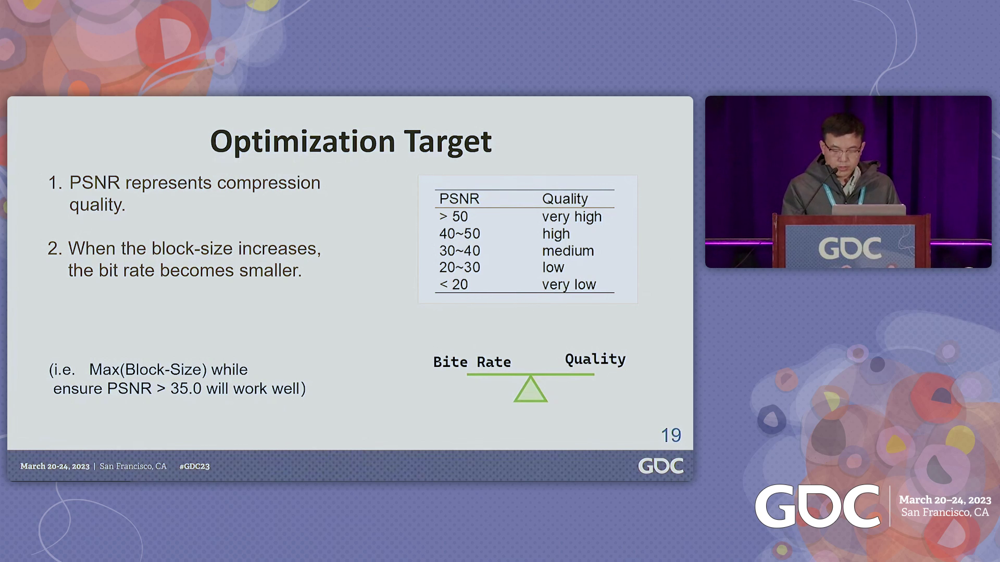

采样时间为11:00。`[verified: frame_11m00s.png；原视频对应时间点]`

### 12:00 · 构建数据集

采样时间为12:00。`[verified: frame_12m00s.png；原视频对应时间点]`

### 13:00 · 预测块大小的分布

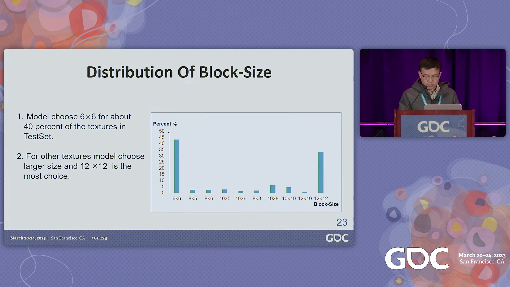

采样时间为13:00。`[verified: frame_13m00s.png；原视频对应时间点]`

### 14:00 · 压缩贴图预览

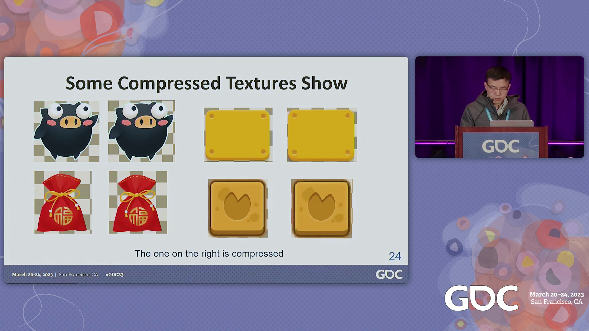

采样时间为14:00。`[verified: frame_14m00s.png；原视频对应时间点]`

### 15:00 · 模型与6×6

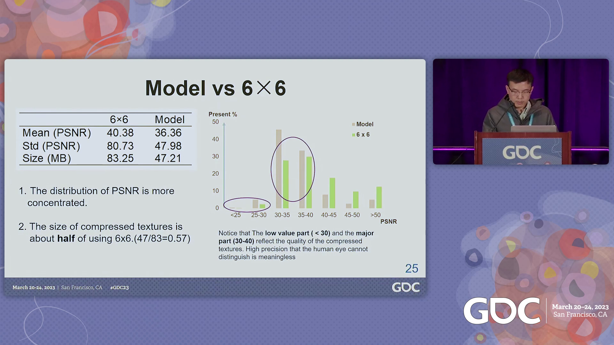

采样时间为15:00。`[verified: frame_15m00s.png；原视频对应时间点]`

### 16:00 · 模型与12×12

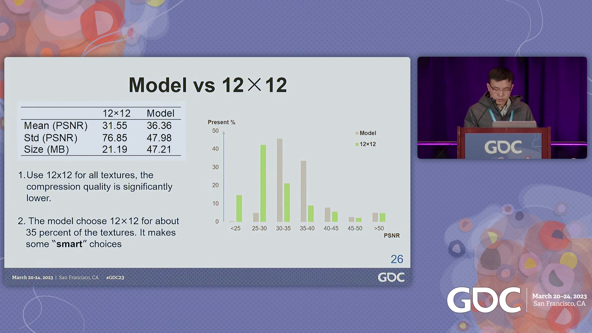

采样时间为16:00。`[verified: frame_16m00s.png；原视频对应时间点]`

### 17:00 · 数据构建、训练和推理耗时

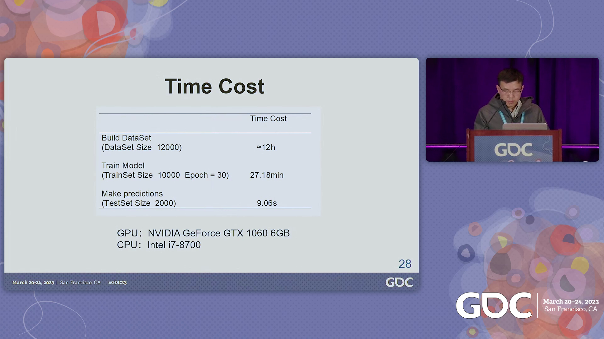

采样时间为17:00。`[verified: frame_17m00s.png；原视频对应时间点]`

### 18:00 · 致谢

采样时间为18:00。`[verified: frame_18m00s.png；原视频对应时间点]`

## 其他关键页

17:30仍在总结阶段，17:50展示Take Away，建议使用机器学习选择块大小，并同时关注质量与存储。`[verified: detail_17m30s.png、detail_17m50s.png]`

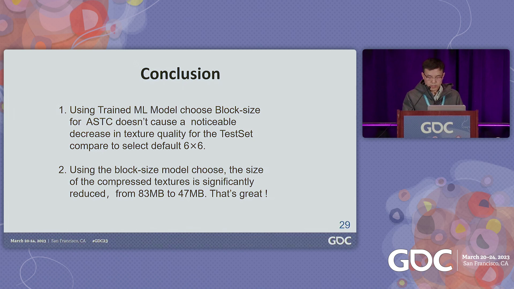

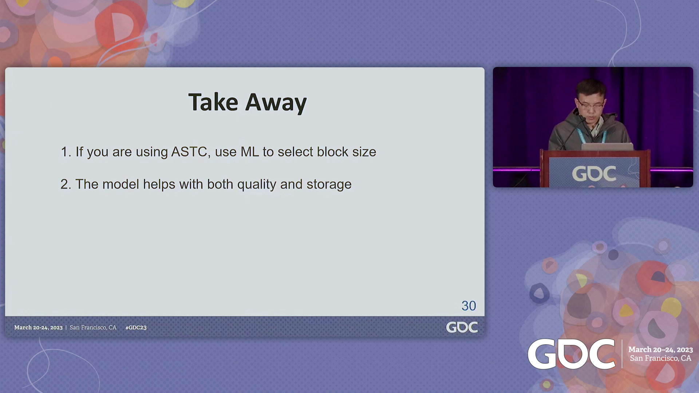

## 字幕校订与仍存疑的地方

- PSNR方向已按幻灯片校订，字幕中的“38 decimal”和画面30 dB经验阈值的差异保留待核听。`[verified: 字幕68–72；03:25画面]`
- 字幕93–94混淆块大小比较对象，字幕144的3300 KB和字幕267的96 MB／50 megabits与画面不一致。原文完整保留，正文数值按图表注明。`[verified: 原字幕93–94、144、267；05:00、08:00、15:00画面]`
- 09:19关于offline的句子和17:34关于easy to follow的句子，英文原字幕语义存疑，全文稿保留待核对标记。`[verified: 原字幕170、320、324]`
- 字幕覆盖从00:02.583至18:12.440，间隔至少2秒的无字幕区间共30处。逐条原始字幕和间隔表可供后续核听。`[verified: material-metadata.json subtitle_gaps_at_least_2_seconds]`

## 本轮交付与验收

仓库包含原视频、双语字幕、19张固定截图、10张补充截图、完整校订稿与逐条对照稿。检查结果见仓库根目录verification.json，涵盖视频副本哈希、PNG结构与时间点、字幕条目覆盖及同步链接。`[verified: 交付文件与verification.json]`

本轮完成资料整理与正文方法核实。本地实验复现状态为待开展，表中训练、质量和耗时均为演讲报告值。`[verified: 本轮执行记录]`
